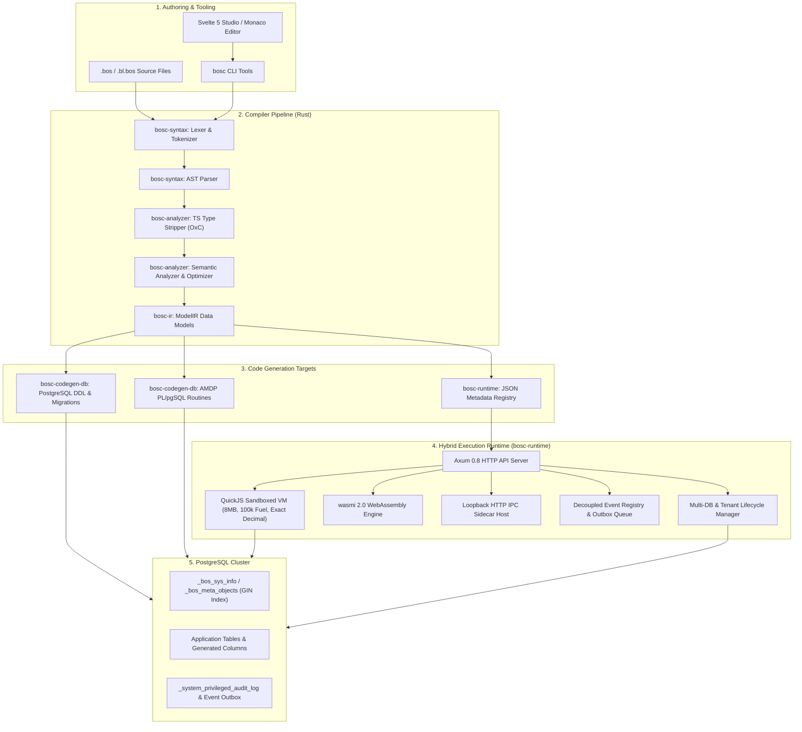
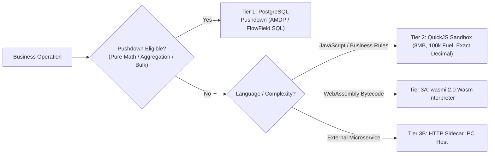

# System Architecture & Engine Overview

> **Document ID:** `BOS-DOC-00`  
> **Source Verification:** `crates/*`, `ui/*`, `Cargo.toml`  
> **Target Audience:** Systems Architects, Core Developers, Enterprise Engineers

---

## 1. Executive Summary & Vision

**BOS (Business Operating System)** is a modern, modular, metadata-driven, enterprise-grade business application platform. Designed as a next-generation platform for ERP and CRM systems, BOS marries the structural rigidity, auditability, and data integrity of enterprise platforms (such as Microsoft Dynamics 365 Business Central and SAP) with modern web engineering, safe systems programming (Rust 2024 edition), and reactive web frontends (Svelte 5 runes).

BOS replaces fragile relational database schemas and monolithic ORMs with **declarative metadata objects** (`table`, `page`, `codeunit`, `statemachine`, etc.) compiled by an optimizing Rust compiler (`bosc`) into database DDL, sandboxed bytecode, and reactive user interfaces.

---

## 2. High-Level System Architecture

---

## 3. Crate Decomposition & Responsibilities

The BOS backend workspace consists of six tightly integrated Rust crates:

### 3.1. `bosc-syntax` (Parser & Abstract Syntax Tree)
- **Role:** Pure lexing, parsing, and concrete AST construction.
- **Key Modules:**
  - `lexer.rs`: Lexical analysis converting UTF-8 BOS source into strongly typed `Token` streams with source position spans.
  - `parser.rs`: Recursive-descent parser building the AST for all 18 meta-objects.
  - `ast.rs`: Serializable definitions for `Program`, `Item`, `TableDef`, `TableLogicDef`, `StateMachineDef`, `CodeunitDef`, expressions, and statements.
  - `token.rs`: Token kinds, literal representations, and span tracking.

### 3.2. `bosc-ir` (Intermediate Representation)
- **Role:** Central semantic data structures shared across compiler, codegen, runtime, and API serialization.
- **Key Structs:**
  - `ModelIR`: Root compilation unit container for all analyzed meta-objects and diagnostics.
  - `TableIR`, `ColumnIR`, `ForeignKeyIR`, `CheckConstraintIR`: Physical and logical table definitions.
  - `FlowFieldIR`: Declarative calculated fields, aggregation functions (`sum`, `count`, `avg`, `exist`, `lookup`), and index references.
  - `StateMachineIR`, `StateIR`, `TransitionIR`, `ApprovalTierIR`: Declarative workflow state models.
  - `CodeunitIR`, `MethodIR`, `ActionIR`: Business logic service specifications.
  - `PackageManifestIR`, `PackageBundleIR`: Modular deployment units (`.bospkg`).

### 3.3. `bosc-analyzer` (Semantic Analysis & Type Stripping)
- **Role:** Type checking, semantic validation, AST lowering to `ModelIR`, and script optimization.
- **Key Modules:**
  - `ts_stripper.rs`: Zero-overhead TypeScript type stripper based on `oxc_allocator` and `oxc_parser`, removing TypeScript annotations, interfaces, and decorators while preserving modern JavaScript code intact.
  - `lib.rs` (`SemanticAnalyzer`): Validates cross-object references, primary keys, foreign keys, FlowField calculations, state machine transitions, and permission sets.
  - `script_opt.rs`: JavaScript AST optimizations, tree-shaking, and bytecode pre-compilation.

### 3.4. `bosc-codegen-db` (Database Generation & Migration Engine)
- **Role:** Generating PostgreSQL DDL, schema migrations, and stored procedures.
- **Key Modules:**
  - `lib.rs` (`PostgresGenerator`): Generates DDL for system kernel catalogs (`_bos_sys_info`, `_bos_meta_objects`), tables, constraints, generated stored columns (`GENERATED ALWAYS AS (...) STORED`), RLS policies, and views.
  - `migration.rs`: Declarative schema diff planner that compares live PostgreSQL schemas against declared `TableIR` definitions, producing ordered `MigrationStep` lists classified as `Safe` or `Destructive`.
  - `pushdown.rs`: AMDP (Advanced Metadata Database Pushdown) transpiler that converts eligible codeunit actions directly into atomic PL/pgSQL stored procedures.
  - `relations.rs`: Generates foreign key constraints and validation triggers.

### 3.5. `bosc-runtime` (Hybrid Execution Runtime & API Server)
- **Role:** Live execution engine, transaction manager, database session host, and REST API server.
- **Key Modules:**
  - `server.rs`: Axum 0.8 REST/HTTP routing, authentication middleware, entity CRUD, GraphQL-style query API (`/api/query`), and database administration.
  - `quickjs_engine.rs`: Embedded QuickJS JavaScript VM with instruction fuel metering, memory limits, and host SDK injection (`ctx.db`, `ctx.decimal`, `ctx.crypto`, `ctx.ui`, etc.).
  - `db_manager.rs`: Multi-tenant, multi-database cluster manager (create, switch, inspect, drop).
  - `db_session.rs`: Transactional unit-of-work wrapper for PostgreSQL connections.
  - `schema_sync.rs`: Online schema synchronization engine applying non-destructive migration steps within database transactions.
  - `event_engine.rs`: Decoupled publish/subscribe event registry with transactional outbox queue.
  - `wasm_engine.rs`: In-process WebAssembly interpreter powered by `wasmi 2.0`.
  - `sidecar_host.rs`: Loopback HTTP IPC client for microservice companions.

### 3.6. `bosc-cli` (Command Line Interface)
- **Role:** Developer and DevOps command-line binary.
- **Subcommands:** `build`, `run`, `deploy`, `test-live`, `detect-db`, `node` (`node run --config <file>.toml` is the only way to run BOS), `provision`, `create-db`, and `package`.

---

## 4. The 3-Tier Hybrid Execution Pipeline

BOS implements a high-performance **3-Tier Hybrid Execution Pipeline** that selects the most efficient execution target depending on the business operation:

### Tier 1: PostgreSQL Pushdown (SIFT & AMDP)
- FlowField calculated properties (e.g., `balance = sum(CustomerLedgerEntry.amount where { customerId == id })`) are compiled directly into PostgreSQL subqueries and indexed with SIFT (Sum Index Field Technology) covering indexes.
- Eligible codeunit procedures annotated with `@pushdown` are transpiled by `pushdown.rs` directly into PL/pgSQL stored procedures, eliminating network latency and processing data at the storage layer.

### Tier 2: Sandboxed QuickJS VM
- Complex business logic, document validation cascades, state machine guards, and field validations run inside an isolated QuickJS sandbox.
- **Resource Constraints**:
  - Memory ceiling: 8 MB.
  - Stack ceiling: 512 KB.
  - Instruction fuel quota: 100,000 steps (metered in 10,000-tick intervals).
  - Wall-clock timeout: 30 seconds.
- **Host Context Injections**:
  - `models.<Table>`: High-speed proxy for PostgreSQL CRUD and aggregation operations.
  - `ctx.decimal(...)`: Exact 128-bit monetary fixed-point arithmetic (`SCALE = 10^18`), eliminating floating-point rounding errors.
  - `ctx.crypto`: Industrial cryptographic primitives (Argon2id password hashing, SHA-256, CSPRNG random bytes).
  - `ctx.audit`: Transactional privileged audit trail logging.
  - `ctx.ui`: UI interactions (toasts, modal dialogs, field visibility/editable mutations).

### Tier 3: Wasm Plugins & Sidecar Microservices
- **WebAssembly (`wasmi 2.0`)**: High-performance CPU-bound extensions (tax engines, cryptographic hashing algorithms, barcode generation) run as sandboxed Wasm bytecode.
- **Companion Sidecars**: Complex enterprise integrations (SAP RFCs, EDI gateways, third-party carrier APIs) run as loopback HTTP companion services managed through `sidecar_host.rs`.

---

## 5. Security & Multi-Tenancy Architecture

BOS provides enterprise security and multi-tenancy out of the box:

1. **Storage Strategies**:
   - `shared_rls` (Default): All tenants and companies share tables, isolated by PostgreSQL Row-Level Security (RLS) policies filtering on `_tenant_id` and `_company_id`.
   - `partitioned`: Native PostgreSQL table partitioning per tenant or company.
   - `schema_per_company`: Distinct PostgreSQL schemas per operating company.
   - `table_per_company`: Dynamics NAV / Business Central-style table naming (`company$table`).
2. **Identity & RBAC**:
   - Built-in session token management, argon2id password hashing, and user-role mappings.
   - Declarative permission sets (`permissionset`) defining granular Read, Insert, Modify, and Delete (RIMD) permissions with row filters.
3. **Optimistic Concurrency Control (OCC)**:
   - Every business entity tracks `_system_version` (integer). Modifying operations verify that the incoming version matches the stored version, immediately rejecting concurrent modifications with HTTP 409 Conflict.
4. **Pessimistic Row Locking**:
   - Explicit row locking endpoint (`POST /api/entities/:table/:id/lock`) executes `SELECT ... FOR UPDATE` to serialize high-contention operations (such as sequential document numbering).
5. **Privileged Statutory Audit Trail**:
   - The system maintains an append-only audit trail in `_system_privileged_audit_log`, capturing before-and-after snapshots, authorizing tickets, actor IDs, and reasons for privileged overrides.

---

## 6. Frontend Developer Studio (Svelte 5)

The Developer Studio is hosted under `ui/` and is built completely using **Svelte 5 runes**:
- Reactive state management with `$state`, `$derived`, `$props`, and `$effect`.
- Integrated Monaco Code Studio supporting custom BOS-Script syntax highlighting, AST diagnostics, and auto-formatting.
- Visual designers for Tables, Queries, Pages, State Machines, and Relationships.
- Full component showcase showcasing `bos-ui` enterprise data grids, datasheets, command palettes, and dialogs.
