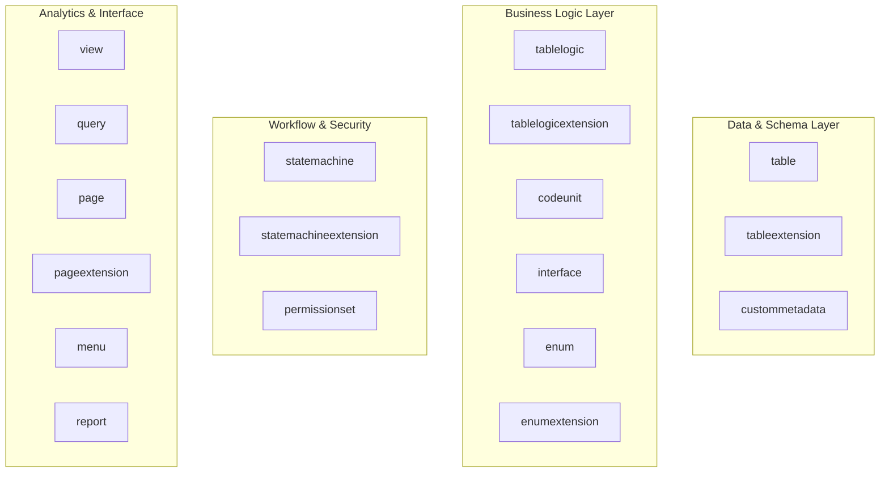

# Exhaustive Meta-Objects Specification

> **Document ID:** `BOS-DOC-02`  
> **Source Verification:** `crates/bosc-syntax/src/ast.rs`, `crates/bosc-ir/src/lib.rs`, `crates/bosc-analyzer/src/lib.rs`  
> **Target Audience:** Enterprise Developers, Meta-Object Engineers, ERP Architects

---

## 1. Overview of the 18 First-Class Meta-Objects

BOS defines 18 first-class meta-objects. Each meta-object represents a distinct architectural concern—separating data persistence, business logic, document lifecycles, user interfaces, access control, and reporting.



---

## 2. Data & Schema Layer

### 2.1. `table`
Defines the physical table schema, fields, primary/secondary keys, and FlowFields. Contains no procedural logic.
- **Attributes & Properties:**
  - `caption`: Human-readable display label.
  - `tableType`: `Normal`, `Document`, `Ledger`, `Temporal`, `Temporary`, `Virtual`.
  - `dataPerCompany`: Boolean indicating whether rows are partitioned per company.
- **Column Attributes:**
  - `notNull`: Enforces non-nullability.
  - `unique`: Generates unique constraint.
  - `default`: Literal or `auto()` for UUIDs.
  - `computed`: Declarative FlowField formula.
  - `formula`: Generated stored SQL formula (`GENERATED ALWAYS AS (...) STORED`).
  - `relation`: Target table foreign key reference.
  - `onDelete`: Referential deletion action (`RESTRICT`, `CASCADE`, `SET NULL`, `NO ACTION`).
- **Example:**
```typescript
table Customer {
    caption = "Customer Master";
    tableType = Normal;
    dataPerCompany = true;

    id: UUID {
        default = auto();
    };
    code: String(30) {
        notNull = true;
        unique = true;
    };
    name: String(100) {
        notNull = true;
    };
    creditLimit: Decimal(18, 2) {
        default = 0.00;
    };
    balance: Decimal(18, 2) {
        computed = sum(CustomerLedgerEntry.amount where { customerId == id });
    };

    primaryKey(id);
    key(code);
}
```

### 2.2. `tableextension`
Provides non-invasive extension of existing tables by adding fields and secondary keys without altering base source code.
- **Example:**
```typescript
tableextension CustomerLoyaltyExt extends Customer {
    loyaltyTier: String(30) {
        default = "Bronze";
    };
    loyaltyPoints: Integer {
        default = 0;
    };

    key(loyaltyTier);
}
```

### 2.3. `custommetadata`
Defines tenant-configurable or deployment-configurable custom metadata records that are bundled into packages and deployed into system catalogs.
- **Example:**
```typescript
custommetadata TaxProviderSetting {
    caption = "Tax Engine Configuration";

    providerCode: String(30) {
        notNull = true;
    };
    endpointUrl: String(255) {
        notNull = true;
    };
    timeoutSeconds: Integer {
        default = 30;
    };
}
```

---

## 3. Business Logic Layer

### 3.1. `tablelogic`
The exclusive companion object for a `table`. Encapsulates field validations, entity lifecycle triggers, and instance helper methods.
- **Lifecycle Triggers:**
  - `onInsert(rec, ctx)` / `beforeInsert(rec, ctx)` / `afterInsert(rec, ctx)`
  - `onModify(rec, ctx)` / `beforeModify(rec, ctx)` / `afterModify(rec, oldRec, ctx)`
  - `onDelete(rec, ctx)` / `beforeDelete(rec, ctx)` / `afterDelete(rec, ctx)`
  - `validate <field>(val, oldVal)`
- **Example:**
```typescript
tablelogic CustomerLogic for Customer {
    validate creditLimit(val) {
        if (val < 0) {
            throw new Error("Credit limit cannot be negative");
        }
    }

    beforeInsert(rec, ctx) {
        rec.code = rec.code.toUpperCase().trim();
        ctx.audit.log(`Customer record ${rec.code} prepared for insertion`);
    }

    onDelete(rec, ctx) {
        if (rec.balance > 0) {
            throw new Error(`Cannot delete customer ${rec.code} with outstanding balance of ${rec.balance}`);
        }
    }

    isCreditWorthy(rec) {
        return rec.balance <= rec.creditLimit;
    }
}
```

### 3.2. `tablelogicextension`
Extends the business logic of an existing table logic companion from an external package.
- **Example:**
```typescript
tablelogicextension CustomerAuditLogic for Customer {
    afterModify(rec, oldRec, ctx) {
        if (rec.creditLimit !== oldRec.creditLimit) {
            ctx.audit.log(`Customer ${rec.code} credit limit changed from ${oldRec.creditLimit} to ${rec.creditLimit}`);
        }
    }
}
```

### 3.3. `codeunit`
Encapsulates procedural business logic, cross-table transactional routines, domain event publishing, and background batch jobs.
- **Attributes:**
  - `@businessEvent`: Declares a decoupled publishable event.
  - `@subscribeEvent(Publisher, "EventName")`: Subscribes to a published event.
  - `@pushdown`: Requests database-level AMDP PL/pgSQL transpilation.
- **Example:**
```typescript
codeunit OrderPostService {
    @businessEvent
    onBeforePostOrder(orderId: UUID) {}

    @businessEvent
    onAfterPostOrder(orderId: UUID, invoiceNo: String) {}

    postOrder(orderId: UUID): String {
        const order = models.SalesHeader.get(orderId);
        if (!order) throw new Error("Order not found");
        if (order.status !== "Approved") throw new Error("Order must be approved before posting");

        this.onBeforePostOrder(orderId);

        const invoiceNo = `INV-${order.code}`;
        // Posting logic here...

        this.onAfterPostOrder(orderId, invoiceNo);
        return invoiceNo;
    }
}
```

### 3.4. `interface` & `enum` / `enumextension`
Implements the Strategy Pattern natively in enterprise metadata.
- **Interface Definition:**
```typescript
interface PricingCalculator {
    calculateDiscount(customerId: UUID, subtotal: Decimal): Decimal;
}
```

- **Extensible Enum Definition:**
```typescript
enum PricingStrategy implements PricingCalculator {
    extensible = true;
    Standard = StandardPricingCodeunit;
    Tiered = TieredPricingCodeunit;
}
```

- **Enum Extension:**
```typescript
enumextension RegionalPricingExt extends PricingStrategy {
    Wholesale = WholesalePricingCodeunit;
}
```

---

## 4. Workflow & Security

### 4.1. `statemachine`
Defines declarative document state lifecycles, valid transitions, authorization roles, and approval matrices.
- **Example:**
```typescript
statemachine SalesOrderWorkflow for SalesHeader {
    statusField = status;
    initial = Draft;
    states = [Draft, PendingApproval, Approved, Rejected, Released];

    transition submitApproval from Draft to PendingApproval {
        roles = ["SalesAgent", "Admin"];
    }

    transition approve from PendingApproval to Approved {
        roles = ["SalesManager", "Admin"];
        guard(rec, ctx) {
            return rec.totalAmount > 0;
        }
    }

    transition reject from PendingApproval to Rejected {
        roles = ["SalesManager", "Admin"];
    }

    transition release from Approved to Released {
        roles = ["WarehouseManager", "Admin"];
    }
}
```

### 4.2. `statemachineextension`
Extends an existing workflow with additional states and transitions without modifying the base workflow.
- **Example:**
```typescript
statemachineextension ExtendedOrderWorkflow for SalesOrderWorkflow {
    states = [CreditCheckHold];

    transition holdForCredit from PendingApproval to CreditCheckHold {
        roles = ["FinanceManager"];
    }

    transition releaseFromHold from CreditCheckHold to PendingApproval {
        roles = ["FinanceManager"];
    }
}
```

### 4.3. `permissionset`
Defines granular table-level and procedure-level permissions.
- **Permissions:** `R` (Read), `I` (Insert), `M` (Modify), `D` (Delete).
- **Row-Level Filters:** Filters rows accessible to assigned users.
- **Example:**
```typescript
permissionset SalesRepresentative {
    caption = "Sales Representative Permissions";

    permissions = {
        Customer = RIM where { status == "Active" };
        SalesHeader = RIMD;
        SalesLine = RIMD;
        CustomerLedgerEntry = R;
    };

    execute = [OrderPostService, PricingService];
}
```

---

## 5. Analytics & User Interface

### 5.1. `view` & `query`
Declarative projections and multi-table joins optimized for reporting and data grids.
- **View Definition:**
```typescript
view OpenCustomerInvoicesView {
    caption = "Open Customer Invoices";
    materialized = false;

    select {
        customerId,
        invoiceNo,
        amount,
        dueDate
    }
    from CustomerLedgerEntry
    where { open == true };
}
```

- **Query Definition (with hierarchical data items and aggregations):**
```typescript
query CustomerSalesPerformance {
    caption = "Customer Sales Performance";

    elements {
        dataitem(cust; Customer) {
            column(customerId; id) {}
            column(customerName; name) {}

            dataitem(orders; SalesHeader) {
                left join (orders.customerId == cust.id);
                column(totalSales; totalAmount; sum) {}
                column(orderCount; id; count) {}
            }
        }
    }

    groupBy(cust.id, cust.name);
    orderBy(totalSales desc);
}
```

### 5.2. `page` & `pageextension`
Defines user interface pages and their controls. Supported page types: Card, List, Document, ListPart, CardPart, Worksheet, StandardDialog, ConfirmationDialog, NavigatePage, RoleCenter, Api, Board and Timeline. The full reference is in [17_page_compiler_and_designer.md](17_page_compiler_and_designer.md): layout and action syntax, style tokens, responsive spans, page variables, the client expression language, extension directives, the customization layer and the BOS3001–BOS3012 diagnostics.

Like Dynamics NAV / Business Central, a `field(x)` takes most of its properties from the table field:
- caption
- control type
- mandatory flag
- editability
- decimal places
- enum options
- lookup page from `relation`
- drill-down for FlowFields

You only author what differs.

- **Page Definition:**
```typescript
page CustomerCard for Customer {
    pageType = Card;
    caption = "Customer Details";

    layout {
        area(Content) {
            group(General) {
                field(code) { caption = "Customer No."; }
                field(name);                                   // caption "Name", text box, max length from the table
                field(creditLimit) {
                    showWhen = rec.blocked == false;
                    style { emphasis = Attention; icon = "wallet"; }
                }
            }
            group(Financials) {
                field(balance);                                // FlowField: read-only with drill-down, automatically
            }
        }
    }

    actions {
        area(Processing) {
            action(PostInvoice) {
                caption = "Post Invoice";
                image = "receipt";
                onAction(rec, ctx) {                           // runs server-side in the QuickJS sandbox
                    ctx.ui.openModal("CreateInvoiceDialog", { customerId: rec.id });
                }
            }
        }
    }
}
```

- **Page Extension** (anchor directives `addFirst`, `addLast`, `addBefore`, `addAfter`, `modify`, `hide`, `moveFirst`, `moveLast`, `moveBefore`, `moveAfter`, `wrap`, `replace`):
```typescript
pageextension CustomerCardLoyaltyExt extends CustomerCard {
    layout {
        addLast(Content) {
            group(Loyalty) {
                field(loyaltyTier);
                field(loyaltyPoints) { caption = "Points Earned"; }
            }
        }
        modify(creditLimit) { style { background = "#FFF7ED"; } }
    }
}
```

### 5.3. `menu` & `report`
Defines role-based navigation trees and analytical report datasets.
- **Menu Definition:**
```typescript
menu SalesNavigationMenu {
    label = "Sales & Receivables";
    role = "SalesRepresentative";

    items {
        item Customers {
            label = "Customers";
            icon = "Users";
            page = CustomerList;
        }
        item Orders {
            label = "Sales Orders";
            icon = "ShoppingCart";
            page = SalesOrderList;
        }
    }
}
```
