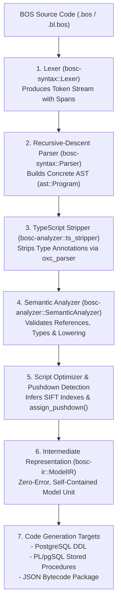

# Compiler Pipeline & IR Architecture

> **Document ID:** `BOS-DOC-03`  
> **Source Verification:** `crates/bosc-syntax/*`, `crates/bosc-analyzer/*`, `crates/bosc-ir/*`  
> **Target Audience:** Compiler Engineers, Systems Developers, Language Tooling Authors

---

## 1. Overview of the `bosc` Compilation Pipeline

The BOS Compiler (`bosc`) transforms declarative BOS-Script source files into structured, strongly typed intermediate representations (`ModelIR`) and downstream deployment artifacts (PostgreSQL DDL, PL/pgSQL procedures, and JSON bytecode).



---

## 2. Phase 1 & 2: Lexing & Parsing (`bosc-syntax`)

### 2.1. Token Stream & Source Spans
Every lexical token is associated with a `Span`:
```rust
#[derive(Debug, Clone, Copy, PartialEq, Eq, Serialize, Deserialize)]
pub struct Span {
    pub start: usize,
    pub end: usize,
    pub line: usize,
    pub column: usize,
}
```
Spans allow pinpoint error reporting and language server protocol (LSP) diagnostics with exact character offsets.

### 2.2. Abstract Syntax Tree (AST)
The root of the parsed syntax tree is `Program`:
```rust
#[derive(Debug, Clone, PartialEq, Serialize, Deserialize)]
pub struct Program {
    pub items: Vec<Item>,
    pub span: Span,
}
```
Where `Item` is an enumeration containing all 18 meta-object AST definitions (`Table`, `TableLogic`, `StateMachine`, `Codeunit`, etc.).

---

## 3. Phase 3: TypeScript Stripping (`bosc-analyzer::ts_stripper`)

Before script bodies are embedded into `ModelIR` for runtime execution in QuickJS, type annotations and decorators are stripped using the `oxc_parser` engine.

### 3.1. What is Stripped
1. **Type Annotations**: `function calculate(id: UUID, rate: Decimal): Decimal` becomes `function calculate(id, rate)`.
2. **Type Declarations & Interfaces**: `type Money = Decimal;` and `interface OrderItem { ... }` are removed completely.
3. **Type Imports/Exports**: `import type { ... }` lines are removed.
4. **Cast Expressions**: `<string>x` and `x as string` become `x`.

### 3.2. Preservation of JavaScript Semantics
- Template literals with expressions (` `${val}` `) are preserved.
- Regular expression syntax is preserved without confusing closing braces (`/}/`).
- Modern JavaScript syntax (`??`, `?.`, destructuring, arrow functions) is kept unaltered.

---

## 4. Phase 4: Semantic Analysis & Validation (`bosc-analyzer`)

The `SemanticAnalyzer` struct (`bosc-analyzer/src/lib.rs`) ingests the parsed `Program` and performs comprehensive validation passes:

### 4.1. Semantic Checks
1. **Table Integrity**:
   - Every `table` must declare a primary key (`primaryKey(...)`).
   - Field names must be unique within a table.
   - Column types must be valid BOS types (`UUID`, `String`, `Decimal`, etc.).
2. **FlowField Validation**:
   - The target table specified in `computed = func(TargetTable.field where ...)` must exist in the compilation context or system catalog.
   - Circular FlowField dependencies are detected and rejected.
   - FlowField filters must reference existing fields on both tables.
3. **State Machine Transitions**:
   - Initial state must exist in `states = [...]`.
   - All `from_states` and `to_state` in transitions must refer to declared states.
   - Unreachable or orphan states are flagged as warnings.
4. **Separation of Concerns**:
   - Verifies that `table` files do not contain procedural scripts that belong in `tablelogic`.
   - Validates that companion `tablelogic` references an existing `table`.
5. **Non-Invasive Extension Merging**:
   - In-memory merging of `tableextension`, `statemachineextension`, and `enumextension` into base objects when they reside within the same compilation unit.

### 4.2. Compiler Diagnostics
Errors and warnings are structured as `CompilerDiagnosticIR`:
```rust
#[derive(Debug, Clone, PartialEq, Serialize, Deserialize)]
pub struct CompilerDiagnosticIR {
    pub severity: String, // "error" | "warning" | "info"
    pub code: String,
    pub message: String,
    pub line: usize,
    pub column: usize,
    pub end_line: usize,
    pub end_column: usize,
    pub hint: Option<String>,
}
```

---

## 5. Phase 5: Script Optimization & Pushdown Detection

### 5.1. SIFT Index Inference
For every FlowField defined with an equality filter (e.g., `where { customerId == id }`), the analyzer infers the required covering index columns:
```rust
flow_field.index_columns = vec!["customer_id".to_string()];
```
This enables `bosc-codegen-db` to generate optimal PostgreSQL indexes supporting single-trip SIFT calculations.

### 5.2. AMDP Pushdown Detection (`assign_pushdown`)
The analyzer inspects all methods inside codeunits marked with `@pushdown`:
- If every statement in the method body maps directly to supported SQL statements (assertions, required field validations, record queries, and audit logs), the method is tagged for PL/pgSQL generation (`is_pushdown = true`).
- If unsupported operations (e.g., argon2 password hashing, HTTP requests, or loopback sidecar calls) are found, the compiler leaves the method in QuickJS bytecode mode, emitting an informational diagnostic.

---

## 6. Structure of `ModelIR`

The resulting output of the compilation pipeline is `ModelIR` (`crates/bosc-ir/src/lib.rs`):

```rust
#[derive(Debug, Clone, PartialEq, Serialize, Deserialize)]
pub struct ModelIR {
    pub package_name: String,
    pub tables: Vec<TableIR>,
    pub table_logics: Vec<TableLogicIR>,
    pub table_extensions: Vec<TableExtensionIR>,
    pub table_logic_extensions: Vec<TableLogicExtensionIR>,
    pub state_machines: Vec<StateMachineIR>,
    pub state_machine_extensions: Vec<StateMachineExtensionIR>,
    pub codeunits: Vec<CodeunitIR>,
    pub interfaces: Vec<InterfaceIR>,
    pub enums: Vec<EnumIR>,
    pub enum_extensions: Vec<EnumExtensionIR>,
    pub permission_sets: Vec<PermissionSetIR>,
    pub views: Vec<ViewIR>,
    pub queries: Vec<QueryIR>,
    pub pages: Vec<PageIR>,
    pub page_extensions: Vec<PageExtensionIR>,
    pub menus: Vec<MenuIR>,
    pub reports: Vec<ReportIR>,
    pub custom_metadata: Vec<CustomMetadataIR>,
    pub diagnostics: Vec<CompilerDiagnosticIR>,
}
```
This JSON-serializable structure is the single source of truth passed to `bosc-codegen-db` for DDL creation, to `bosc-runtime` for system catalog storage, and to `ui` for Monaco Studio Intellisense.
