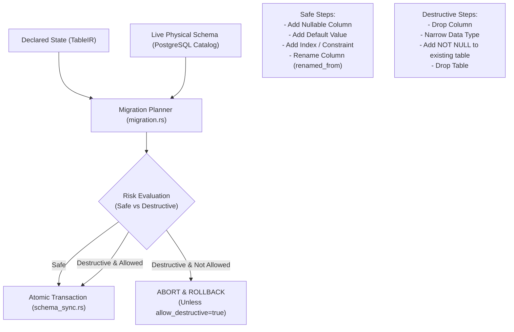

# Schema Sync & Declarative Migrations

> **Document ID:** `BOS-DOC-05`  
> **Source Verification:** `crates/bosc-codegen-db/src/migration.rs`, `crates/bosc-runtime/src/schema_sync.rs`  
> **Target Audience:** DevOps Engineers, Database Administrators, Systems Developers

---

## 1. Overview & Declarative Migration Philosophy

In traditional application development, database migrations rely on sequential imperative script files (e.g., `001_create_table.sql`, `002_add_column.sql`), which are prone to drift, branch merge conflicts, and execution ordering issues.

BOS replaces imperative migrations with a **Declarative Schema Diff Planner**:
1. The developer declares the desired target state in `.bos` files (`TableIR`).
2. The runtime engine introspects the live physical schema from PostgreSQL (`LiveTable`).
3. The diff engine computes the delta and generates an ordered list of `MigrationStep` operations.
4. Each step is evaluated for risk (`Safe` vs. `Destructive`).
5. Destructive operations are strictly rejected unless explicitly permitted with `--allow-destructive`.
6. Changes execute in a single atomic transaction.



---

## 2. Live Schema Introspection (`LiveTable` & `LiveColumn`)

Before computing differences, the migration engine inspects PostgreSQL system catalogs (`information_schema.columns`, `pg_attribute`, `pg_type`, `pg_constraint`, `pg_index`):

```rust
pub struct LiveTable {
    pub schema: String,
    pub name: String,
    pub is_partitioned: bool,
    pub columns: Vec<LiveColumn>,
}

pub struct LiveColumn {
    pub name: String,
    pub sql_type: String,
    pub is_nullable: bool,
    pub default_expr: Option<String>,
    pub generated_expr: Option<String>,
    pub is_unique: bool,
    pub unique_constraint: Option<String>,
}
```

### 2.1. SQL Type Normalization (`normalize_sql_type`)
PostgreSQL reports physical column types in varied canonical forms (`character varying(50)`, `numeric(18,2)`, `timestamp with time zone`). The schema diff planner normalizes both declared and live types to prevent spurious migration steps:
- `VARCHAR(50)` $\leftrightarrow$ `character varying(50)`
- `DECIMAL(18, 2)` $\leftrightarrow$ `numeric(18,2)`
- `TIMESTAMPTZ` $\leftrightarrow$ `timestamp with time zone`
- `BOOLEAN` $\leftrightarrow$ `bool`

---

## 3. Migration Step Generation & Risk Classification

Each generated step is encapsulated in a `MigrationStep`:
```rust
#[derive(Debug, Clone, Copy, PartialEq, Eq, Serialize, Deserialize)]
#[serde(rename_all = "snake_case")]
pub enum StepRisk {
    Safe,
    Destructive,
}

pub struct MigrationStep {
    pub table: String,
    pub action: String,
    pub description: String,
    pub sql: String,
    pub risk: StepRisk,
}
```

### 3.1. Safe Operations (`StepRisk::Safe`)
Operations where existing data cannot be lost or corrupted:
- Creating a new table (`CREATE TABLE IF NOT EXISTS ...`).
- Adding a nullable column (`ALTER TABLE ... ADD COLUMN ... NULL`).
- Adding a non-null column with a valid `DEFAULT` value.
- Adding a secondary index (`CREATE INDEX CONCURRENTLY IF NOT EXISTS ...`).
- In-place column renaming via `renamed_from`.
- Expanding the capacity of a column (e.g., `VARCHAR(50)` $\to$ `VARCHAR(100)`).

### 3.2. Destructive Operations (`StepRisk::Destructive`)
Operations that destroy data or could fail if existing rows violate new constraints:
- Dropping a table (`DROP TABLE ... CASCADE`).
- Dropping a column (`ALTER TABLE ... DROP COLUMN ...`).
- Narrowing a column type (e.g., `VARCHAR(100)` $\to$ `VARCHAR(50)` or `BIGINT` $\to$ `INTEGER`).
- Adding a `NOT NULL` constraint to an existing column without a default value.
- Altering an existing unique constraint that could conflict with present rows.

---

## 4. Preservation of Renamed Columns & Tables (`renamed_from`)

To prevent accidental data loss when refactoring identifiers, BOS supports explicit `renamed_from` attributes:

```typescript
table Customer {
    // Column was previously called 'cust_name'
    fullName: String(100) {
        renamed_from = "cust_name";
    };
}
```

When `renamed_from` is present:
1. The migration planner detects the existing physical column `"cust_name"`.
2. Emits an in-place rename:
   ```sql
   ALTER TABLE "customer" RENAME COLUMN "cust_name" TO "full_name";
   ```
3. Classifies the step as **Safe**, preserving 100% of existing historical data.

---

## 5. Transactional Execution & Dry Run Mode (`SchemaSync`)

Schema synchronization (`bosc-runtime::schema_sync::SchemaSync`) executes via the CLI (`bosc deploy`) or REST API (`POST /api/script/apply`):

### 5.1. Workflow
1. **Acquire Lock**: Begins a PostgreSQL transaction.
2. **Compute Diff**: Calls `migration::plan_table_migration()`.
3. **Audit Risk**: If any step has `risk == StepRisk::Destructive` and `allow_destructive == false`, the engine immediately aborts with:
   ```json
   {
       "error": true,
       "message": "Migration refused: destructive steps detected (column 'credit_score' dropped) without --allow-destructive"
   }
   ```
   `/api/script/apply` checks this with a dry run **before** writing any catalog row, and answers `409` (`SchemaSyncBlocked`). A refused deployment therefore leaves both the database structure and `_bos_meta_objects` unchanged, so the catalog never describes columns the database does not have.
4. **Dry Run Option**: If `dry_run == true`, the planned SQL statements are recorded, and the transaction issues a `ROLLBACK`.
5. **Commit**: If all checks pass, all DDL statements execute in sequence, the system catalog (`_bos_meta_objects`) updates, and the transaction commits atomically.
