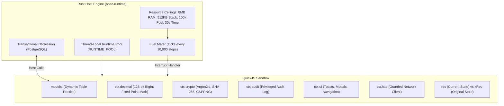

# QuickJS Sandboxed Execution Engine

> **Document ID:** `BOS-DOC-06`  
> **Source Verification:** `crates/bosc-runtime/src/quickjs_engine.rs`, `crates/bosc-runtime/src/db_session.rs`  
> **Target Audience:** Systems Engineers, Runtime Developers, Enterprise Solution Architects

---

## 1. Overview & Sandbox Architecture

BOS embeds a lightweight, high-performance JavaScript engine based on **QuickJS** (`rquickjs`). The QuickJS sandbox executes business logic triggers (`tablelogic`), service procedures (`codeunit`), workflow state transition guards, and approval matrices in a completely deterministic, secure environment.



---

## 2. Resource Ceilings & Fuel Metering (`ExecutionLimits`)

Every execution inside QuickJS is bounded by strict resource quotas:

```rust
pub struct ExecutionLimits {
    pub memory_bytes: usize,       // Default: 8 MB
    pub stack_bytes: usize,        // Default: 512 KB
    pub max_fuel: u64,             // Default: 100,000 steps
    pub max_wall_time: Duration,   // Default: 30 seconds
}
```

### 2.1. Interrupt Handler & Instruction Fuel Metering
QuickJS polls an interrupt callback every `FUEL_STEPS_PER_TICK` (10,000 interpreter steps):
- **Fuel Quota**: If the script consumes more than `max_fuel` steps (e.g. an infinite `while (true)` loop), the interrupt handler trips with `TRIP_FUEL` and terminates execution immediately.
- **Wall-Clock Ceiling**: If execution exceeds `max_wall_time` (30 seconds), it trips with `TRIP_TIME`.
- **Memory Ceiling**: If heap allocations exceed 8 MB, QuickJS raises an out-of-memory exception.

---

## 3. Dynamic Table Model Proxies (`models.<Table>`)

BOS-Script code does not construct manual SQL queries. Instead, the runtime injects dynamic proxies for all cataloged tables:

```typescript
// Look up customer by primary key
const cust = models.Customer.get("CUST-001");

// Check record existence
if (models.Customer.exists({ email: "user@enterprise.com" })) {
    throw new Error("Email already registered");
}

// Find first matching record with projection
const activeOrder = models.SalesHeader.findFirst({
    where: { customerId: cust.id, status: "Open" },
    select: ["id", "code", "totalAmount"]
});

// Create new record inside the current database transaction
const newOrder = models.SalesHeader.create({
    code: "SO-1001",
    customerId: cust.id,
    totalAmount: 500.00
});

// Update record
models.Customer.update(cust.id, {
    creditLimit: 10000.00
});

// Aggregations
const totalBalance = models.CustomerLedgerEntry.sumField("amount", { customerId: cust.id });
```

### Safety Protections
- **Unpaged Row Ceiling**: `findMany` queries without an explicit `take` limit are capped at `MAX_UNPAGED_ROWS` (10,000 rows) to prevent heap exhaustion.
- **Forbidden Raw SQL**: Destructive commands (`DROP TABLE`, `DROP DATABASE`, `TRUNCATE`, `ALTER SYSTEM`) are blocked at the host boundary.

---

## 4. Exact 128-Bit Monetary Math (`ctx.decimal`)

JavaScript's native IEEE-754 floating-point numbers (`Number`) introduce dangerous rounding errors (e.g., `0.1 + 0.2 === 0.30000000000000004`), which are unacceptable in enterprise accounting.

BOS injects an exact 128-bit fixed-point arithmetic engine backed by JavaScript `BigInt` with an internal scale factor of $10^{18}$ (`SCALE = 1_000_000_000_000_000_000n`):

```typescript
const price = ctx.decimal("100.50");
const discountRate = ctx.decimal("0.15");

// Exact addition and subtraction
const gross = price.add("10.00");
const net = gross.sub("5.00");

// Exact multiplication and division
const discount = price.mul(discountRate);
const unitPerBox = price.div("12");

// Decimal rounding
const rounded = discount.round(2);

// Exact comparison (returns -1, 0, 1)
if (price.cmp("50.00") > 0) {
    // Greater than
}

// Division by zero throws a descriptive error immediately
```

---

## 5. Host SDK Services

The `ctx` object exposes enterprise services into the sandbox:

### 5.1. Cryptographic Primitives (`ctx.crypto`)
- `ctx.crypto.argon2Hash(password)`: Produces secure Argon2id hashes with random salt.
- `ctx.crypto.argon2Verify(password, hash)`: Verifies passwords against Argon2id hashes.
- `ctx.crypto.sha256(data)`: Computes SHA-256 digests.
- `ctx.crypto.randomBytes(n).toHex()`: Generates cryptographically secure random hexadecimal tokens.

### 5.2. Statutory Audit Trail (`ctx.audit`)
- `ctx.audit.log(message)`: Writes structured audit entries to the database within the current transaction.

### 5.3. Reactive UI Interactivity (`ctx.ui`)
Triggers and procedures can communicate directives back to the frontend:
- `ctx.ui.toast(message, "info" | "success" | "warning" | "error")`
- `ctx.ui.confirm(message)`: Prompts user confirmation.
- `ctx.ui.openModal(pageName, params)`: Opens modal dialogs.
- `ctx.ui.navigate(url)`: Routes frontend views.
- `ctx.ui.setFieldVisible(fieldName, bool)` / `ctx.ui.setFieldEditable(fieldName, bool)`: Mutates form state dynamically.

### 5.4. Guarded HTTP Client (`ctx.http`)
- `ctx.http.get(url, headers)` / `ctx.http.post(url, body, headers)`
- **Security Restrictions**: Refuses non-HTTP schemes (`file://`, `ftp://`) and blocked reserved hostnames (`localhost`, `example.com`, `test`, `invalid`).

---

## 6. Record State Snapshots: `Rec` vs `xRec`

During update lifecycles (`onModify`, `beforeModify`, `afterModify`), the runtime provides two distinct record states:
1. **`rec`**: The incoming record with modified values.
2. **`xRec`**: The immutable snapshot of the record as it existed in the database before this transaction began.

### Example: Validation of Credit Limit Increases
```typescript
tablelogic CustomerLogic for Customer {
    onModify(rec, ctx) {
        // xRec is passed via ctx or global binding
        if (rec.creditLimit > xRec.creditLimit) {
            const diff = rec.creditLimit - xRec.creditLimit;
            if (diff > 5000 && !ctx.user.hasRole("CreditManager")) {
                throw new Error("Credit limit increases exceeding $5,000 require CreditManager approval");
            }
            ctx.audit.log(`Credit limit increased from ${xRec.creditLimit} to ${rec.creditLimit}`);
        }
    }
}
```
