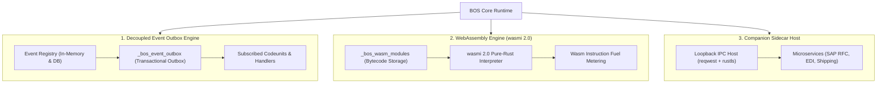

# Events, Wasm Plugins & Sidecar Microservices

> **Document ID:** `BOS-DOC-07`  
> **Source Verification:** `crates/bosc-runtime/src/event_engine.rs`, `crates/bosc-runtime/src/wasm_engine.rs`, `crates/bosc-runtime/src/sidecar_host.rs`  
> **Target Audience:** Integration Engineers, Systems Programmers, Enterprise Architects

---

## 1. Overview of the Extension Ecosystem

BOS provides three complementary extensibility mechanisms that allow developers to decouple business workflows, run high-performance plugins, and interface with external enterprise architectures:



---

## 2. Decoupled Event-Subscriber Outbox Engine (`event_engine.rs`)

Enterprise applications require decoupled event publishing so that custom modules or third-party packages can respond to core lifecycle changes (e.g., `SalesOrder.onAfterPost`) without altering core codeunits.

### 2.1. Declaring & Subscribing to Events
- **Publishing an Event in a Codeunit:**
  ```typescript
  codeunit SalesPost {
      @businessEvent
      onAfterPost(orderId: UUID, invoiceNo: String) {}

      executePost(orderId: UUID) {
          const inv = "INV-1001";
          // Publish event to subscribers
          ctx.events.publish("SalesPost", "onAfterPost", { orderId, invoiceNo: inv });
      }
  }
  ```

- **Subscribing in an Extension Codeunit:**
  ```typescript
  codeunit LoyaltyRewardsService {
      @subscribeEvent(SalesPost, "onAfterPost")
      awardPoints(params) {
          const { orderId, invoiceNo } = params;
          ctx.audit.log(`Loyalty points awarded for order ${orderId}`);
      }
  }
  ```

### 2.2. The Transactional Outbox Pattern (`_bos_event_outbox`)
To prevent distributed transaction failures where data is committed to the database but message delivery fails:
1. Event notifications are written directly to `_bos_event_outbox` inside the **same database transaction** as the business data change.
2. If the transaction rolls back, the event is also rolled back.
3. The outbox processor (`POST /api/events/outbox/process`) reads pending events and dispatches them to registered subscribers with at-least-once delivery guarantees.

---

## 3. Sandboxed WebAssembly Engine (`wasm_engine.rs`)

For compute-intensive operations (cryptographic algorithms, tax calculation engines, image/barcode rendering), BOS embeds a pure-Rust WebAssembly interpreter powered by **`wasmi 2.0`**.

### 3.1. Key Capabilities
- **Pure Rust Isolation**: Executes WebAssembly bytecode (`.wasm`) without external C dependencies or unsafe JIT compilers.
- **Instruction Fuel Metering**: Wasm executions are metered with fuel limits to prevent runaway loops or CPU hogging.
- **Dynamic Module Management**: Modules can be uploaded, cataloged in `_bos_wasm_modules`, and updated dynamically without server restarts.

### 3.2. REST & Script Invocation
- **Via Script:**
  ```typescript
  const taxAmount = ctx.wasm.invoke("tax_engine", "calculate_vat", subtotal, taxRate);
  ```

- **Via REST API:**
  ```http
  POST /api/wasm/tax_engine/calculate_vat/invoke
  Content-Type: application/json

  {
      "params": [100.50, 0.20]
  }
  ```

---

## 4. Companion Sidecar Host (`sidecar_host.rs`)

For interactions with complex legacy enterprise systems (e.g., SAP RFC connectors, AS2 EDI communication, hardware scale interfaces), BOS provides the **Companion Sidecar Host**:

### 4.1. Design
- Companion microservices run as lightweight independent processes alongside the BOS server on loopback (`127.0.0.1`) or a private network.
- `bosc-runtime` communicates with sidecars over high-speed HTTP IPC using pure-Rust `reqwest` and `rustls`.
- The sidecar host regularly executes health probes to monitor companion availability (`GET /api/sidecars/:name/health`).

### 4.2. Invocation Example
- **In BOS-Script:**
  ```typescript
  const trackingNumber = ctx.sidecar.call("fedex_carrier", "/shipments/create", {
      orderId: rec.id,
      recipientAddress: rec.shippingAddress
  });
  ```

- **Direct API Call:**
  ```http
  POST /api/sidecars/fedex_carrier/call
  Content-Type: application/json

  {
      "path": "/shipments/create",
      "payload": { "weightLbs": 12.5 }
  }
  ```

---

## 5. Asynchronous Job Queue (`_bos_job_queue`)

BOS includes an asynchronous job queue for scheduled batch processing:
- Jobs record `job_type`, target `codeunit_name`, `method_name`, JSON `payload`, status (`ready`, `running`, `completed`, `failed`), and retry attempts.
- The runtime provides endpoints to enqueue and process jobs sequentially:
  - `POST /api/jobs/enqueue`
  - `POST /api/jobs/process-next`
