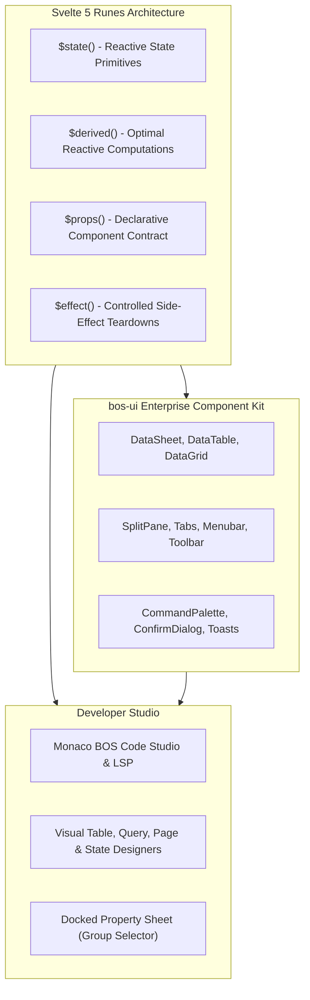

# Svelte 5 UI Studio & Component Library

> **Document ID:** `BOS-DOC-11`  
> **Source Verification:** `ui/src/*`, `ui/src/lib/bos-ui/*`, `ui/src/lib/components/studio/*`  
> **Target Audience:** Frontend Engineers, UI/UX Designers, Studio Developers

---

## 1. Modern Svelte 5 Runes Architecture

The BOS Developer Studio and frontend applications are written exclusively in modern **Svelte 5**, completely eliminating legacy Svelte 3/4 reactive declarations (`$:`, `let` stores, `export let` props) in favor of **Runes**:



### 1.1. Core Runes Patterns
- **`$state`**: Declares reactive values:
  ```javascript
  let activeTabId = $state("tab-01");
  let openTabs = $state([]);
  ```
- **`$derived`**: Pure functional reactivity without double updates:
  ```javascript
  let currentTab = $derived(openTabs.find((t) => t.id === activeTabId) ?? null);
  ```
- **`$props`**: Strongly typed component interfaces:
  ```javascript
  let { theme = "dark", onSave = () => {} } = $props();
  ```
- **`$effect`**: Lifecycle and resource cleanup:
  ```javascript
  $effect(() => {
      const timer = setInterval(pollServer, 5000);
      return () => clearInterval(timer);
  });
  ```

---

## 2. The `bos-ui` Enterprise Component Suite

Located under `ui/src/lib/bos-ui/`, this component suite provides the visual and interaction primitives for enterprise business software:

| Component Category | Components | Key Enterprise Features |
| :--- | :--- | :--- |
| **High-Density Data** | `DataSheet`, `DataTable`, `DataGrid` | Virtualized row rendering, in-cell keyboard editing, Excel-style cell selection, sticky headers, sorting, and inline validation indicators. |
| **Layout & Workspace** | `SplitPane`, `Tabs`, `Toolbar`, `StatusBar` | Resizable multi-pane layouts, draggable document tabs, dirty status indicators, and background compilation progress bars. |
| **Input Controls** | `Input`, `Textarea`, `Checkbox`, `Switch`, `Select`, `Combobox`, `DatePicker` | High-contrast enterprise styling, full keyboard navigation, validation error badges, and auto-formatting. |
| **Command & Dialogs** | `CommandPalette`, `Menubar`, `ContextMenu`, `Dialog`, `ConfirmDialog`, `ToastViewport` | VS Code-style `Ctrl+K` command search, multi-level dropdowns, modal confirmations, and floating notification toasts. |

---

## 3. Monaco BOS-Script Code Studio

The code editor (`ui/src/lib/components/studio/code-editor/MonacoCodeStudio.svelte`) embeds Monaco Editor with custom BOS tooling:

### 3.1. Language Definition & Tokenizer (`monacoBosScript.js`)
- Highlights all 18 meta-object keywords (`table`, `codeunit`, `statemachine`, etc.).
- Colorizes FlowField aggregations (`sum`, `count`, `exist`).
- Differentiates TypeScript types, strings, numbers, and decorators (`@businessEvent`, `@pushdown`).

### 3.2. Background Web Workers (`/workers`)
- `editorWorker.js`: General text editor manipulation.
- `tsWorker.js`: Fast TypeScript syntax parsing and completions.
- `jsonWorker.js`: JSON validation and schema enforcement.

### 3.3. Custom Formatter (`bosPrettier.js`)
- Formats BOS meta-objects with consistent 4-space indentation, normalized property braces, and sorted keys.

---

## 4. Visual Metadata Designers

For developers preferring visual modeling, the studio provides drag-and-drop designers:
1. **Table Designer (`TableDesigner.svelte`)**: Interactive grid for fields, data types, lengths, primary keys, and FlowField wizard modal.
2. **Query Designer (`QueryDesigner.svelte`)**: Visual join canvas and element hierarchy builder with live SQL preview.
3. **Page Designer (`PageDesigner.svelte`)**: Visual layout toolbox with draggable areas, groups, repeater grids, and action bars.
4. **State Machine Designer (`StateMachineDesigner.svelte`)**: Interactive node graph representing states, transition arrows, and role badges.
5. **Relationships Viewer (`RelationshipsViewer.svelte`)**: Entity-relationship diagram visualizing foreign keys and FlowField dependencies across all packages.

---

## 5. Property Sheet Groups Standard

The docked property sheet provides a structured Group selector:
- **Table Groups**: Properties, Events, Methods, and one group per extension.
- **Field Groups**: General, Relation, FlowField, and Events.
- **Page Control Groups**: Identity, Data, Behavior, and Events.
- **Context Retention**: Switching between selected elements preserves the active group selection when present on the target element; otherwise, it resets gracefully to `All`.

---

## 6. Compile vs. Apply Protocol

The studio strictly differentiates compilation from deployment:
- **Compile (`F7`)**:
  - Sends the script to `POST /api/script/compile`.
  - Validates syntax, types, and references.
  - Updates editor squiggles with diagnostics.
  - Displays a banner confirming that **nothing was saved to the database**.
- **Apply (`F5` or `Ctrl+S`)**:
  - Sends the script to `POST /api/script/apply`.
  - Persists the exact authored script into `_bos_meta_objects`.
  - Updates live PostgreSQL tables using safe migration steps.
  - Clears the metadata cache.
  - If the database structure cannot be modified (e.g. destructive change rejected), the script still stays stored and a descriptive warning banner is presented.
