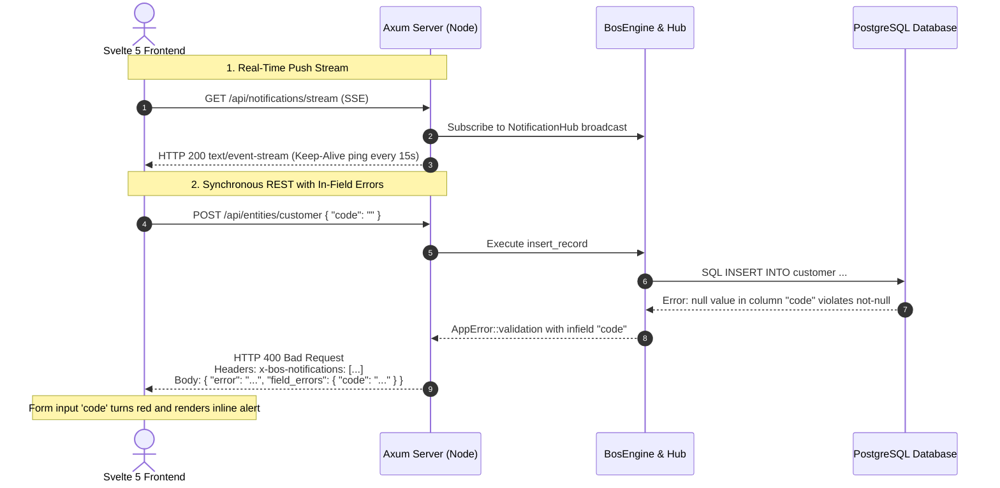

# 15. Unified Notification System Specification

## 1. Executive Summary

BOS (Business Operating System) implements a full-stack, enterprise-grade unified notification system modeled after modern enterprise ERP standards (such as Microsoft Dynamics 365 Business Central and Salesforce Lightning). 

The system provides a single, coherent protocol for throwing, transmitting, and displaying all user-facing and system messages:
- **Floating Toasts** (`target: "toast"`): Non-blocking, transient alerts with auto-dismiss countdowns.
- **Modal Popups / Alerts** (`target: "popup"`): Blocking dialogs for critical system errors, confirmations, and security alerts with expandable and copyable technical details.
- **In-Field Validation Errors** (`target: "infield"`): Field-level errors bound directly to input identifiers (`field: "code"`), rendering real-time red borders and inline guidance beneath inputs.
- **Page Banners** (`target: "banner"`): Prominent dismissible top alerts.
- **Notification Center Drawer** (`history`): A persistent slide-over drawer accessible from the top navigation bar, with unread badge indicators and real-time SSE stream status.

---

## 2. Notification Data Model & Contract

All notifications share a uniform JSON schema across the Axum Rust runtime, REST APIs, Server-Sent Events (SSE), and Svelte 5 runes:

```json
{
  "id": "9b1deb4d-3b7d-4bad-9bdd-2b0d7b3dcb6d",
  "severity": "info" | "success" | "warning" | "error",
  "target": "toast" | "popup" | "infield" | "banner",
  "title": "Validation Error",
  "message": "Customer Code already exists or cannot be empty",
  "field": "code",
  "code": "UNIQUE_VIOLATION",
  "details": "Key (code)=(CUST001) already exists in table 'customer'",
  "duration_ms": 5000,
  "timestamp": "2026-10-20T12:00:00Z",
  "actions": [
    {
      "label": "Retry",
      "action_type": "retry",
      "payload": null
    }
  ]
}
```

### Rust Engine Definitions (`crates/bosc-runtime/src/notification.rs`)

```rust
#[derive(Debug, Clone, Copy, PartialEq, Eq, Serialize, Deserialize)]
#[serde(rename_all = "lowercase")]
pub enum NotificationSeverity {
    Info,
    Success,
    Warning,
    Error,
}

#[derive(Debug, Clone, Copy, PartialEq, Eq, Serialize, Deserialize)]
#[serde(rename_all = "lowercase")]
pub enum NotificationTarget {
    Toast,
    Popup,
    Infield,
    Banner,
}

#[derive(Debug, Clone, Serialize, Deserialize)]
pub struct Notification {
    pub id: Uuid,
    pub severity: NotificationSeverity,
    pub target: NotificationTarget,
    pub title: Option<String>,
    pub message: String,
    pub field: Option<String>,
    pub code: Option<String>,
    pub details: Option<String>,
    pub timestamp: DateTime<Utc>,
    pub duration_ms: Option<u64>,
    pub actions: Vec<NotificationAction>,
    pub tenant_id: Option<Uuid>,
    pub company_id: Option<Uuid>,
    pub user_id: Option<Uuid>,
}
```

---

## 3. Propagation & Transport Architecture



### 3.1. Synchronous REST API Responses
1. **HTTP Header (`x-bos-notifications`)**:
   Standardized JSON string array attached to both 2xx and 4xx/5xx responses. Allows background actions or database triggers to surface toast messages without modifying data payloads.
2. **Standard Error Envelope (`AppError`)**:
   ```json
   {
     "error": "null value in column \"name\" violates not-null constraint",
     "message": "null value in column \"name\" violates not-null constraint",
     "code": "CLIENT_ERROR",
     "notifications": [
       {
         "id": "...",
         "severity": "error",
         "target": "infield",
         "field": "name",
         "message": "null value in column \"name\" violates not-null constraint"
       }
     ],
     "field_errors": {
       "name": "null value in column \"name\" violates not-null constraint"
     }
   }
   ```

### 3.2. Real-Time Asynchronous SSE Stream (`/api/notifications/stream`)
- Implemented with Axum 0.8 `Sse<impl Stream>` and `tokio::sync::broadcast::Sender<Notification>`.
- Auto-reconnect handling on the frontend with 5-second backoff.
- Automatic 15-second heartbeat ping comments.

### 3.3. Test & Management Endpoints
- `GET /api/notifications`: Retrieves recent notification buffer (last 100 items).
- `DELETE /api/notifications`: Clears historical notification log.
- `POST /api/notifications/test`: Dispatches and broadcasts test notifications with custom severity, target (`toast`, `popup`, `infield`), title, and field parameters.

---

## 4. Frontend Svelte 5 Architecture

### 4.1. `notificationStore.svelte.js`
The store is authored purely with modern Svelte 5 runes (`$state`, `$derived`):
- `toasts`: Active floating toasts.
- `modalAlert`: Current active blocking modal.
- `fieldErrors`: Reactive map of `{ [field]: error_message }`.
- `history`: Notification history for the slide-over drawer.
- `unreadCount`: `$derived` count of unread items.
- `isSseConnected`: Reactive boolean indicating live SSE stream health.
- `handleApiResponse(res, data)`: Automatic inspection routine extracting `x-bos-notifications`, `data.field_errors`, and `data.notifications`.

### 4.2. UI Components
1. **`ToastContainer.svelte`**:
   Fixed at the bottom-right viewport with severity icons (Emerald Check, Amber Triangle, Rose Alert, Indigo Info), title, message, and CSS-animated progress countdown bar.
2. **`AlertModal.svelte`**:
   Accessible modal with backdrop blur, technical details drawer, and a one-click clipboard copy button.
3. **`PageSurface.svelte`**:
   Automatically binds input controls to `notificationStore.fieldErrors[col.name]`. If an in-field error exists:
   - Sets `status="error"` on the `Input` component.
   - Highlights the input border with a rose outline.
   - Renders an inline error message beneath the input.
   - Clears the error dynamically as soon as the user starts typing.
4. **`TopNavBar.svelte`**:
   Shows the bell notification icon with a reactive numeric badge (`1`, `2`, `9+`) for unread notifications and a green/amber pulse for SSE stream status.
