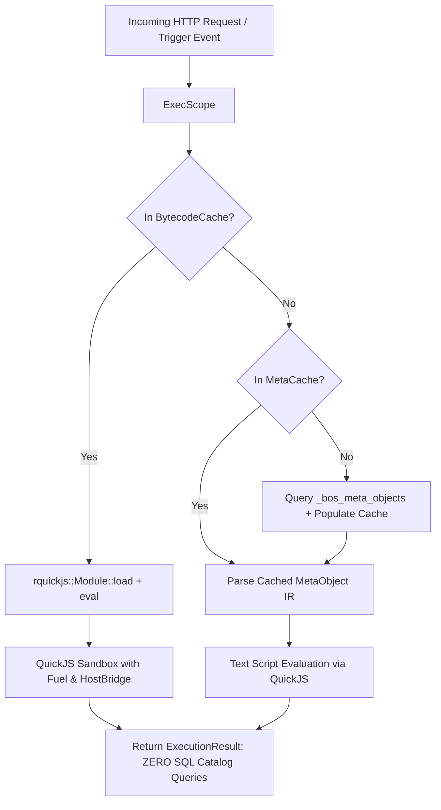

# 16. Ahead-of-Time Bytecode & Static Node Architecture

This specification defines the production-grade Ahead-of-Time (AOT) bytecode compilation, in-memory execution pipeline, prepared SQL statement cache, and self-healing static node architecture of the BOS platform.

---

## 1. Executive Summary & Design Principles

To achieve market-leading execution speed, security, and enterprise determinism without any hardcoded Rust business logic, the BOS architecture enforces two foundational invariants:

1. **Pure Host Kernel (Zero-Rust Business Logic)**: Rust is strictly the host kernel (compiler, memory-safe sandbox host, SQL executor, static asset server, and transaction coordinator). All domain logic, triggers, validations, procedures, and workflows live exclusively in `.bos` meta-objects.
2. **AOT Bytecode & Static Serving (Zero Database Reads on Hot Paths)**: Modules are pre-compiled into QuickJS bytecode (`.qbc`) envelopes with CRC32 integrity verification, AOT prepared SQL statements (`prepared_queries.json`), and static Svelte 5 page descriptors (`pages/[PageName].json`). On node startup, these artifacts are served directly from disk and cached in memory (`BytecodeCache`, `PreparedStatementRegistry`), completely bypassing metadata catalog queries (`_bos_meta_objects`) during request execution.

---

## 2. Directory Structure of Compiled Static Packages

When `bosc package build` compiles a package (e.g. `bos.auth`), it emits a self-contained static directory hierarchy under `dist/packages/<package_id>/`:

```
dist/packages/<package_id>/
├── manifest.json              # Merkle root, checksum, module count, metadata
├── bytecode/                  # Verified Ahead-of-Time QuickJS bytecode (.qbc)
│   ├── AuthManager.qbc        # Individual Codeunit bytecode envelope
│   ├── UserLogic.qbc          # TableLogic trigger & validation bytecode envelope
│   └── package.bundle.qbc     # Monolithic pre-linked bundle of all logic
├── pages/                     # Pre-compiled Svelte 5 UI descriptors
│   ├── UserList.json          # Static JSON layout, controls, views, filters
│   └── UserCard.json          # Form structure, groups, fields, actions
└── schema/                    # Database DDL & Prepared SQL
    ├── tables.sql             # Idempotent DDL schemas & indexes
    └── prepared_queries.json  # AOT parameterized SQL queries (GetById, Insert, SIFT)
```

---

## 3. Bytecode Binary Envelope (`BCBOS`)

Every `.qbc` artifact is serialized using the `BCBOS` binary container specification:

| Field | Type | Size | Description |
| :--- | :--- | :--- | :--- |
| **Magic** | `[u8; 4]` | 4 bytes | `0xBC, 0x42, 0x4F, 0x53` (`BCBOS`) |
| **Version** | `u32` (BE) | 4 bytes | Container format version (currently `1`) |
| **CRC32** | `u32` (BE) | 4 bytes | Fast hardware-accelerated CRC32 checksum over payload |
| **Payload** | `[u8; N]` | N bytes | Raw QuickJS bytecode generated via `Module::write` |

On disk read, `BytecodeCache::load_file` verifies the container header, extracts the payload, computes the CRC32 checksum, and rejects corrupted or tampered files before memory registration.

---

## 4. Hot-Path In-Memory Execution Flow



### 4.1. Codeunit Procedure Execution
`ExecutionEngine::execute_procedure_in` checks `scope.services.bytecode_cache.get(codeunit_name)`. When present, QuickJS executes the compiled bytecode module directly. Resilient parameter unpacking dynamically handles both positional argument arrays and object payloads.

### 4.2. TableLogic Triggers & Validations
`ExecutionEngine::execute_trigger_in` checks `scope.services.bytecode_cache.get("<Table>Logic")`. Triggers (`onInsert`, `onModify`, `onDelete`) and field validations (`validate_<field>`) run with zero SQL metadata queries.

---

## 5. AOT Prepared Statement Registry

To eliminate dynamic string SQL construction during record lifecycle operations:
1. `bosc-codegen-db` generates parameterized queries for all physical tables (`GetById`, `Exists`, `Insert`, `UpdateOptimistic`, `Delete`, and SIFT covering aggregations).
2. `PreparedStatementRegistry` indexes queries by `format!("{}_{}", table, kind)`.
3. `insert_in` and `get_record` bind parameters via positional placeholders (`$1, $2, ...`), maximizing PostgreSQL plan cache efficiency.

---

## 6. Self-Healing Package Vault (`_bos_sys_package_vault`)

If local disk artifacts are deleted, corrupted, or tampered with:
1. `PackageVault` stores base64-encoded package bundles (`.bospkg`) and SHA-256 signatures in PostgreSQL system table `_bos_sys_package_vault`.
2. When `BytecodeCache::load_from_dir` detects missing or invalid artifacts, `PackageVault::reconcile_and_heal` unpacks the pristine bundle to disk atomically via copy-on-write staging (`.tmp_heal`), restoring healthy node operation in sub-80ms.

---

## 7. Frontend Static Serving & Svelte 5 Dynamic Loader

1. **Axum Static Serving**: The runtime mounts `/packages` directly to `dist/packages/` using `tower_http::services::ServeDir`.
2. **PageSurface Dynamic Resolution**:
   - `PageSurface.svelte` checks `/packages/${packageId}/pages/${pageName}.json` first.
   - If present, the pre-bundled descriptor loads instantly via static HTTP GET.
   - Fallback queries to `_bos_meta_objects` occur only if the static descriptor is missing.
