# 17. Pages v2: Page Compiler, Customization Layer & WYSIWYG Designer

This specification covers how `page` and `pageextension` meta-objects are **defined, merged, resolved, compiled, published and rendered**. Pages compile into optimized Svelte 5 (runes) ES modules. Each BOS node hash-checks those modules at startup and serves them from disk instead of reading the database.

| Phase | Scope | Status |
| :--- | :--- | :--- |
| 0 | Feasibility gates: Svelte compiler inside QuickJS, shared Svelte runtime via import map | **Done** (`crates/bosc-runtime/tests/svelte_compile_bench.rs`; the import map now comes from `ui/vite.config.js`, §11) |
| 1 | Page IR v2 (`crates/bosc-ir/src/page.rs`) | **Done** |
| 2 | Parser, lowering, merger, resolver (auto-fill), diagnostics | **Done** |
| 3 | `bosc-codegen-svelte` (CompiledPageIR → `.svelte`) | **Done** (`crates/bosc-codegen-svelte`) |
| 4 | Runtime page compiler, content-addressed artifacts, publish hooks | **Done** (`page_compiler.rs`, `page_artifacts.rs`, `page_routes.rs` in `bosc-runtime`) |
| 5 | `@bos/page-kit`, single renderer (`PageHost`) | **Done** (`ui/src/lib/page-kit`, §11) |
| 6 | Studio WYSIWYG designer (develop + customize modes), incl. its server side: `.bos` printer + span-patch editor and the `/parse`, `/edit`, `/property-schema`, `/customization` endpoints | **Done** (`bosc-analyzer::page_source`, `bosc-runtime::page_designer`, `ui/src/lib/components/studio/designers/page`, §12) |
| 7 | Page-type coverage, responsive baselines, performance budgets | **Done** (`scripts/test-agent/pages_suite.mjs`, §13) |

---

## 1. Pipeline

```mermaid
flowchart LR
    SRC[".bos source<br/>page / pageextension"] --> PARSE["bosc-syntax<br/>parse_page / parse_page_ext"]
    PARSE --> LOWER["bosc-analyzer::page_lower<br/>authored PageIR v2"]
    LOWER --> CAT[("_bos_meta_objects<br/>definition JSONB")]
    LOWER --> MERGE["page_merger<br/>ordered extensions + customization"]
    CAT --> MERGE
    MERGE --> RESOLVE["page_resolver<br/>NAV-style auto-fill + BOS30xx"]
    RESOLVE --> CPIR["CompiledPageIR"]
    CPIR --> GEN["bosc-codegen-svelte (Phase 3)"]
    GEN --> QJS["Svelte compiler in rquickjs (Phase 4)"]
    QJS --> ART["page-artifacts/&lt;db&gt;/&lt;Page&gt;.&lt;hash&gt;.js"]
    ART --> HOST["PageHost.svelte<br/>@bos/page-kit"]
```



---

## 2. Authoring syntax

```typescript
page CustomerCard for Customer {
    pageType = Card;                       // Card, List, Document, ListPart, CardPart, Worksheet,
                                           // StandardDialog, ConfirmationDialog, NavigatePage,
                                           // RoleCenter, Api, Board, Timeline
    caption = "Customer";                  // optional: defaults to table caption / page name
    cardPageId = CustomerCard;             // optional on List pages: auto-filled from the same table
    dataCaptionFields = [no, name];
    style { background = surface; radius = lg; }

    variables {                            // page globals (bound by field() when no column matches)
        note: String(250) { caption = "Internal Note"; };
        confirmed: Boolean = false;
    }

    layout {
        area(Content) {
            group(General) {
                field(no);                 // caption, control, mandatory, length: all from the table
                field(name) { importance = Promoted; }
                field(email);              // email control (name hint), max length from String(80)
                field(phone);
                field(website);
                field(notes);              // String(500) -> multi-line text area
                field(balance);            // FlowField -> read-only with drill-down
                field(creditLimit) {
                    showWhen = rec.blocked == false;           // client expression (see §5)
                    style { emphasis = Attention; borderColor = "#1e40af"; borderWidth = 1; icon = "wallet"; }
                    responsive { md = 6; hideBelow = sm; }
                }
            }
            part(Lines; SalesLineSubform) {
                link { documentNo = rec.no; }                  // subPageLink
            }
        }
        area(FactBoxes) { part(Stats; CustomerStatsFactBox) { link { customerNo = rec.no; } } }
    }

    actions {
        area(Processing) {
            group(Posting) {
                caption = "Posting";
                action(Post) {
                    caption = "Post";
                    image = "receipt";
                    confirm = "Post this invoice?";
                    enableWhen = rec.status == "Released";
                    onAction(rec, ctx) { ctx.call("SalesPost", "Post", { no: rec.no }); }   // runs server-side
                }
                separator;
                action(Ledger) { openPage = CustomerLedgerEntries; link { customerNo = rec.no; } }
            }
            action(Delete) { confirm = "Delete this customer?"; }
        }
        area(Promoted) { actionref(Post_Promoted; Post) {} }
    }
}
```

Extensions use anchor directives exactly like Business Central:

```typescript
pageextension CustomerCardLoyalty extends CustomerCard {
    caption = "Client";                              // overrides the page caption
    layout {
        addAfter(name) { field(loyaltyTier); }
        addLast(General) { field(points); }
        modify(creditLimit) { caption = "Limit"; style { background = "#FFF7ED"; } }
        moveAfter(name; email);                          // or moveAfter(name) { email; phone; }
        moveFirst(General) { balance; }
        hide(website);
        wrap(phone) { flex(Row) { field(mobile); } }    // wraps in place
        replace(notes) { field(remarks); }
        group(Loyalty) { field(memberSince); }           // non-directive: appended into area(Content)
    }
    actions {
        addAfter(Post) { action(PostAndPrint) { caption = "Post and Print"; } }
        addFirst(Posting) { action(Preview) { } }
        modify(Post) { caption = "Post Invoice"; }
        moveBefore(Post; Ledger);
        hide(Delete);
    }
}
```

---

## 3. Page IR v2 (`bosc-ir::page`)

- **Authored IR** (`PageIR`, `PageExtensionIR`, `PageControlIR`, `PageActionIR`) is what the catalog stores. Every v2 field is `#[serde(default)]`, so v1 JSON still loads. v1 rows report `ir_version = 1` and the analyzer writes `2`.
- Typed vocabularies, all accepting legacy aliases:

  | Type | Values |
  | :--- | :--- |
  | `PageType` | Card, List, Document, ListPart, CardPart, Worksheet, StandardDialog, ConfirmationDialog, NavigatePage, RoleCenter, Api, Board, Timeline |
  | `PageControlKind` | area, group, grid, fixed, repeater, part, systempart, field, label, image, spacer, divider, cuegroup, cue, headline, usercontrol, tabs, tab, flex, split, card, wizardstep, container, plus directives |
  | `ActionArea` | Processing, Navigation, Reporting, Creation, Promoted |

- **Style (`PageStyleIR`)** holds design tokens only:
  - `background`, `textColor`, `borderColor`: a theme token or a hex colour (`ColorValue`)
  - `borderWidth`: 0–4
  - `radius`, `shadow`, `density`: token values
  - `emphasis`: NAV `Style`, one of Standard, StandardAccent, Strong, StrongAccent, Attention, AttentionAccent, Favorable, Unfavorable, Ambiguous, Subordinate
  - `icon`: a lucide name, normalized to kebab-case

  The theme tokens are surface, surfaceMuted, primary, secondary, accent, neutral, info, favorable, unfavorable, attention, ambiguous, subordinate and strong. Hex colours are validated as `#rgb` or `#rrggbb` and normalized to lowercase `#rrggbb`. **Raw CSS is impossible by construction.**
- **Responsive (`ResponsiveIR`)**:
  - a span per breakpoint `xs..xl` on a 12-column grid
  - `hideBelow`
  - `importance`: Promoted, Standard or Additional
- **Compiled IR** (`CompiledPageIR`, `ResolvedControlIR`, `ResolvedFieldIR`, `ResolvedActionIR`, `ClientExprIR`) is the merged, fully resolved page. It is the only input of the code generator.

---

## 4. NAV-style auto-fill (`page_resolver`)

Authored values always win. Every property filled from the table is listed in `ResolvedFieldIR.auto_filled`, and the designer shows those as "auto".

| Property | Filled from |
| :--- | :--- |
| caption | explicit table caption, else the prettified name (`ipAddress` → `IP Address`) |
| control | data type: `String(n≥500)`→textArea, `Integer`/`Decimal`→number, `Boolean`→switch (card) or checkbox (grid), `Date`/`DateTime`→pickers, `Enum(X)`→select, `UUID`→readOnly, `Blob`→image, relation→lookup |
| extendedDatatype | name hint on text fields: email, phone/mobile, *url/website, password/secret, *color |
| options | enum members of `Enum(X)` (base + all `enumextension`s), with prettified captions |
| decimals | `Decimal(p, s)` → `(s, s)`; `Integer` → `(0, 0)`; authored `decimalPlaces = 2:5` |
| maxLength | `String(n)` |
| required | `notNull` with no default and no formula |
| editable | `false` for FlowFields, formula columns, `_system_*` columns, auto UUIDs, and non-editable pages |
| lookup | `relation = T.f`: target table, field, lookup page (`lookupPageId`, else the target's first List page), display fields |
| drillDown | FlowFields: source table + drill-down page (explicit, FlowField `drill_down_page`, else the target's List page) |
| cardPage | List pages: the Card/Document page with the same source table |
| defaultValue | column default (function defaults skipped) or page-variable default |

Fields bind in this order: table column, then FlowField, then page variable. A sign-in dialog can therefore collect `username` and `password` without storing them on the table (`packages/bos.auth`, `LoginPage`).

---

## 5. Client expression language (`page_expr`)

The following properties take a small, side-effect-free expression:
- `showWhen` (or `visible = <expr>`)
- `enableWhen` (or `enabled = <expr>`)
- `editableWhen` (or `editable = <expr>`)
- `styleExpr`
- `link { }` entries

The language supports:
- literals: number, `"string"`, `'string'`, `true`, `false`, `null`, `[lists]`
- references: `rec.field`, `page.variable`, or a bare name (field first, then variable)
- operators: `|| && == != < <= > >= in + - * / !`, plus `and`, `or`, `not`, `=` and `<>`
- whitelisted functions: `isEmpty`, `isNotEmpty`, `today`, `now`, `workDate`, `len`, `lower`, `upper`, `trim`, `contains`, `startsWith`, `endsWith`, `round`, `abs`, `min`, `max`, `coalesce`

Comparisons cannot be chained. Expressions compile to JavaScript that only touches `rec["sql_name"]`, `page["var"]` and the page-kit helper `fx`. Numbers are emitted as `fx.num("…")` to keep decimals exact. Strings are JSON-escaped and `</` is escaped, so there is no `eval`, no `Function` and no script injection.

```text
rec.status == "Open" && !blocked
→ (fx.truthy(fx.eq(rec["status"], "Open")) && fx.truthy(!fx.truthy(rec["blocked"])))
```

---

## 6. Merging & the customization layer (`page_merger`)

- **Order:** developer extensions by package dependency rank, then name. The customization layer is always last (`sort_extensions_for_merge`).
- **Directives:**

  | Directive | Effect |
  | :--- | :--- |
  | `addFirst`, `addLast` | insert children into a container |
  | `addBefore`, `addAfter` | insert children next to an anchor |
  | `modify` | caption, properties, style/responsive overlay, triggers |
  | `hide` | hide the control |
  | `wrap` | wrap the control **in place** |
  | `replace` | replace the control in place |
  | `moveBefore`, `moveAfter`, `moveFirst`, `moveLast` | move controls |

  Action placements are `addFirst`, `addLast` (to a group or area), `addBefore`, `addAfter`, `modify`, `hide`, `moveBefore` and `moveAfter`.
- **Orphans:** a directive whose anchor is missing is **skipped** and reported (`MergeOrphan` → BOS3007). It is never appended somewhere else. Orphans in developer extensions are errors; orphans in the customization layer are warnings, so a base upgrade never breaks a customized page.
- **Customization layer:** a machine-owned `pageextension <Page>_Customization` with `isCustomization = true` (package `bos.customizations`).
  - It applies to everyone using the database. `scope` is reserved for future row-tenant overrides.
  - `enforce_customization_whitelist` allows only:
    - `modify` of caption, visible, importance, tooltip, colSpan, hideBelow, style and responsive
    - `hide` and the move directives
    - adding plain table fields
    - action `modify` (caption, icon, style, prominence), `hide` and moves
  - Everything else is removed and reported as BOS3009.

---

## 7. Diagnostics

| Code | Meaning | Severity |
| :--- | :--- | :--- |
| BOS3001 | Unknown source table | error (closed catalog) / warning (single package) |
| BOS3002 | Unknown field (control, data caption, link field) | error |
| BOS3003 | Invalid style value (colour, token, icon) or unknown style key | error |
| BOS3004 | Unknown referenced object (page, codeunit, action group, actionref target) | error / warning |
| BOS3005 | Invalid client expression or unknown reference in it | error |
| BOS3006 | Duplicate control or action name on the merged page | error |
| BOS3007 | Extension anchor not found | error / warning (customization) |
| BOS3008 | Control kind not allowed on the page type, directive outside an extension, unknown kind | error / warning |
| BOS3009 | Directive not allowed in a customization layer | error |
| BOS3010 | Unknown page type | error |
| BOS3011 | Invalid property value (responsive, area, selection, decimalPlaces, control, …) | error |
| BOS3012 | Unknown enum used by an option field | error / warning |

Inside one compilation unit (`SemanticAnalyzer::analyze_and_lower`), the catalog is **open**: objects of other packages may be missing, so references to them are warnings. The runtime compiles against the whole database with a **closed** catalog (`ModelCatalog::closed()`), where they are errors. Resolver diagnostics carry the node path (`area:Content/group:General/field:name`), which is mapped back to the authored line and column.

---

## 8. Generated Svelte component (`bosc-codegen-svelte`)

`generate(&CompiledPageIR, GenerateOptions { design })` emits one runes-mode component per page (`CODEGEN_VERSION` is part of the artifact hash). `Api` pages return `CodegenError::NoUserInterface`.

```svelte
<svelte:options runes={true} />

<script>
  // Generated by bosc-codegen-svelte v1 from page CustomerCard. Do not edit.
  import { Area, Field, Group, PageFrame, createPage, fx } from "@bos/page-kit";

  let { ctx } = $props();

  const META = Object.freeze({ ...page-level metadata... });
  const C = Object.freeze([ { "i": 0, "kind": "area", ... }, ... ]);         // one entry per control
  const X = Object.freeze({ 7: Object.freeze({ show: (rec, page) => fx.eq(rec["blocked"], false) }) });
  const A = Object.freeze([ ...actions, with enable/show/links functions... ]);

  const p = createPage(() => ctx, META, C, X);
  const v7 = $derived(fx.truthy(X[7].show(p.rec, p.vars)));
</script>

<PageFrame {p} actions={A}>
  <Area {p} c={C[0]}>
    {#if v7}
      <Group {p} c={C[7]}> <Field {p} c={C[8]} /> </Group>
    {/if}
  </Area>
</PageFrame>
```

**Generation rules**
- **Markup carries no authored text.** It only indexes `META`, `C` and `A`, which are JSON literals with `</` escaped. A caption such as `</script>{#if}` stays inert data (tested).
- **No CSS classes and no `<style>` block.** Page-kit components style themselves from each control's `style` tokens, because Tailwind cannot see pages generated at runtime.
- **Visibility conditions:** a top-level visibility condition becomes a `$derived` gate around an `{#if}`. Tabs, wizard steps and split panes get a reactive `visible` on their entry. Every other expression is a function in `X`, evaluated inside the page-kit component, so only controls that read a changed field re-render.
- **`styleExpr`:** follows NAV `StyleExpr`. A boolean switches the control's static `style.emphasis` on and off; a string names the emphasis.
- **Hidden controls:** statically hidden controls are left out of runtime builds. Design builds (`design: true`) keep every node, pass `visible={vN}` instead of gating, and keep `auto_filled` so the property panel can show which values are automatic.

**Page-kit contract** (implemented by `ui/src/lib/page-kit`, §11):
- **`createPage(() => ctx, META, C, X)` returns `p`**, which exposes:
  - `p.rec`: the reactive current record
  - `p.vars`: page variables
  - `p.design`
  - `p.x`
- **Components** all take `{p}` and `c` (`c.i` is the control's index):
  - `PageFrame` (`actions`), `Area`, `FactBoxes`, `Group`, `Grid`, `Card`, `Flex`, `Container`
  - `CueGroup`, `Cue`, `Field`, `Label`, `Image`, `Spacer`, `Divider`, `Headline`, `UserControl`
  - `Part`, `SystemPart`, `Repeater` (`columns`), `Tabs` (`tabs`), `Split` (`panes`), `WizardSteps` (`steps`)
  - `tabs`, `steps` and `panes` are `{ c, body, visible? }` entries with snippet bodies.
- **`fx`:** `truthy`, `eq`, `cmp`, `num`, `neg`, `add`, `sub`, `mul`, `div`, `in`, and the whitelisted functions of §5.

**Verification:** golden files cover every UI page type (`crates/bosc-codegen-svelte/tests/golden`; regenerate with `BOS_UPDATE_GOLDEN=1`). `cargo test -p bosc-codegen-svelte --features svelte-compile` compiles every golden page with the real Svelte compiler inside QuickJS and fails on any compiler warning.

**Requirement for Phase 4:** the Svelte compiler recurses deeply, so QuickJS' stack limit (8 MB) must be below the native stack of the thread running it. Page compiler worker threads are therefore spawned with an explicit 64 MB stack. On default ~2 MB threads the compiler overflows the native stack.

## 9. Node runtime: compiler pool, artifact store, publish

**Compiler pool** (`bosc-runtime::page_compiler`)
- **Source of the compiler:** the `bos-page-runtime` plugin of `ui/vite.config.js` copies the exact compiler of the UI build to `dist/bos-runtime/svelte-compiler.js`. Its `version.json` records `{ svelte, compilerSha256 }`.
- **Version check:** the node refuses a compiler whose `svelte.VERSION` differs from `version.json`, so compiled pages always match the browser's shared runtime chunks.
- **Workers:** `pages.compiler_workers` OS threads (default min(cores, 4)), each with a 64 MB native stack and a warm QuickJS runtime. Limits are 512 MB memory and an 8 MB QuickJS stack, with no fuel metering; this pool is separate from the business sandbox.
- **Missing or broken compiler:** the node still starts. Pages are listed with their diagnostics, and artifact requests answer `503 COMPILER_UNAVAILABLE`.

**Artifact store** (`bosc-runtime::page_artifacts`)
- **Layout:** `<pages.artifact_dir>/<db_key>/<Page>.<hash16>.js` plus `manifest.json`.
  - `db_key` = sha256(host:port/database)[..16], so credentials don't affect it.
  - `hash` = sha256(svelte version, compiler sha, generated source). The generated source embeds `CODEGEN_VERSION` and every table-derived property, so a table change changes exactly the pages that show it.
- **Startup:**
  1. One catalog query loads pages, page extensions, tables (with table extensions merged in), enums with extensions, and codeunits. Extensions are ordered by their package's install order, with the customization layer last.
  2. Every page is compiled against the **closed** catalog in milliseconds.
  3. The manifest is published.
  4. Missing modules are compiled in the background: role centres, then lists, then cards, then the rest.
  5. An unchanged database recompiles nothing (verified in `tests/page_service.rs`).
- **On demand:** a missing file is compiled on first request. This is single-flight: six concurrent requests trigger one compilation. Before compiling, the node copies a matching file from `pages.seed_dirs` (`dist/packages/*/pages/`, written by `bosc package build`).
- **Atomic writes:** writes go to a temporary file followed by a rename. An existing file is never overwritten, because content addressing means it is identical. Unreferenced modules older than 24 h and previews older than 1 h are removed.

**Publish**
- **Triggers:** `compile_script` (apply), `install_package`, `register_meta_object`, `register_table_extension`, `apply_table_script` and `sync_schema` re-resolve the pages.
- **Changes:** when hashes change, the manifest etag changes, missing modules are warmed, and `NOTIFY bos_pages_channel '<db_key>|<node instance>'` is sent.
- **Other nodes:** they `LISTEN`, ignore their own messages, and refresh, reconnecting after errors or database switches.
- **Database switch:** `switch_database` re-resolves for the new database.

**Routes**

| Route | Behaviour |
| :--- | :--- |
| `GET /api/v1/pages/manifest` | `{ format, db_key, etag, codegen, svelte, pages: { Name: { file, url, hash, page_type, caption, source_table, errors, warnings } } }`, `ETag`, `If-None-Match` → 304, `no-cache` |
| `GET /api/v1/pages/manifest/stream` | SSE `manifest` event (data = etag) on every change |
| `GET /page-artifacts/{db}/{file}` | ES module, `public, max-age=31536000, immutable`, `nosniff`; only `<Stem>.<16 lowercase hex>.js` names are accepted |
| `GET /api/v1/pages/{name}/artifact.svelte` | generated source (`bos-pages-dev` Vite plugin, §11) |
| `GET /api/v1/pages/{name}/compiled` | `{ page: CompiledPageIR, diagnostics, hash, url, base: PageIR, extensions: [PageExtensionIR] }` (base page and its extensions in merge order, for designer previews) |
| `POST /api/v1/pages/preview` | `{ page: PageIR, extensions?, design = true }` → `{ url, hash, source, compiled, diagnostics }`; needs a designer role (SUPER, Admin, Global Admin, Developer, PageDesigner) |
| `POST /api/v1/pages/parse`, `POST /api/v1/pages/edit`, `GET /api/v1/pages/property-schema`, `GET`/`PUT /api/v1/pages/{name}/customization`, `POST /api/v1/pages/{name}/customization/preview` | designer routes, §12 |
| `POST /api/v1/pages/{name}/triggers/{trigger}` | `{ record?, variables?, ui_answers? }` → `{ record, variables, messages, directives, return_value, logs, fuel_used }` |

**Page trigger endpoint**
- **Trigger reference:** `onOpenPage` (any page trigger), `action.<Name>` (an `onAction` script), or `control.<Name>.<trigger>` (`onValidate`, `onLookup`, ...).
- **Execution:** the script runs in the business sandbox inside one transaction. It sees `rec`, `ctx` and `ctx.page = { name, trigger, variables }`. Changed page variables, `ctx.ui` messages and directives are returned.
- **Confirm:** an unanswered `ctx.ui.confirm` returns `409 { code: "CONFIRM_REQUIRED", confirm }`. The client asks the user and repeats the call with `ui_answers`.

**Configuration** (`bos-node.toml`)

```toml
[pages]
enabled = true
artifact_dir = "./data/page-artifacts"
# runtime_dir = "./ui/dist/bos-runtime"   # defaults to <ui.static_dir>/bos-runtime
compiler_workers = 0                      # 0 = min(cores, 4)
seed_dirs = ["./dist/packages"]
```

Both `bosc serve` and `bosc node run` start the page service. `bosc package build` writes `pages/<Page>.<hash16>.js` and `pages/manifest.json` using the same hashing. It finds the compiler at `$BOS_UI_RUNTIME`, `ui/dist/bos-runtime` or `ui/node_modules/svelte/compiler`. A single `npm run build` in `ui/` produces the app, the shared page runtime, the import map and the compiler bundle (§11).

## 10. Phase 0 measurements (release build, this repository)

| Check | Result |
| :--- | :--- |
| Svelte 5.57.1 compiler loaded in rquickjs | 0.34 s, once per node start |
| 208-line / 120-field generated page, cold compile | 0.84 s |
| Same page, warm compile | **0.61 s** (gate 1.5 s) |
| Output determinism | identical across runs |
| Shared runtime | dynamically imported page module reacts to host `$state` through `dist/bos-runtime/importmap.json`; one `svelte/internal/client` instance |

## 11. Browser runtime: `@bos/page-kit` and `PageHost`

**One renderer.** Every page in the app is a compiled page module rendered by `PageHost` (`ui/src/lib/page-kit/PageHost.svelte`). The shell's `PageSurface.svelte` is a thin wrapper that maps a workspace tab to `PageHost`. The old renderers (`page-engine/DynamicPageRenderer`, the PageSurface layout engine and the designer's mocked `PageCanvas`) are removed.

**Loading** (`loader.svelte.js`)
- `pageManifest` fetches `/api/v1/pages/manifest` (ETag) and follows `/api/v1/pages/manifest/stream` (SSE). A republish bumps `pageManifest.version`, and open pages and parts re-import their new content-addressed URL.
- `loadPageComponent(name)`: production imports `manifest.pages[name].url`; development imports `/@bos-page/<Page>.svelte` (see "Build" below). A page with compile errors is not imported; `PageHost` shows the error.
- `loadPreview(result)`: imports a designer preview (production: `/page-artifacts/<db>/preview/...`; development: the generated source through the dev server).

**Host context** passed to a page as `ctx`: `page`, `recordId`, `mode` (`view` | `edit` | `create`), `filters` (exact field filters), `embedded`, `modal`, `design`, `openPage(name, { recordId, mode, filters, modal })`, `closePage(result)`, `navigate(url)`, `onRecordChange(id)`, `onChanged()`. `PageHost` opens dialog-type pages (StandardDialog, ConfirmationDialog, NavigatePage) and `modal: true` requests in its own modal stack; other pages become workspace tabs `<Page>:<recordId|new>`.

**Page controller** (`createPage`, `page.svelte.js`): one runes class per page instance.
- **Cards** load `recordId`, or (as in NAV) the first record of the filter by primary key. Insert-allowed cards with no record start in create mode with table defaults and the link filters.
- **Lists** page, sort (`key:asc|desc`, default primary key), search (one chosen text column; the default is the first non-key one) and keep a current row and a selection.
- **FlowFields** are not returned by `/api/entities`; the controller adds them for all visible records with one `POST /api/query` (`{ _id: { $in: [...] } }`, SIFT pushdown).
- **Saving:** `PATCH` sends only changed writable fields plus `_system_version` (optimistic concurrency). A 409 or 428 shows a "changed by someone else" banner with Reload; field errors attach to their fields. Lists save every edited row. Ctrl+S saves.
- **Validation:** a control with an `onValidate` trigger calls `POST .../triggers/control.<name>.onValidate` when the user commits a value (blur, pick, switch). Returned record fields are merged.
- **Actions:** `confirm` asks first, a dirty card is saved before a script or codeunit runs, `ctx.ui.confirm` questions are answered in a loop (`ui_answers`), `open_page` passes its links as filters, and the record or rows reload afterwards. Directives: `modal`, `navigate` (same origin only), `fieldVisible`, `fieldEditable`.
- **Parts:** `Part` evaluates its links against the parent record, shows nothing until every link value is known, embeds the sub page with exact filters (`{ field: { $eq: value } }`), and reloads the parent on changes when `updatePropagation` is set. FactBox parts are read-only.

**Components** (contract in §8):
- FastTab groups with Promoted / Additional fields ("Show more"; a collapsed group summarises its Promoted values) and 12-column field grids.
- Tabs, split panes, wizard steps (Next checks the step's required fields; footer actions show on the last step), cue tiles with drill-down, headlines, image, label, divider and spacer.
- User controls (`registerUserControl(name, component)`) and system parts (explicit "not available" state).
- The repeater: a table from `sm` up and cards on phones, with inline editing for Worksheet, ListPart and lists without a card page. Board pages get lanes from the first option column (move a card by dragging or with its lane picker). Timeline pages group by day of the first date column, newest first.

`FieldInput` maps the resolved control to an editor:
- bos-ui `Input` (text, number with formula input, email, phone, url, masked), `Textarea`, `Select`, `Switch`, `Checkbox` and `DatePicker` (work-date aware);
- native date-time, time and colour inputs;
- a lookup `Combobox` that searches both the code and the description column;
- a JSON editor and an image picker (data URL, 2 MB).

Read-only values are formatted from the field metadata. Email, phone and url values become links, and FlowFields with a drill-down page open it.

**Styling.** Generated pages have no classes. `page-kit.css` (imported by `app.css`) defines the light and dark `--bos-color-*` palette and the `.bos-*` classes; style tokens only ever set `--bos-*` custom properties. Field spans follow the width of the surrounding section through container queries (sm 420 px, md 560 px, lg 860 px, xl 1100 px), so the same group is one column in a narrow part and two on a wide card. `hideBelow` uses the viewport. FactBoxes move beside the content once the page is 900 px wide.

**Build** (`ui/vite.config.js`, one `npm run build`)
- **`bos-page-runtime` plugin:** the app build also emits every Svelte runtime specifier (`svelte`, `svelte/internal/*`, `svelte/store`, ...) and `@bos/page-kit` as entry chunks with their exports kept (`dist/bos-runtime/`). An import map pointing at them is injected into every HTML entry and written to `dist/bos-runtime/importmap.json`. Page modules compiled on the node therefore share the app's single Svelte runtime and stores. The plugin also writes `svelte-compiler.js` and `version.json` for the node (§9). `vite.runtime.config.js` is gone.
- **`bos-pages-dev` plugin (`vite dev`):** `/@bos-page/<Page>.svelte` is fetched from the node (`BOS_NODE_URL`, default `http://127.0.0.1:3000`) into `ui/.bos-pages/` and compiled by vite-plugin-svelte against the dev runtime. When the node's manifest stream reports a republish, the file is refreshed, which hot-updates open pages. `POST /__bos-dev/preview` does the same for designer previews.

## 12. WYSIWYG designer (Studio)

**Server** (`bosc-analyzer::page_source`, `bosc-runtime::page_designer`)
- **Outline:** `page_source::outline(source)` scans the real lexer's tokens. It returns every `page` / `pageextension` with byte ranges for each control, property, `style` / `responsive` / `link` block and trigger. Node paths are the compiled paths: `area:Content/group:General/field:no` for controls and `actions/area:Processing/action:Post` for actions.
- **Span edits:** `apply_edits(source, page, ops)` applies `setProperty`, `removeProperty` (optionally inside a `style` / `responsive` block), `insert`, `move` and `delete`.
  - Each operation rewrites only the exact range it touches and takes indentation from neighbouring lines.
  - It turns `field(x);` into `field(x) { ... }` when a property is added, and drops a block when its last property is removed.
  - Comments and formatting elsewhere survive.
  - The result must parse, or the edit is rejected.
- **Customization printer:** `print_customization(page, changes)` prints `pageextension <Page>_Customization extends <Page>` from the designer's change model:
  - page caption and style;
  - per control: caption, tooltip, visible, importance, style and responsive;
  - moves and added table fields;
  - action caption or hide.

  The source is parsed and lowered like hand-written code, marked `is_customization`, and filtered by the whitelist (§6). `changes_from_extension` reads it back.

| Route | Behaviour |
| :--- | :--- |
| `POST /api/v1/pages/parse` | `{ source, package_name? }` → `{ outline, model: { pages, page_extensions, diagnostics }, error? }` |
| `POST /api/v1/pages/edit` | `{ source, page, ops, package_name? }` → `{ source, outline, selected, model, error? }`; 400 when an op does not apply or the result does not parse; designer role required |
| `GET /api/v1/pages/property-schema` | vocabulary from the IR types: page types with their allowed control kinds, field controls, colour tokens, radius / shadow / density / emphasis / breakpoints / importance / action areas, and the property sheet rows (`customize: true` marks what Customize mode may change) |
| `GET /api/v1/pages/{name}/customization` | `{ page, exists, changes, source }` |
| `PUT /api/v1/pages/{name}/customization` | `{ changes }` → stores `<Page>_Customization` in package `bos.customizations` and republishes (`register_meta_object`); 422 `BOS3009` when the whitelist removes something; designer role required |
| `POST /api/v1/pages/{name}/customization/preview` | `{ changes }` → preview result (§9) with the draft layer merged last |

**UI** (`ui/src/lib/components/studio/designers/PageDesigner.svelte` + `designers/page/`)
- **Develop mode** edits the page or page extension source.
  - Every change goes through `/edit`, and undo/redo keeps source snapshots. The Studio tab's source follows.
  - **Apply** runs `/api/script/apply` like a hand-written change.
  - Controls defined by other extensions are marked `ext` and are read-only here.
- **Customize mode** edits the change model only; **Publish** stores the customization layer for everyone using the database.
  - Changes are limited to the whitelist, and the property sheet shows only `customize: true` rows.
  - Dropping a toolbox field adds it with `addFirst` / `addLast` / `addBefore` / `addAfter`.
  - Delete hides a control, or removes a field this layer added. **Reset all** clears the layer.
- **Canvas** (`DesignerCanvas.svelte`): the real design build of the page (preview artifact) with real records, at phone (375), tablet (768), desktop (1280) or full width.
  - An overlay draws hover, selection and drop indicators from the `data-bos-node` rectangles.
  - Pointer-event drag and drop works with mouse, pen and touch, and auto-scrolls near the edges. Drops land before, after or inside containers; horizontal neighbours use left/right halves.
  - Keyboard: Alt+Up / Alt+Down move the selection, Delete removes or hides it, and Esc clears it. Ctrl+Z, Ctrl+Y and Ctrl+S undo, redo and save.
- **Toolbox** (`Toolbox.svelte`): table fields, unplaced ones first, plus the predefined controls the page type allows. Dropping a field writes `field(name);`, and the resolver auto-fills caption, control, mandatory and lookups. Enter adds the focused item into the selected container.
- **Outline** (`Outline.svelte`): the compiled tree with hidden markers, move buttons and the action list.
- **Property sheet** (`PropertyPanel.svelte`): typed editors from the property schema.
  - A value filled from the table shows `auto · Customer.email`, and the reset button returns to it.
  - Style tab (`StyleEditor.svelte`): palette swatches, a validated `#rrggbb` picker, border width, radius, shadow, padding, emphasis and a searchable lucide `IconPicker`.
  - Layout tab: span per breakpoint and `hideBelow`.
- **Diagnostics** of the closed-catalog compile are listed under the canvas and select their control. Apply / Publish are disabled while errors remain.

## 13. Verification (Phase 7)

- **Rust:**
  - `cargo test -p bosc-analyzer`: parser, lowering, merger, resolver, expressions, source outline and every edit op, and the customization printer round trip.
  - `cargo test -p bosc-codegen-svelte --features svelte-compile`: golden pages for every page type, compiled with the real compiler.
  - `BOS_TEST_DATABASE_URL=… cargo test -p bosc-runtime --test page_service`: startup, incremental recompiles, two-node NOTIFY, single-flight, triggers, every page route, the designer routes and publishing a customization.
- **UI unit tests:**
  - `npm run test:page-kit`: decimals, `fx`, styles, formatting and the record model.
  - `node --test src/lib/components/studio/designers/page/design-values.test.js`: BOS value encoding, drop locations and customization merging.
- **Browser suite:** `BOS_NODE_URL=… node scripts/test-agent/pages_suite.mjs`, run against a node with pages installed. The fixture `crates/bosc-codegen-svelte/tests/fixtures/pages.bos` covers every page type.
  - Every page renders at 375×812, 768×1024, 1280×800 and 1920×1080, in light and dark. The run fails on console errors, horizontal overflow or missing dark tokens. Screenshots go to `scratch/pages-suite/`.
  - Functional flows: list search and sort, the wizard's required-field gate, document lines and FactBox through links, a clean card on open, and a worksheet inline new line.
- **Budgets** (release node, this machine):

  | Budget | Gate | Measured |
  | :--- | :--- | :--- |
  | Manifest response (browser Resource Timing, median of 20) | < 5 ms | 1.1 ms |
  | Warm page module → first painted fields (after the app shell) | < 300 ms | 204 ms |
  | Restart with unchanged pages | 0 recompiles | 0 |

**Known limitation:** drilling down from a FlowField or a cue opens its list page without the FlowField's own filter. The table IR records which child columns are filtered (`index_columns`) but not the parent values they are compared with, so the page kit cannot rebuild the filter yet.
