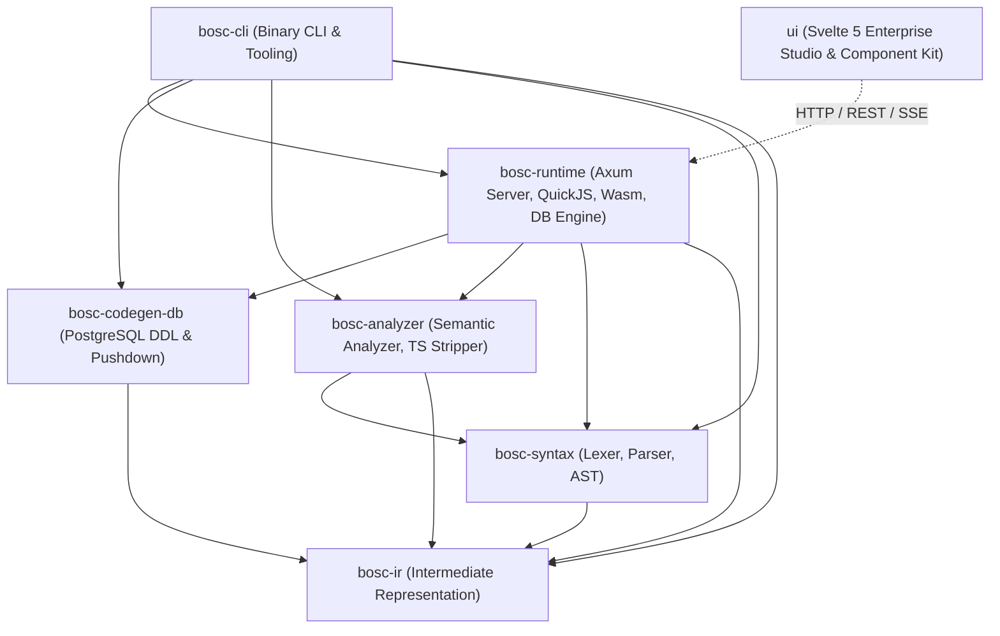

# BOS (Business Operating System) Documentation Suite

Welcome to the official, code-verified technical documentation suite for **BOS (Business Operating System)**. 

This documentation is generated through exhaustive, direct analysis of the production codebase (`crates/`, `ui/`, and `examples/`), reflecting the exact state of the compiler, runtime engine, database layer, REST API server, and developer studio.

---

## 📑 Documentation Index

| File | Title | Description |
| :--- | :--- | :--- |
| [**`00_architecture_overview.md`**](00_architecture_overview.md) | **System Architecture & Engine Overview** | High-level system architecture, multi-tier hybrid execution pipeline, crate dependency graph, and end-to-end lifecycle. |
| [**`01_bos_script_language_reference.md`**](01_bos_script_language_reference.md) | **BOS-Script Language Reference** | DSL syntax, lexical tokens, grammar, type system, TypeScript OxC type stripping, and AST lowering. |
| [**`02_meta_objects_specification.md`**](02_meta_objects_specification.md) | **Exhaustive Meta-Objects Specification** | Deep-dive into all 18 first-class meta-objects (`table`, `tablelogic`, `tableextension`, `codeunit`, `statemachine`, `page`, `query`, etc.). |
| [**`03_compiler_and_ir_architecture.md`**](03_compiler_and_ir_architecture.md) | **Compiler Pipeline & IR Architecture** | `bosc-syntax`, `bosc-analyzer`, `bosc-ir`, semantic validation passes, diagnostics, and intermediate representation. |
| [**`04_database_engine_and_storage_strategies.md`**](04_database_engine_and_storage_strategies.md) | **Database Engine & Storage Strategies** | PostgreSQL DDL code generation, system kernel catalogs, GIN-indexed metadata, and 4 multi-tenant storage models. |
| [**`05_schema_sync_and_declarative_migrations.md`**](05_schema_sync_and_declarative_migrations.md) | **Schema Sync & Migration Planner** | Live database schema inspection, diff planning, safe vs. destructive risk analysis, and atomic transactional application. |
| [**`06_quickjs_sandbox_and_execution_runtime.md`**](06_quickjs_sandbox_and_execution_runtime.md) | **QuickJS Sandboxed Execution Engine** | Sandboxed QuickJS VM, fuel metering, memory/stack quotas, `models.*` proxies, exact 128-bit monetary math, and `Rec`/`xRec`. |
| [**`07_events_wasm_and_companion_sidecars.md`**](07_events_wasm_and_companion_sidecars.md) | **Events, Wasm Plugins & Sidecars** | Decoupled event registry, transactional outbox processor, `wasmi 2.0` WebAssembly engine, and HTTP IPC sidecars. |
| [**`08_backend_api_server_reference.md`**](08_backend_api_server_reference.md) | **Backend HTTP & Query API Reference** | Axum 0.8 REST endpoints, session middleware, optimistic concurrency control (`_system_version`), locking, and `/api/query`. |
| [**`09_bosc_cli_reference.md`**](09_bosc_cli_reference.md) | **BOS Compiler CLI (`bosc`) Manual** | Complete command reference for `build`, `run`, `deploy`, `test-live`, `detect-db`, `serve`, `provision`, and `package`. |
| [**`10_modular_packaging_system.md`**](10_modular_packaging_system.md) | **Modular Packages & Distribution** | `.bospkg` package bundles, manifest format, dependency resolution, SHA-256 checksums, and package installation. |
| [**`11_svelte5_ui_studio_and_component_library.md`**](11_svelte5_ui_studio_and_component_library.md) | **Svelte 5 UI Studio & Component Library** | Modern Svelte 5 runes (`$state`, `$derived`, `$props`), `bos-ui` enterprise component suite, and interactive visual designers. |
| [**`12_enterprise_use_cases_and_reference_implementations.md`**](12_enterprise_use_cases_and_reference_implementations.md) | **Enterprise Use Cases & Walkthroughs** | End-to-end production use cases: Security & RBAC (`bos.auth`), Dispatch Validator, and transactional business workflows. |
| [**`13_server_node_and_nas_architecture.md`**](13_server_node_and_nas_architecture.md) | **Server Node & NAS Architecture** | 3-tier enterprise ERP server nodes (NAV NST/NAS equivalent), declarative configuration profiles (`bos-node.toml`), and headless batch processing daemons. |
| [**`14_distribution_and_packaging_guide.md`**](14_distribution_and_packaging_guide.md) | **Distribution & Packaging Guide** | Standalone zero-dependency distribution bundles, cross-platform packaging automation scripts (`build-distribution.ps1`, `build-distribution.sh`), and 1-click launchers. |
| [**`15_unified_notification_system.md`**](15_unified_notification_system.md) | **Unified Notification System Specification** | Full-stack notification protocol across Rust Axum & Svelte 5: floating toasts, modal alerts, in-field validation errors, SSE streams, and Notification Center drawer. |
| [**`16_aot_bytecode_and_static_node_architecture.md`**](16_aot_bytecode_and_static_node_architecture.md) | **Ahead-of-Time Bytecode & Static Node Architecture** | AOT QuickJS bytecode envelopes (`.qbc`, `BCBOS`), CRC32 verification, in-memory caches, AOT prepared SQL statements, self-healing vault, and static serving. |
| [**`17_page_compiler_and_designer.md`**](17_page_compiler_and_designer.md) | **Pages v2: Page Compiler, Customization Layer & Designer** | Page IR v2, NAV-style auto-fill from table fields, client expression language, extension directives, super-user customization layer, BOS30xx diagnostics, the Svelte 5 page compilation pipeline, the `@bos/page-kit` browser runtime, the WYSIWYG designer and the page verification suite. |

---

## 🏗️ Repository Crate Organization

---

## ⚡ Key Architectural Facts Directly Verified in Code

1. **Pure Rust Systems Core**: All compiler crates and backend runtime engines are written in 100% safe, idiomatic Rust (2024 edition) with zero mocks in production execution paths.
2. **First-Class Meta-Object Architecture**: 18 declarative meta-objects are supported across compiler AST, IR, and runtime catalog.
3. **Decoupled Data and Logic**: Data schemas live cleanly in `table` definitions, while all business validations, lifecycle triggers, and procedures reside in companion `tablelogic` and `codeunit` files.
4. **Hybrid 3-Tier Execution Pipeline**:
   - High-throughput database-level pushdown via generated PostgreSQL views and PL/pgSQL procedures.
   - High-speed sandboxed QuickJS execution for complex enterprise business logic (8 MB RAM cap, 100,000 instruction fuel quota, exact 128-bit monetary math).
   - In-process WebAssembly execution (`wasmi 2.0`) for CPU-bound computations and extensions.
   - Loopback HTTP IPC companion microservices for legacy or external system integration.
5. **Modern Svelte 5 Reactive Frontend**: The Developer Studio and Component Showcase are authored completely in modern Svelte 5 utilizing runes (`$state`, `$derived`, `$props`, `$effect`) over Monaco editor, Lucide icons, and Tailwind CSS.
