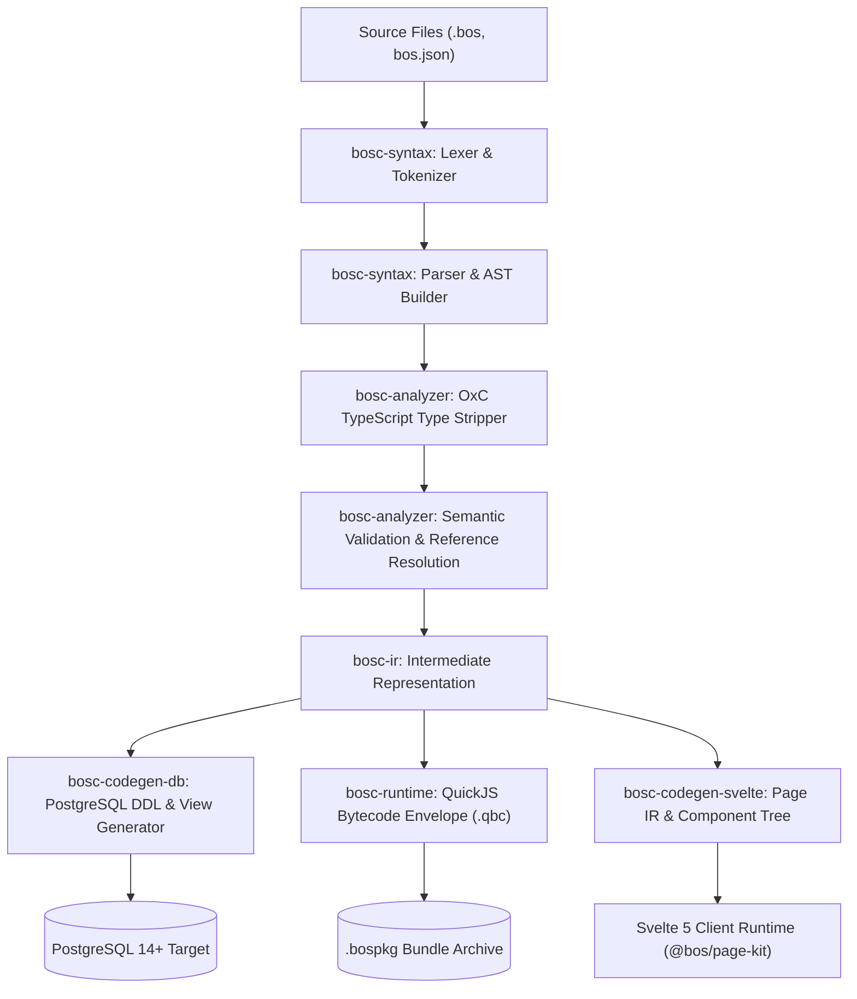

# 00. System Architecture Blueprint

## 1. Executive Summary & Vision

The **Business Operating System (BOS)** is an enterprise application engine designed to combine the rigor, transactional integrity, and ledger immutability of tier-1 ERP platforms (Microsoft Dynamics 365 Business Central / NAV, SAP S/4HANA, Salesforce) with the agility, developer ergonomics, and lightweight footprint of modern systems software.

Built from the ground up in 100% safe Rust and modern reactive Svelte 5, BOS operates without legacy runtime weight, multi-gigabyte application servers, or proprietary database locks.

---

## 2. Core Pillars of the Architecture

```
┌────────────────────────────────────────────────────────────────────────┐
│                        BOS Modern ERP Platform                         │
├────────────────────┬────────────────────┬──────────────────────────────┤
│ 1. Metadata-Driven │ 2. Zero-Mock Rust  │ 3. Hybrid 3-Tier Execution   │
│    Declarative DSL │    Memory & Thread │    PostgreSQL AMDP Pushdown  │
│    Tables, Pages,  │    Safe Systems    │    QuickJS Sandboxed Engine  │
│    Workflows, RBAC │    Core Engine     │    wasmi 2.0 WebAssembly     │
└────────────────────┴────────────────────┴──────────────────────────────┘
```

1. **Metadata-Driven Paradigm**: All enterprise entities (data schemas, UI page definitions, state machine transitions, background job schedules, and security permissions) are declared as concise `.bos` metadata files.
2. **Type-Stripped TypeScript Business Logic**: Companion `.bl.bos` or inline TypeScript triggers execute through an OxC-accelerated zero-overhead type-stripper and compile directly into sandboxed QuickJS bytecode envelopes.
3. **Hybrid 3-Tier Execution Pipeline**:
   - **Database-Level Pushdown (AMDP)**: Bulk set calculations, declarative FlowFields, and immutable ledger integrity checks run directly inside PostgreSQL via generated stored generated columns, index-backed pushdown views, and atomic triggers.
   - **QuickJS Sandboxed Virtual Machine**: Record-level validations, custom calculations, and transactional hooks run inside an isolated QuickJS instance with an 8 MB memory ceiling, 100,000 instruction fuel metering, and exact 128-bit monetary math.
   - **wasmi 2.0 WebAssembly Engine**: High-performance cryptographic verification, document rendering, and algorithmic extensions run in a sandboxed, fuel-metered WebAssembly environment.
   - **Loopback IPC Companion Sidecars**: Legacy microservices and third-party binaries communicate over loopback HTTP sockets with TLS/mTLS encryption.
4. **Reactive Svelte 5 Frontend**: The UI Studio and dynamically rendered user pages leverage Svelte 5 runes (`$state`, `$derived`, `$props`, `$effect`), Tailwind CSS, Lucide icons, and the Monaco code editor.

---

## 3. End-to-End Compilation Pipeline

The BOS Compiler (`bosc`) transforms declarative source files into database structures, intermediate representations, and web assets:



---

## 4. Crate Responsibility Matrix

| Crate | Responsibility | Key Dependencies | Production Guarantee |
| :--- | :--- | :--- | :--- |
| `crates/bosc-syntax` | Lexing, tokenizing, recursive descent parsing into Abstract Syntax Trees (AST). | `logos`, `chumsky` / custom hand-rolled AST | Zero external dynamic dependencies; deterministic AST emission. |
| `crates/bosc-analyzer` | Symbol table generation, cross-reference validation, TypeScript OxC type stripping, and semantic analysis. | `oxc_allocator`, `oxc_parser` | Detects circular references, missing fields, and type mismatches at compile time. |
| `crates/bosc-ir` | Canonical intermediate representation of tables, fields, indexes, pages, codeunits, and statemachines. | `serde`, `serde_json`, `uuid` | Serde-serializable IR enabling independent codegen backends. |
| `crates/bosc-codegen-db` | Generation of PostgreSQL DDL, Row-Level Security policies, stored generated columns, and SIFT FlowField views. | `bosc-ir` | Idempotent, safe DDL scripts with automatic dependency ordering. |
| `crates/bosc-codegen-svelte` | Compiles Page metadata into Svelte 5 template components and Page IR JSON envelopes. | `bosc-ir`, `serde` | Generates accessible, reactive form and list interfaces. |
| `crates/bosc-runtime` | Axum 0.8 HTTP API server, QuickJS sandbox VM, `wasmi 2.0` WebAssembly engine, SQLx database connection manager, NAS daemon. | `axum`, `sqlx`, `rquickjs`, `wasmi`, `tokio` | Thread-safe, non-blocking asynchronous execution pool; zero unhandled panics. |
| `crates/bosc-cli` | CLI tooling binary (`bosc`) implementing build, deploy, run, package, provision, and node subcommands. | `clap`, `tokio`, `tracing` | Cross-platform standalone executable (Windows, Linux, macOS). |
| `ui/` | Svelte 5 enterprise UI Studio, Monaco editor, visual designers, and `@bos/page-kit`. | Svelte 5, Tailwind CSS, Lucide | 100% runes-based reactive state, zero legacy reactive statements (`$:`). |

---

## 5. Security & Isolation Boundaries

BOS enforces defense-in-depth across every layer:

```
┌────────────────────────────────────────────────────────┐
│ Client Browser / Svelte 5 UI Studio                    │
└──────────────────────────┬─────────────────────────────┘
                           │ HTTPS / Session Token / CSRF
┌──────────────────────────▼─────────────────────────────┐
│ Axum 0.8 Backend Gateway & RBAC Guard                  │
│ - Session validation against _bos_sessions             │
│ - Role & Permissionset evaluation                      │
├──────────────────────────┬─────────────────────────────┤
│ QuickJS Execution VM     │ wasmi WebAssembly Sandbox   │
│ - 8 MB RAM Limit         │ - Instruction Fuel Metering │
│ - 100k Fuel Instruction  │ - No Direct OS Access       │
│ - Zero Network/File I/O  │                             │
├──────────────────────────┴─────────────────────────────┤
│ PostgreSQL Database Layer                              │
│ - Uniform Row-Level Security (RLS) on tenant_id        │
│ - Immutable ledger insert-only database triggers       │
│ - Privileged audit logs with SHA-256 hash chaining     │
└────────────────────────────────────────────────────────┘
```

---

## 6. Enterprise Consistency & Concurrency

- **Optimistic Concurrency Control (OCC)**: Every mutable table automatically incorporates a `_system_version` integer column. Updates enforce `WHERE id = $id AND _system_version = $version`, returning HTTP 409 Conflict if concurrent modifications occur.
- **UUIDv7 Identifiers**: All primary keys utilize time-ordered UUIDv7 identifiers, preserving strict chronological B-Tree index locality while avoiding auto-increment sequential vulnerability.
- **Two-Phase Immutable Ledgers**: Documents transition through editable Draft and Approval stages before committing immutable, non-modifiable, insert-only Ledger entries.
