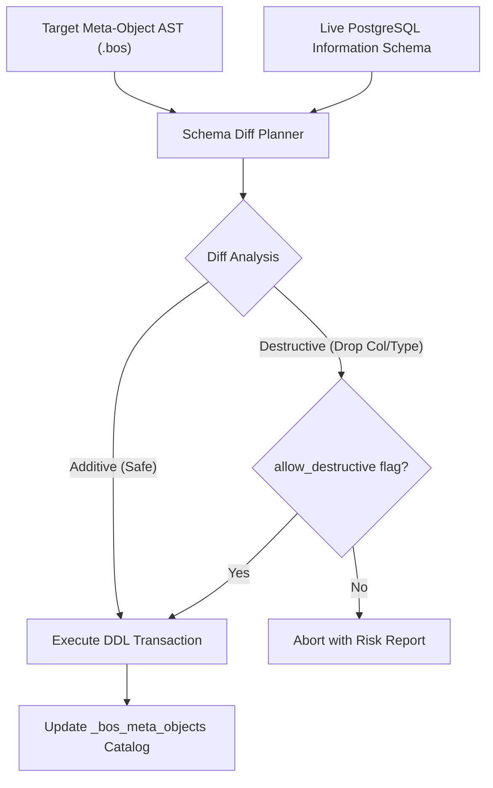

# 02. Database Engine & Storage Models

## 1. Relational Database Strategy

BOS uses PostgreSQL (14+) as its primary relational engine, combining standard ANSI SQL compliance with advanced PostgreSQL-specific capabilities:
- **Row-Level Security (RLS)** for multi-tenant data isolation.
- **Stored Generated Columns** for deterministic zero-overhead calculations.
- **AMDP (Application Managed Database Procedures)** pushing complex sets and aggregations into PL/pgSQL and view layers.
- **UUIDv7 B-Tree Primary Keys** ensuring temporal locality and zero fragmentation.

---

## 2. Multi-Tenant Storage Topologies

BOS supports 4 configurable multi-tenant and multi-company storage strategies:

```
┌────────────────────────────────────────────────────────────────────────┐
│                   BOS Multi-Tenant Storage Models                      │
├────────────────────┬────────────────────┬──────────────────────────────┤
│ 1. shared_rls      │ 2. partitioned     │ 3. schema_per_company        │
│    Single schema   │ Native PostgreSQL  │ Dedicated schema per         │
│    Uniform RLS on  │ Table partitions   │ company with isolated        │
│    tenant_id       │ on tenant/company  │ DDL structures               │
└────────────────────┴────────────────────┴──────────────────────────────┘
```

1. **`shared_rls` (Default Cloud Multi-Tenant)**:
   - All tenants share the same PostgreSQL tables.
   - Every single business table carries `tenant_id: UUID` as an indexed column.
   - Axum session middleware executes `SET LOCAL app.current_tenant_id = '...'` before every transaction.
   - Postgres RLS policy automatically enforces:
     ```sql
     CREATE POLICY tenant_isolation_policy ON customer
     USING (tenant_id = current_setting('app.current_tenant_id', true)::uuid);
     ```
2. **`partitioned` (High-Volume Enterprise)**:
   - Tables are partitioned using PostgreSQL native declarative partitioning by `LIST (tenant_id)` or `RANGE (created_at)`.
   - Offers physical data separation and fast partition-drop archiving.
3. **`schema_per_company` (Sovereignty & Isolation)**:
   - Each company resides in a dedicated PostgreSQL schema (`company_001`, `company_002`).
   - Tables with `dataPerCompany: false` (e.g., Users, Global Currency Exchange Rates) reside in a shared kernel schema.
4. **`table_per_company` (NAV/BC Compatibility)**:
   - Company tables are prefixed: `acme$customer`, `beta$customer`.
   - Maintained for legacy compatibility with Dynamics NAV data migration pipelines.

---

## 3. Declarative Schema Sync & Migration Planner

BOS rejects manual migration scripts (`0001_initial.sql`, `0002_add_field.sql`). Instead, BOS features a declarative **Schema Synchronization Engine**:



### Risk Classification
- **Safe Operations**: Adding new tables, adding nullable columns, adding indexes, expanding varchar length (`String(50)` -> `String(100)`). Executed automatically.
- **Destructive Operations**: Dropping columns, dropping tables, narrowing datatypes, adding non-null constraints without defaults. Blocked unless `--allow-destructive` is explicitly provided.

---

## 4. FlowFields & SIFT (Sum Index Field Technology)

Borrowing the battle-tested design of Microsoft Dynamics NAV/BC, BOS implements **FlowFields**: calculated values computed dynamically rather than stored statically.

### Example FlowField
```bos
table Customer {
    customer_no: String(20) [primaryKey];
    name: String(100);
    balance: FlowField(Sum("CustLedgerEntry".amount WHERE customer_no = field(customer_no)));
}
```

### PostgreSQL Generated Pushdown View
```sql
CREATE OR REPLACE VIEW v_customer AS
SELECT 
    c.customer_no,
    c.name,
    COALESCE((
        SELECT SUM(e.amount) 
        FROM cust_ledger_entry e 
        WHERE e.customer_no = c.customer_no
    ), 0.0000) AS balance
FROM customer c;
```
When queries select `balance`, the calculation pushes directly down to PostgreSQL, utilizing index scans and eliminating N+1 application roundtrips.
