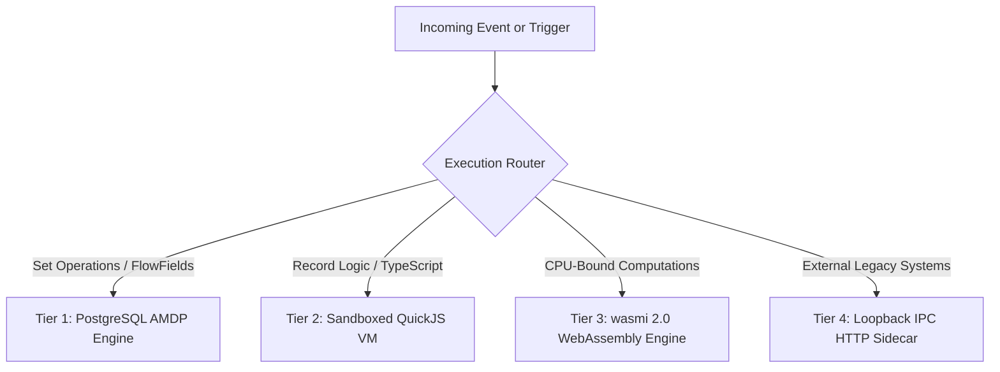

# 03. Runtime Sandbox & Execution Engine

## 1. Multi-Tier Execution Pipeline

Business logic in BOS is executed via a safe, tiered architecture:



---

## 2. Sandboxed QuickJS Virtual Machine

BOS embeds QuickJS through a zero-copy Rust wrapper (`rquickjs` / custom bindings):

### 2.1. Sandboxing Guarantees
- **Memory Ceiling**: Strict 8 MB heap quota per execution context. Memory exhaustion immediately aborts execution without crashing the server process.
- **Fuel Metering**: 100,000 instruction fuel limit per trigger. Prevents infinite loops (`while (true) {}`) and catastrophic CPU starvation.
- **I/O Isolation**: Zero direct filesystem, OS socket, or process execution APIs are injected into the QuickJS global context.

### 2.2. Exact 128-bit Monetary Math (`ctx.decimal`)
JavaScript numbers are 64-bit floating-point (IEEE 754), which causes disastrous rounding bugs in enterprise ERPs (e.g., `0.1 + 0.2 === 0.30000000000000004`).

BOS injects an exact 128-bit fixed-point Decimal engine into the VM:
```typescript
// Inside tablelogic or codeunit
const unitPrice = ctx.decimal.from("199.9500");
const quantity = ctx.decimal.from("3");
const discountRate = ctx.decimal.from("0.1500");

// Exact decimal calculation with bankers' rounding (round half to even)
const gross = unitPrice.mul(quantity);
const discount = gross.mul(discountRate);
const net = gross.sub(discount);

this.total_amount = net.toString(); // "509.8725"
```

### 2.3. Record Snapshots: `Rec` vs `xRec`
Every trigger receives both the proposed record state (`Rec` or `this`) and the persistent database snapshot (`xRec`):
```typescript
tablelogic SalesLine {
    validate quantity(newQty: Decimal, xRec: SalesLine) {
        if (newQty !== xRec.quantity) {
            // Recalculate line discount and update header
            this.recalculateLine();
        }
    }
}
```

---

## 3. WebAssembly Sandbox (`wasmi 2.0`)

For CPU-intensive tasks (e.g., PDF generation, barcode hashing, encryption, data transformations):
- BOS embeds the pure-Rust `wasmi 2.0` WebAssembly interpreter.
- Wasm modules are packaged inside `.bospkg` bundles or registered dynamically.
- Each invocation runs with a deterministically metered fuel limit and dedicated memory pages.

---

## 4. Decoupled Business Events & Transactional Outbox

BOS provides an enterprise event bus:
1. Procedures annotate events with `@businessEvent`:
   ```bos
   codeunit SalesPost {
       @businessEvent
       procedure onAfterPostSalesOrder(orderId: UUID, invoiceNo: String) {}
   }
   ```
2. When the trigger fires inside a transaction, an event row is committed into `_bos_event_outbox` in the **same database transaction**.
3. The NAS Worker Daemon polls `_bos_event_outbox` and dispatches events to registered event subscribers asynchronously, guaranteeing **at-least-once delivery** and zero transaction rollback side-effects.
