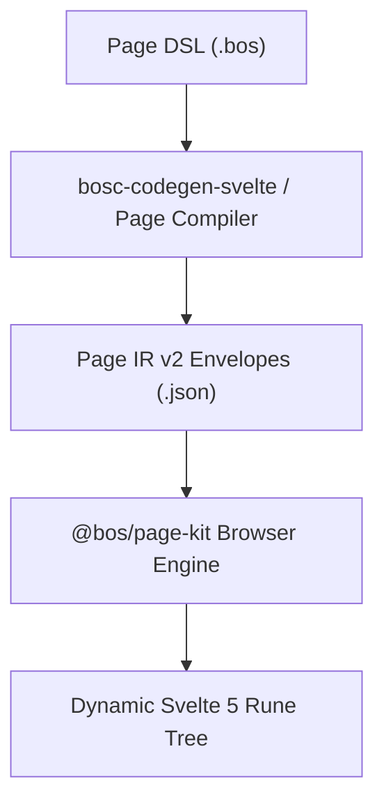

# 04. UI Architecture & Page Compiler

## 1. Overview & Frontend Philosophy

The BOS user interface is engineered in **Svelte 5** using the new reactive **Runes** primitive model (`$state`, `$derived`, `$props`, `$effect`). It delivers a lightning-fast, zero-lag enterprise studio and application runner without the overhead of heavy virtual-DOM frameworks.

---

## 2. Page Meta-Object & Page IR v2

Pages in BOS are declared in high-level DSL (`page <Name>`) and compiled into **Page IR v2** JSON envelopes:



### Supported Page Types:
- **`List`**: Grid/table view for browsing collections with sorting, filtering, and paging.
- **`Card`**: Form view for single entity inspection and detail editing.
- **`Document`**: Master-detail view (e.g., Sales Order Header + Sales Order Lines grid).
- **`Dashboard / RoleCenter`**: Executive summary with KPI tiles, charts, and quick-action buttons.
- **`Worksheet`**: Excel-style fast editable tabular grid for rapid data entry.

---

## 3. Dynamic Page Kit Runtime (`@bos/page-kit`)

Rather than requiring a full frontend build cycle for every page modification:
1. The Svelte 5 application hosts the `@bos/page-kit` dynamic component runner.
2. When a user opens a page, the browser queries `/api/pages/:page_id/definition`.
3. `@bos/page-kit` dynamically constructs the UI layout, binds input controls to data fields, evaluates client expression rules, and wires up dirty-state indicators.

---

## 4. Real-Time UI Messaging & Notification Center

BOS replaces intrusive popup dialogs with an integrated notification architecture:

```
┌────────────────────────────────────────────────────────┐
│ Floating Toast Layer (Success, Warning, Error)         │
├────────────────────────────────────────────────────────┤
│ In-Field Form Validation Badges                        │
├────────────────────────────────────────────────────────┤
│ Slide-Out Notification Center Drawer                   │
│ - Historical system alerts                             │
│ - Long-running background job progress                 │
│ - Approval request notifications                       │
└────────────────────────────────────────────────────────┘
```

- **Server-Sent Events (SSE)** stream real-time events from `/api/events/stream` directly to the active user session.
- Client-side error toasts link directly to the invalid input field, setting focus automatically.
