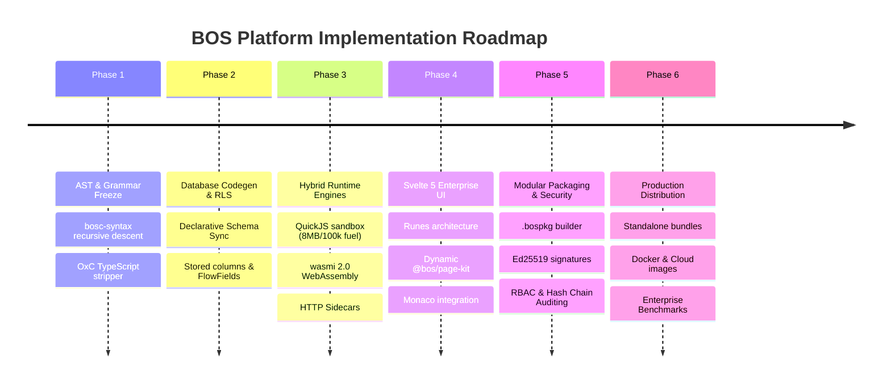

# 06. Roadmap & Release Milestones

## 1. Phased Development Roadmap

The development of the BOS Core Engine and Ecosystem proceeds through structured enterprise milestones:

---

## 2. Granular Milestone Deliverables

### Milestone 1: Compiler Core & Grammar (Completed)
- [x] Complete lexer and AST parser in `bosc-syntax` for all 18 meta-objects.
- [x] High-performance TypeScript type stripper via `oxc_parser` in `bosc-analyzer`.
- [x] Intermediate representation definitions and serialization in `bosc-ir`.

### Milestone 2: Relational Engine & Schema Sync (Completed)
- [x] PostgreSQL DDL generator in `bosc-codegen-db`.
- [x] Declarative schema sync with safe vs. destructive diff planning.
- [x] Row-Level Security (RLS) policies and tenant isolation strategies.
- [x] FlowField pushdown views and SIFT aggregation queries.

### Milestone 3: Execution Runtime & Sandbox (Completed)
- [x] Sandboxed QuickJS virtual machine with 8 MB RAM cap and 100,000 instruction fuel quota.
- [x] Exact 128-bit monetary math engine (`ctx.decimal`).
- [x] `wasmi 2.0` WebAssembly plugin executor.
- [x] Loopback IPC HTTP sidecar proxy host.
- [x] Axum 0.8 REST backend server and session token middleware.

### Milestone 4: Svelte 5 UI Studio & Page Kit (Completed)
- [x] Svelte 5 runes (`$state`, `$derived`, `$props`, `$effect`) implementation.
- [x] Interactive API and Developer Studios.
- [x] Monaco code editor integration with syntax highlighting.
- [x] `@bos/page-kit` dynamic JSON-driven page renderer.

### Milestone 5: Modular Packaging & RBAC (Completed)
- [x] `.bospkg` package format and `bosc package build/install/list`.
- [x] Ed25519 detached digital signatures and SHA-256 integrity verification.
- [x] Full RBAC security package (`bos.core`) with tenants, companies, users, and roles.
- [x] Cryptographic SHA-256 hash-chained audit logging.

### Milestone 6: Distribution, Production Hardening & Cloud (In Progress)
- [x] Standalone zero-dependency distribution scripts (`build-distribution.ps1`, `build-distribution.sh`).
- [x] 1-Click Server Node runtime (`bosc node run --config nodes/dev.toml`).
- [x] Docker and Docker Compose containerization templates.
- [ ] Enterprise multi-node high-availability clustering and geo-replicated WAL streaming.
- [ ] Automated visual Playwright regression suite.

---

## 3. Enterprise Performance & Quality Targets

- **Startup Time**: Cold start to accepting HTTP traffic in under 50 milliseconds.
- **REST Latency**: P99 read latency < 2 ms; P99 transactional write latency < 8 ms on PostgreSQL.
- **Memory Footprint**: Base server node idling at < 25 MB RAM.
- **Test Invariants**: Zero compiler warnings, 100% rust test passing, zero mock data in production paths.
