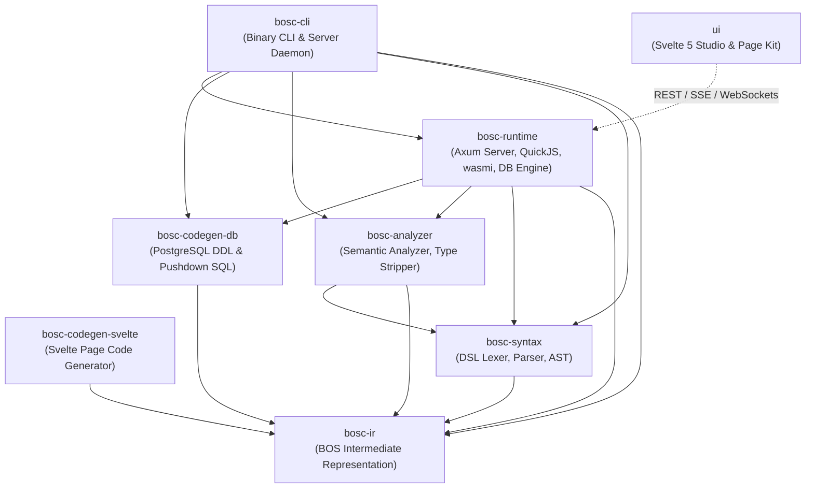

# BOS Planning & Architectural Blueprints

This directory contains the formal architectural specifications, engineering designs, intermediate representations, and technical blueprints that govern the BOS Core Engine.

---

## 📑 Planning Document Index

| Document | Title | Scope & Purpose |
| :--- | :--- | :--- |
| [**`00_system_architecture_blueprint.md`**](00_system_architecture_blueprint.md) | **System Architecture Blueprint** | High-level system architecture, 3-tier hybrid execution pipeline, crate dependency topology, and lifecycle flows. |
| [**`01_meta_objects_and_dsl_specification.md`**](01_meta_objects_and_dsl_specification.md) | **Meta-Objects & DSL Specification** | Formal specification of the 18 BOS meta-objects, BOS-Script grammar, TypeScript OxC type-stripping, and AST definitions. |
| [**`02_database_engine_and_storage_models.md`**](02_database_engine_and_storage_models.md) | **Database Engine & Storage Models** | PostgreSQL DDL code generation, Row-Level Security (RLS), 4 multi-tenant models (`shared_rls`, `partitioned`, `schema_per_company`, `table_per_company`), declarative migrations, and FlowFields. |
| [**`03_runtime_sandbox_and_execution_engine.md`**](03_runtime_sandbox_and_execution_engine.md) | **Runtime Sandbox & Execution Engine** | Sandboxed QuickJS execution runtime, instruction fuel limits, memory caps, exact 128-bit monetary math, `wasmi 2.0` WebAssembly engine, and HTTP IPC sidecars. |
| [**`04_ui_architecture_and_page_compiler.md`**](04_ui_architecture_and_page_compiler.md) | **UI Architecture & Page Compiler** | Svelte 5 runes architecture, Page IR v2, Monaco code editor, `@bos/page-kit` browser runtime, and unified notification protocols. |
| [**`05_modular_packaging_and_security.md`**](05_modular_packaging_and_security.md) | **Modular Packaging & Security System** | `.bospkg` bundle archive structure, dependency resolution, Ed25519 digital signatures, SHA-256 validation, RBAC security profiles, and immutable audit logs. |
| [**`06_roadmap_and_release_milestones.md`**](06_roadmap_and_release_milestones.md) | **Implementation Roadmap & QA Matrix** | Phased milestone delivery, 36+ QA test task matrix, feature decomposition, and enterprise benchmark criteria. |
| [**`adr/`**](adr/README.md) | **Architectural Decision Records** | Formal architectural records for UUIDv7, uniform RLS, logical table naming, package signing, and audit chaining. |

---

## 🏗️ Crate Architecture Topology

---

## 🛡️ Architectural Principles & Invariants

1. **Zero Mocks in Production Paths**: Every compiler stage, database query, and business rule executes against real infrastructure or isolated test harness containers.
2. **Metadata As Code**: Schemas, workflows, views, security policies, and UI layouts are version-controlled declarative metadata files.
3. **Immutability Where It Matters**: Ledger entries, system audit trails, and compiled package bundles cannot be modified or truncated in place once committed.
4. **Sub-Millisecond Business Execution**: Push set operations directly down to the PostgreSQL query planner (AMDP), run business logic in a lean sandboxed QuickJS context, and keep network hops to zero.
