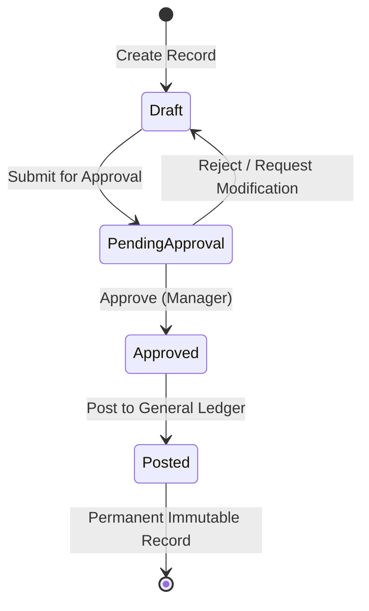

# Volume 2: End-User & Operator Manuals
## 04. Document Workflows & Approval States

Enterprise financial and operational documents follow formal lifecycles governed by declarative State Machines. This guide explains how documents progress from Draft to Posted and how approvals operate.

---

## 🔄 The Document Lifecycle

---

## 📑 Understanding Document States

### 1. `Draft` State
- The document is currently being prepared by the operator.
- All fields (Customer, Lines, Quantities, Unit Prices) are freely editable.
- Inventory is not committed, and no general ledger entries are created.
- You can delete or discard the document at any time.

### 2. `PendingApproval` State
- The operator has finished drafting and clicked **Submit for Approval**.
- The document is locked against regular edits to prevent modifications during review.
- An approval request notification is sent to designated managers (e.g., Purchasing Manager or Finance Director).

### 3. `Approved` State
- An authorized approver has reviewed and accepted the document.
- The document is unlocked for the final posting step.

### 4. `Posted` State
- The posting engine executes the codeunit procedure inside a single atomic database transaction.
- **Permanent & Immutable**: Once in `Posted` state, the document can never be modified or deleted.
- Corresponding entries are written to:
  - `GeneralLedgerEntry`
  - `CustLedgerEntry` or `VendorLedgerEntry`
  - `ItemLedgerEntry` (inventory balance updated)

---

## 👥 How to Approve or Reject a Document

If your user account has an approval role (e.g., `PurchasingManager`):
1. Navigate to **Approvals** in the sidebar (or click the approval bell notification).
2. Open the pending document to inspect header details and line totals.
3. In the top action bar:
   - Click **Approve**: Document transitions to `Approved`.
   - Click **Reject**: Enter an optional rejection reason; the document reverts to `Draft` so the creator can correct the issues.
