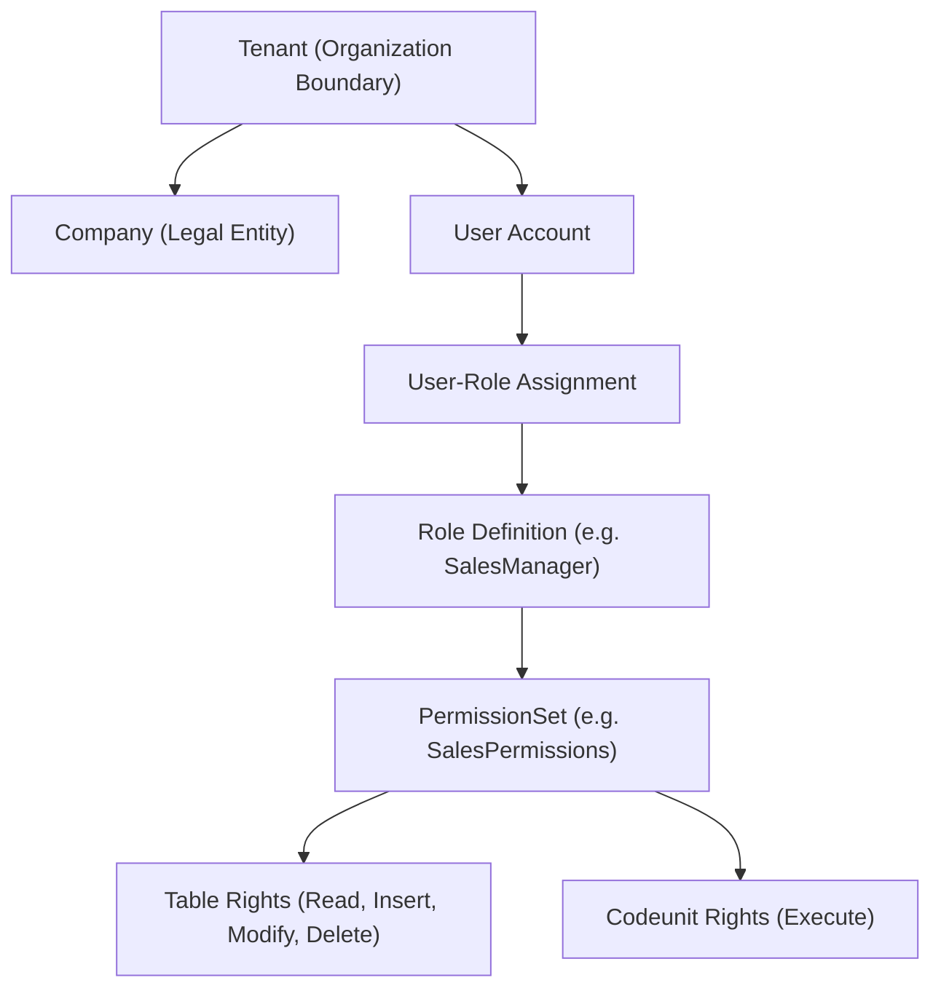

# Volume 3: Administrator & DevOps Manuals
## 03. User Security & Role-Based Access Control (RBAC)

Security in BOS is managed by the foundational `bos.core` package, implementing multi-tenant Role-Based Access Control (RBAC) with argon2id password hashing and fine-grained PermissionSets.

---

## 👥 Security Model Hierarchy



---

## 👤 Managing Users

### 1. Creating a User via REST API
```http
POST /api/users
Content-Type: application/json
Authorization: Bearer <AdminSessionToken>

{
  "username": "sarah.finance",
  "email": "sarah@acme.com",
  "full_name": "Sarah Jenkins",
  "password": "SecurePassword123!",
  "tenant_id": "018f4a12-8800-7214-9bf2-b430c5e7b411",
  "status": "Active"
}
```

### 2. Password Hashing Guarantee
BOS never stores plaintext passwords. Passwords are salted and hashed using **Argon2id** (`m=19456, t=2, p=1`), meeting OWASP and NIST enterprise password security guidelines.

---

## 🛡️ Defining PermissionSets & Roles

PermissionSets are defined declaratively in `.bos` files or created dynamically via the administrative interface:

```bos
permissionset FinanceAccounting {
    caption: "Finance & General Ledger Accounting";

    // Table Access: R=Read, I=Insert, M=Modify, D=Delete
    table "GeneralLedgerEntry" = R;
    table "GLAccount" = RIM;
    table "SalesInvoiceHeader" = RIM;
    table "SalesInvoiceLine" = RIM;

    // Codeunit Execution: X=Execute
    codeunit "GenJnlPost" = X;
    codeunit "SalesPost" = X;
}
```

### Assigning Roles to Users
Assigning roles links a user to one or more PermissionSets within a specific company:
```http
POST /api/user-roles
Content-Type: application/json
Authorization: Bearer <AdminSessionToken>

{
  "user_id": "018f4a12-8800-7214-9bf2-b430c5e7b411",
  "role_id": "FinanceAccounting",
  "company_id": "018f4a12-8800-7214-9bf2-b430c5e7b499"
}
```

---

## 🔑 Session Tokens & Security Policies

- **Token Format**: High-entropy cryptographically secure tokens stored in `_bos_sessions`.
- **Session Expiry**: Default 8-hour inactivity timeout (configurable in `bos-node.toml`).
- **IP & User-Agent Binding**: Optional strict session binding preventing token hijack.
- **CSRF Defense**: State-changing endpoints (`POST`, `PUT`, `DELETE`) validate `X-CSRF-Token` headers.
