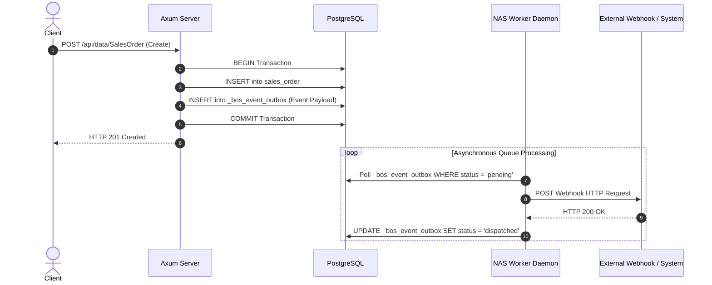

# Volume 5: Integration & API Manuals
## 02. Event-Driven Architecture & Webhooks

BOS provides an enterprise event bus that bridges transactional database modifications with decoupled event subscribers and external webhook endpoints using the **Transactional Outbox Pattern**.

---

## ⚡ The Transactional Outbox Pattern

To prevent dual-write vulnerabilities (where a database write succeeds but an external message queue write fails):



---

## 📢 Publishing Business Events

Annotate procedures in codeunits with `@businessEvent`:

```bos
codeunit SalesOrderService {
    @businessEvent
    procedure onAfterSalesOrderReleased(orderId: UUID, orderNo: String, totalAmount: Decimal) {
        // Body is executed when the event fires
        ctx.events.emit("sales.order.released", {
            order_id: orderId,
            order_no: orderNo,
            total_amount: totalAmount.toString()
        });
    }
}
```

---

## 👂 Subscribing to Events

### 1. In-Process Event Subscribers (`eventsubscriber`)
Subscribe within BOS packages to execute decoupled business logic:

```bos
eventsubscriber InventoryReservationSubscriber {
    event: "sales.order.released";

    handle(payload: JSON) {
        models.Inventory.reserveStockForOrder(payload.order_id);
    }
}
```

### 2. External HTTP Webhooks
Register an external webhook endpoint:
```http
POST /api/webhooks
Content-Type: application/json
Authorization: Bearer <AdminToken>

{
  "event_name": "sales.order.released",
  "target_url": "https://api.thirdpartyshipping.com/webhooks/bos-order",
  "secret": "whsec_7f9a2b4c6e8d1a3f...",
  "retry_count": 5
}
```

### Webhook Signature Verification
Incoming webhook payloads contain a signature header:
```
X-BOS-Signature-256: t=1729938120,v1=9f8c4e...
```
Calculate `HMAC-SHA256(timestamp + "." + rawBody, secret)` on your receiving server to verify the authenticity of the message.
