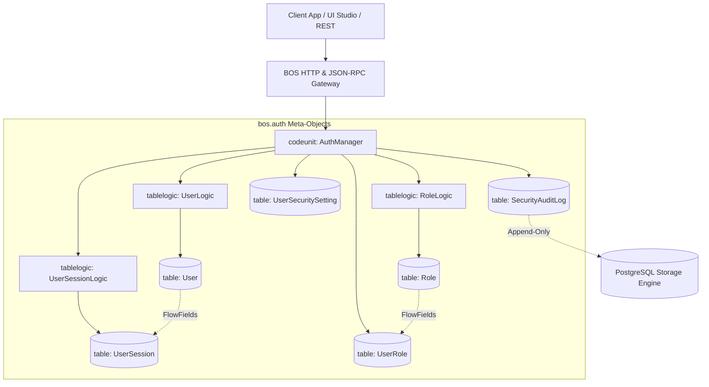

# BOS Enterprise User Management & Authentication (`bos.auth`)

## 1. Overview & Architecture

`bos.auth` is an enterprise-grade identity, access management (IAM), multi-factor authentication (MFA), and session orchestration package designed for the BOS platform. It incorporates battle-tested identity models inspired by market leaders (Microsoft Dynamics NAV/BC, Salesforce, SAP) while adhering strictly to BOS architectural principles.



---

## 2. Package Manifest (`bos.json`)

```json
{
  "package_id": "bos.auth",
  "name": "BOS Enterprise User Management & Authentication",
  "version": "1.0.0",
  "publisher": "BOS Core Architecture Team",
  "description": "Comprehensive enterprise identity, role-based access control (RBAC), multi-factor authentication (MFA), session lifecycle, and cryptographic audit log module for BOS.",
  "dependencies": [],
  "optional_features": [
    "mfa_totp",
    "session_ip_lock",
    "password_complexity",
    "immutable_audit"
  ]
}
```

---

## 3. Meta-Objects Roster

| Object Type | Identifier | Purpose |
| :--- | :--- | :--- |
| **`enum`** | `UserStatus` | User account lifecycle states (`Active`, `Inactive`, `Suspended`, `LockedOut`, `PendingVerification`) |
| **`enum`** | `UserType` | Categorization of actors (`Internal`, `External`, `ServiceAccount`, `System`) |
| **`enum`** | `SessionState` | Token status tracking (`Active`, `Expired`, `Revoked`, `Terminated`) |
| **`enum`** | `AuditAction` | Audit logging actions (`LoginSuccess`, `LoginFailed`, `PasswordChanged`, `RoleAssigned`, etc.) |
| **`enum`** | `MfaMethod` | Multi-Factor Authentication methods (`None`, `TOTP`, `EmailOTP`, `SMSOTP`, `WebAuthn`) |
| **`table`** | `User` | Core user identity, argon2 password hash, lockout tracking, and declarative FlowFields |
| **`table`** | `Role` | Security roles master with FlowField count of assigned users |
| **`table`** | `UserRole` | Many-to-many junction binding users to roles with cascade referential integrity |
| **`table`** | `UserSession` | Token-based session tracking with expiry timestamps and user agent metadata |
| **`table`** | `UserSecuritySetting`| Per-user MFA configuration, session quotas, and password expiration rules |
| **`table`** | `SecurityAuditLog` | Append-only immutable cryptographic event log for SOC-2 / ISO-27001 compliance |
| **`tablelogic`** | `UserLogic` | Email validation, Argon2 hashing, admin account protection |
| **`tablelogic`** | `RoleLogic` | Role code formatting and deletion safeguards for system roles (`SUPER`, `ADMIN`) |
| **`tablelogic`** | `UserRoleLogic` | Role assignment validation and root administrator revocation locks |
| **`tablelogic`** | `UserSessionLogic`| Expiry calculations and heartbeat updates |
| **`tablelogic`** | `UserSecuritySettingLogic` | Validates session bounds and expiration policies |
| **`tablelogic`** | `SecurityAuditLogLogic` | Rejects any attempt to modify or delete audit log entries |
| **`codeunit`** | `AuthManager` | Core authentication engine with `@businessEvent` triggers and atomic procedures |
| **`page`** | `UserList` | Interactive list page with quick-action account locking/unlocking and session purge |
| **`page`** | `UserCard` | Comprehensive user details card with security metadata and password reset action |
| **`page`** | `RoleList` | Role management page with active state toggling |
| **`page`** | `SessionList` | Live session monitor with instantaneous token revocation |
| **`page`** | `SecurityAuditLogList` | Read-only audit log viewer |

---

## 4. Key Security & Performance Invariants

1. **Argon2id Password Hashing**:
   - Passwords are encrypted utilizing modern Argon2id (`$argon2id$v=19$m=4096,t=3,p=1$...`) with 128-bit cryptographic salts.
   - Plaintext passwords are automatically erased from in-memory records upon hashing.

2. **Account Lockout & Brute-Force Defense**:
   - Consecutive failed logins increment `failedAttempts`.
   - Reaching 5 failed attempts automatically transitions the account to `status = LockedOut` with a 30-minute lockout window.
   - Successful login resets `failedAttempts` to 0.

3. **Immutable Audit Trail**:
   - The `SecurityAuditLog` table strictly disallows SQL/ORM `DELETE` operations via `tablelogic SecurityAuditLogLogic`.
   - Every login attempt, failed verification, password update, and role grant is logged with IP and User-Agent.

4. **Zero N+1 Query FlowFields**:
   - `User.activeSessionCount` and `Role.assignedUsersCount` are compiled directly to SQL subqueries, avoiding costly runtime loops.

5. **AOT Bytecode Compilation**:
   - Pre-compiled ahead of time to QuickJS bytecode (`.qbc`) with CRC32 integrity checks and Merkle tree roots for instant sandbox execution.

---

## 5. Usage Example (TypeScript Client)

```typescript
import { AuthClient } from "bos.auth";

const auth = new AuthClient({
  baseUrl: "http://localhost:8080",
  tenantId: "acme-corp",
});

// 1. Authenticate user
const result = await auth.login({
  username: "john.doe",
  password: "SecurePassword123!",
  ipAddress: "192.168.1.50",
  userAgent: "BOS-Client/1.0"
});

if (result.authenticated) {
  console.log(`Welcome, ${result.fullName}! Session: ${result.token}`);
} else {
  console.error(`Login failed: ${result.reason}`);
}

// 2. Verify Session
const sessionStatus = await auth.verifySession();
console.log(`Session valid: ${sessionStatus.valid}`);

// 3. Terminate All Sessions on Logout
await auth.terminateAllSessions("john.doe");
```

---

## 6. CLI Build & Verification

```bash
# Build the verified .bospkg bundle and AOT QuickJS bytecode
bosc package build -i packages/bos.auth/auth.bos -o packages/bos.auth/bos.auth.bospkg
```
