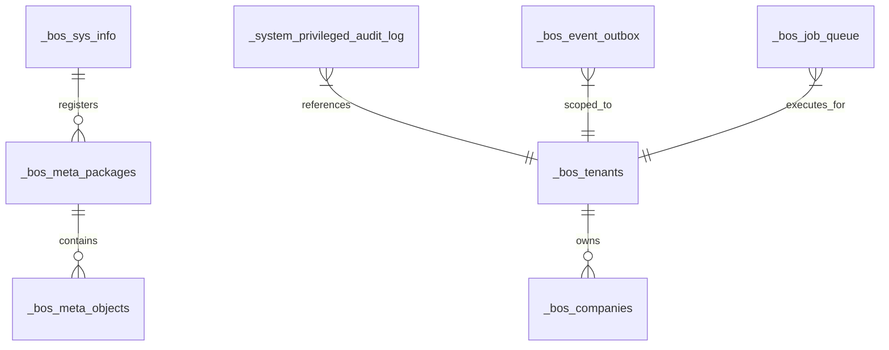
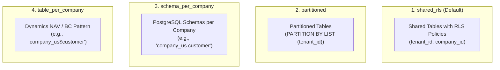

# Database Engine & Storage Strategies

> **Document ID:** `BOS-DOC-04`  
> **Source Verification:** `crates/bosc-codegen-db/*`, `crates/bosc-ir/src/lib.rs`, `crates/bosc-runtime/src/db_manager.rs`  
> **Target Audience:** Database Administrators, Backend Engineers, Cloud Infrastructure Architects

---

## 1. Overview & Database Philosophy

BOS utilizes **PostgreSQL** (version 15+) as its primary transactional storage and relational compute engine. Rather than treating PostgreSQL merely as a dumb row store, BOS leverages advanced database features:
- **Generated Stored Formula Columns**: Real-time declarative math computed by the database engine without runtime overhead.
- **SIFT (Sum Index Field Technology)**: FlowField aggregations pushed down to PostgreSQL subqueries backed by covering indexes.
- **PostgreSQL Row-Level Security (RLS)**: Cryptographically enforced data isolation per tenant and operating company.
- **Single Source of Truth Catalog**: High-performance GIN-indexed JSONB meta-object catalog (`_bos_meta_objects.definition`) that eliminates metadata sprawl.

---

## 2. System Kernel Provisioning (`_bos_*`)

When a database is initialized via `bosc provision` or `POST /api/meta/provision`, `PostgresGenerator::generate_system_kernel_ddl()` automatically executes to provision the core system infrastructure:



### 2.1. Kernel Tables Summary

| System Table | Purpose & Key Columns |
| :--- | :--- |
| **`_bos_sys_info`** | Records kernel version, schema version, status, and active storage strategy (`shared_rls`, `partitioned`, `schema_per_company`, `table_per_company`). |
| **`_bos_meta_packages`** | Registry of installed `.bospkg` packages (`package_id`, `name`, `version`, `publisher`, `status`, `checksum`). |
| **`_bos_meta_objects`** | Consolidated catalog for all meta-objects. Contains `definition JSONB` with an optimized `GIN` index (`jsonb_path_ops`). |
| **`_bos_tenants`** | Enterprise tenant directory (`tenant_id`, `code`, `name`, `is_active`, `settings`). In company-only deployments without multi-tenant partitioning, this table is optional. |
| **`_bos_companies`** | Company isolation units (`company_id`, `tenant_id` [nullable for single-tenant / company-only deployments], `code`, `name`, `is_active`). In company-only mode without tenants, `tenant_id` is `NULL` with a global unique index on `("code") WHERE "tenant_id" IS NULL`. |
| **`_bos_object_map`** | ADR 0003 Physical Object Mapping Registry (`logical_name`, `tenant_id`, `company_id`, `layout`, `physical_schema`, `physical_table`, `object_version`). Resolves logical entities to physical database targets across adaptive strategies. |
| **`_system_privileged_audit_log`** | Append-only statutory audit trail recording before/after values, authorized ticket reference, and actor IDs. |
| **`_bos_event_subscribers`** | Event bus subscriber registry (`subscriber_id`, `publisher`, `event_name`, `target_codeunit`, `target_method`). |
| **`_bos_event_outbox`** | Transactional event outbox queue ensuring reliable at-least-once message delivery. |
| **`_bos_wasm_modules`** | Registry and storage of compiled WebAssembly bytecode binaries. |
| **`_bos_job_queue`** | Asynchronous background worker queue (`job_id`, `codeunit_name`, `method_name`, `payload`, `status`, `attempts`). |

---

## 3. The 4 Adaptive Storage Strategies (`StorageStrategyIR`)

BOS natively supports four distinct enterprise storage topologies, configured at the database level:



### 3.1. `shared_rls` (Default Cloud Native & Company-Only Capable)
- **Mechanism**: All tenants and companies share identical physical tables with zero data bleed.
- **Unified Restrictive Isolation**: Automatic Row-Level Security (RLS) policies are injected into PostgreSQL with `FORCE ROW LEVEL SECURITY`, supporting both full multi-tenant SaaS and company-only deployments without a tenant:
  ```sql
  ALTER TABLE "customer" ENABLE ROW LEVEL SECURITY;
  ALTER TABLE "customer" FORCE ROW LEVEL SECURITY;

  -- Permissive base allows operations subjected to restrictive isolation
  CREATE POLICY "bos_base_customer" ON "customer" FOR ALL USING (true) WITH CHECK (true);

  -- Restrictive policy: enforces tenant match (when tenant set) OR NULL tenant (company-only mode),
  -- plus company match (when data_per_company)
  CREATE POLICY "bos_isolation_customer" ON "customer"
      AS RESTRICTIVE
      FOR ALL
      USING (
          (
              (NULLIF(current_setting('bos.current_tenant_id', true), '') IS NOT NULL AND "_tenant_id" = NULLIF(current_setting('bos.current_tenant_id', true), '')::uuid)
              OR (NULLIF(current_setting('bos.current_tenant_id', true), '') IS NULL AND "_tenant_id" IS NULL)
          )
          AND (
              (COALESCE(NULLIF(current_setting('bos.current_company_id', true), ''), NULLIF(current_setting('bos.company_id', true), '')) IS NOT NULL AND ("_company_id" = COALESCE(NULLIF(current_setting('bos.current_company_id', true), ''), NULLIF(current_setting('bos.company_id', true), ''))::uuid OR "_company_id" IS NULL))
              OR (COALESCE(NULLIF(current_setting('bos.current_company_id', true), ''), NULLIF(current_setting('bos.company_id', true), '')) IS NULL AND (NULLIF(current_setting('bos.current_tenant_id', true), '') IS NOT NULL OR "_company_id" IS NULL))
          )
          AND (
              NULLIF(current_setting('bos.current_tenant_id', true), '') IS NOT NULL
              OR COALESCE(NULLIF(current_setting('bos.current_company_id', true), ''), NULLIF(current_setting('bos.company_id', true), '')) IS NOT NULL
              OR ("_tenant_id" IS NULL AND "_company_id" IS NULL)
          )
      )
      WITH CHECK ( ... );
  ```
- **Best For**: Multi-tenant SaaS deployments and single-tenant company-only ERP deployments alike, ensuring zero overhead with mathematical proof of isolation. Time-ordered UUIDv7 keys prevent index fragmentation and eliminate B-Tree page splits.

### 3.2. `partitioned` (High-Volume Horizontal Partitioning)
- **Mechanism**: Tables are partitioned using PostgreSQL native declarative partitioning (`PARTITION BY LIST ("_tenant_id")`).
- **Best For**: High-throughput environments with large transaction volumes per tenant that require partition pruning.

### 3.3. `schema_per_company` (Isolated Enterprise Schemas)
- **Mechanism**: Each operating company receives its own dedicated PostgreSQL schema (e.g., `acme_usa."customer"`, `acme_uk."customer"`). Shared master data resides in the `public` schema.
- **Best For**: Mid-market and large enterprises requiring strict schema-level data separation for backups and regional compliance.

### 3.4. `table_per_company` (Dynamics NAV / BC Legacy Compatibility)
- **Mechanism**: Emulates the classic Microsoft Dynamics NAV and Business Central multi-company storage pattern, prefixing table names with the company identifier:
  ```sql
  CREATE TABLE "CRONUS_USA$Customer" ( ... );
  CREATE TABLE "CRONUS_UK$Customer" ( ... );
  ```
- **Best For**: Legacy ERP migrations and organizations migrating from Dynamics NAV / Business Central.

---

## 4. Generated Stored Formula Columns

For calculated values that depend strictly on fields within the same row, BOS compiles declarative formulas into native PostgreSQL generated stored columns:

### Authored BOS-Script:
```typescript
table SalesLine {
    quantity: Decimal(18, 2);
    unitPrice: Decimal(18, 2);
    discountPercent: Decimal(5, 2);
    
    lineAmount: Decimal(18, 2) {
        formula = round(quantity * unitPrice * (1 - (discountPercent / 100)), 2);
    };
}
```

### Generated PostgreSQL DDL:
```sql
CREATE TABLE "sales_line" (
    "id" UUID PRIMARY KEY DEFAULT gen_random_uuid(),
    "quantity" NUMERIC(18, 2) NOT NULL,
    "unit_price" NUMERIC(18, 2) NOT NULL,
    "discount_percent" NUMERIC(5, 2) NOT NULL DEFAULT 0.00,
    "line_amount" NUMERIC(18, 2) GENERATED ALWAYS AS (
        round("quantity" * "unit_price" * (1 - ("discount_percent" / 100)), 2)
    ) STORED
);
```
- **Benefits**: Zero latency on reads; mathematical guarantees enforced by the database storage engine.

---

## 5. FlowField Pushdown & SIFT Aggregations

When a FlowField is declared on a table:
```typescript
balance: Decimal(18, 2) {
    computed = sum(CustomerLedgerEntry.amount where { customerId == id });
};
```

1. **Subquery Generation**: `bosc-codegen-db` constructs an optimized SQL subquery:
   ```sql
   (SELECT COALESCE(SUM("amount"), 0) FROM "customer_ledger_entry" 
    WHERE "customer_id" = "customer"."id") AS "balance"
   ```
2. **Covering SIFT Index Generation**: The compiler emits an index on the foreign key with included aggregation columns:
   ```sql
   CREATE INDEX "idx_cust_ledger_sift" 
   ON "customer_ledger_entry" ("customer_id") INCLUDE ("amount");
   ```
3. **Execution**: Queries executing via `/api/query` or `models.Customer.findMany()` automatically project this subquery in a single database roundtrip, eliminating N+1 query performance penalties.
