# Architectural Decision Paper: Gap-02 Immutable Ledger Enforcement

> **Focus:** Deciding how BOS will enforce immutability on tables with `sub_type = 'Ledger'` (e.g. `CustomerLedgerEntry`, `ItemLedgerEntry`, `GeneralLedgerEntry`).  
> **Status:** Implemented & Verified (Option A + Option B + Privileged Override)  
> **Prepared by:** BOS Supervisor & Architecture Team  

---

## 1. The Core Enterprise Problem

In enterprise ERPs and accounting systems (SAP, Microsoft Dynamics 365 Business Central, NetSuite):
- **The Ledger is Sacred:** A ledger entry records a historical financial, inventory, or operational fact (e.g., "$5,000 invoiced to Customer X on Oct 10th", "10 units of Stock Item A shipped from Warehouse 1").
- **Statutory & Audit Mandates (SOX, GoBD, IFRS, GAAP):** Direct SQL `UPDATE` or `DELETE` on a ledger entry is illegal in regulated accounting. Once a document is posted to a ledger, the only legal way to fix an error is to **post a reversing entry** (a compensating negative transaction) so the audit trail is 100% transparent and chronological.
- **Current State in BOS:** Currently, calling `DELETE /api/entities/{ledgerTable}/{id}` or `PUT /api/entities/{ledgerTable}/{id}` physically alters or deletes the row in PostgreSQL.

---

## 2. The Four Implementation Options

Below are the 4 established architectural patterns used by market leaders, adapted to the BOS architecture:

```mermaid
flowchart TD
    subgraph OptionA ["Option A: Engine Guard"]
        API_A["PUT / DELETE API"] --> CheckA{"sub_type == 'Ledger'?"}
        CheckA -- Yes --> ErrA["403 Forbidden: Ledgers are Immutable"]
        CheckA -- No --> ExecA["Execute Mutation"]
    end

    subgraph OptionB ["Option B: PostgreSQL DB Trigger"]
        SQL_B["SQL UPDATE / DELETE"] --> DB_Trig{"DB Trigger Check"}
        DB_Trig -- Blocked --> ExB["RAISE EXCEPTION: Tamper Proof"]
        DB_Trig -- Allowed --> OverB["Privileged Override Only"]
    end

    subgraph OptionC ["Option C: Reversal Flag & Period Lock"]
        Mut_C["Reversal Request"] --> PerC{"Fiscal Period Open?"}
        PerC -- Yes --> FlagC["Mark reversed = true, append compensating row"]
        PerC -- No --> ErrC["400 Period Closed"]
    end

    subgraph OptionD ["Option D: Posting Codeunit Encapsulation"]
        Ext_D["External Client"] -- Direct Write --> Blk_D["403 Blocked: Read-Only via REST"]
        Ext_D -- Call Codeunit --> CU_D["PostJournal Codeunit"] --> Append_D["Atomic Append-Only Insert"]
    end
```



---

### Option A: Runtime Engine Guard (`sub_type = 'Ledger'`)
* **How it works:**
  Inside `bosc-runtime` (`update_record` and `delete_record`), the engine inspects the table's `sub_type` in `_bos_meta_objects`. If `sub_type == 'Ledger'` (or table property `immutable = true`), direct `PUT`, `PATCH`, and `DELETE` requests are immediately rejected with `HTTP 403 Forbidden`:
  > *"Ledger records are immutable and cannot be updated or deleted directly. Post a reversing or compensating entry."*
* **Exception:** Only `update_privileged` (with authorization ticket and reason) or internal system functions can modify specific non-financial audit fields.
* **Quick Example:**
  A client issues `DELETE /api/entities/CustomerLedgerEntry/06473d2a-...`. The server immediately returns `403 Forbidden`.
* **Real-World Business Example:**
  An accountant accidentally enters an invoice for \$1,000 instead of \$100. Rather than deleting the ledger entry, the accountant creates a Credit Memo which posts a new ledger entry of -\$900, preserving the full transaction history.
* **Pros:** Simple, clean, zero database trigger overhead, instant enforcement across all existing endpoints.
* **Cons:** Protects only at the BOS API boundary; direct raw SQL executed outside BOS (e.g. pgAdmin) could still bypass it unless paired with PostgreSQL roles.

---

### Option B: PostgreSQL Native Database Guard Trigger (Defense-in-Depth)
* **How it works:**
  `bosc-codegen-db` automatically generates a native PostgreSQL trigger for every table marked `table_type = Ledger`:
  ```sql
  CREATE OR REPLACE FUNCTION guard_immutable_ledger()
  RETURNS TRIGGER AS $$
  BEGIN
      IF current_setting('bos.privileged_override', true) = 'true' THEN
          RETURN NEW;
      END IF;
      RAISE EXCEPTION 'BOS INTEGRITY VIOLATION: Ledger table "%" is write-once and cannot be modified or deleted.', TG_TABLE_NAME;
  END;
  $$ LANGUAGE plpgsql;
  ```
* **Quick Example:**
  Even if someone connects directly via `psql` or `pgAdmin` as the application user and runs `DELETE FROM "customer_ledger_entry"`, PostgreSQL aborts with a database exception.
* **Real-World Business Example:**
  In a multinational audited under GoBD/SOX, external auditors demand proof that even database administrators cannot quietly alter ledger rows without leaving audit trails in `_system_privileged_audit_log`.
* **Pros:** Absolute physical protection, tamper-proof even against direct SQL queries.
* **Cons:** Requires database trigger execution on writes; requires `SET LOCAL bos.privileged_override` for authorized ledger corrections.

---

### Option C: Soft Immutability with Fiscal Period Locking
* **How it works:**
  Ledgers permit soft-state corrections (e.g., updating a description or cost allocation) as long as the **Fiscal Accounting Period** is open (`is_closed = false`). Once a financial period is closed (e.g. Month-End Close), the entire period is locked.
  Deletions are never physical; instead, a `reversed: Boolean` column and `reversal_entry_id: UUID` link the original row to its correcting row.
* **Quick Example:**
  If the January 2026 period is closed, an attempt to alter an invoice dated January 15th fails with *"Fiscal Period 2026-01 is closed"*.
* **Real-World Business Example:**
  At month-end, the CFO runs the "Close Period" procedure for October. All ledger entries posted on or before October 31st become permanently read-only, preventing post-closing financial restatements.
* **Pros:** Matches real-world accounting workflows with month-end closing cycles.
* **Cons:** Requires implementing fiscal periods in core runtime or standard library.

---

### Option D: Posting Codeunit Encapsulation (Dynamics NAV / BC Model)
* **How it works:**
  Ledger tables are completely hidden from public REST mutation endpoints (`POST`, `PUT`, `DELETE /api/entities/{ledgerTable}` return `405 Method Not Allowed`).
  Ledgers can **ONLY** be created by a registered BOS Codeunit (e.g. `SalesPost`, `GenJnlPostBatch`) executing inside a secure transactional posting routine.
* **Quick Example:**
  A client cannot `POST /api/entities/ItemLedgerEntry`. Instead, they call `POST /api/codeunits/ItemJnlPost/run` with a journal line payload.
* **Real-World Business Example:**
  A warehouse worker records 20 boxes received. They don't insert inventory ledger entries directly; they post a "Warehouse Receipt". The posting codeunit atomically validates item serial numbers, updates warehouse bin quantities, and writes the ledger entry in one ACID transaction.
* **Pros:** Highest architectural rigor, completely prevents malformed or unverified entries from ever entering the ledger.
* **Cons:** Requires journal tables and posting codeunits to exist before ledger entries can be created.

---

## 3. Comparison & Recommendation

| Feature | Option A (Engine Guard) | Option B (DB Trigger) | Option C (Period Lock) | Option D (Posting Codeunit) |
| :--- | :--- | :--- | :--- | :--- |
| **Effort** | **Low (Immediate)** | **Medium** | **High** | **High (ERP Apps)** |
| **Protection Level** | API & Runtime | Database Physical | Accounting Business | End-to-End Workflow |
| **Flexibility** | High | Strict | High | Medium |
| **Audit Compliance** | Good | Maximum | High | Maximum |

### Recommended Phased Architecture:
1. **Immediate (Phase 1): Implement Option A + Option B**:
   - `bosc-runtime` rejects `PUT`, `PATCH`, `DELETE` on tables with `sub_type == 'Ledger'` (`403 Forbidden`).
   - `bosc-codegen-db` generates the native PostgreSQL trigger `guard_immutable_ledger()`.
   - Result: Instant, zero-defect ledger immutability that satisfies strict audit standards without breaking any existing read APIs.
2. **Next (Phase 2): Implement Option D in ERP Modules**:
   - As we build standard modules (`bos.sales`, `bos.finance`), document posting will encapsulate ledger insertions inside specialized Codeunits.
