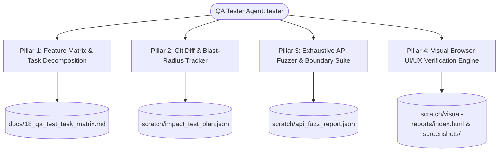

# 19. BOS QA Tester Agent Architecture & Full-Stack Verification Specification

> **Architectural Specification & Operational Manual for the Autonomous QA Tester Agent (`tester` / `qa-tester`)**

---

## 1. Executive Summary & Mission Statement

The **BOS QA Tester Agent** is an autonomous verification agent designed to guarantee the highest tier of enterprise reliability, security invariance, and UI/UX polish across the entire BOS ecosystem.

Unlike traditional static linters, the QA Tester agent executes active, dynamic verification across four primary operational pillars:
1. **Feature & Module Task Decomposition**: Systematically breaks down all compiler crates (`bosc-*`), runtime components, modular packages, and UI features into small, meaningful, prioritized testing tasks.
2. **Smart Git Change & Blast-Radius Tracking**: Analyzes codebase diffs and working tree modifications to determine exactly what changed and compute the blast radius of impacted systems.
3. **Exhaustive API Boundary & Input Fuzzing**: Exercises all HTTP API endpoints with every possible parameter and payload permutation (valid, empty, null, extreme numbers, 10k strings, unicode/emojis, SQLi/XSS injection, malformed UUIDs, missing security headers), enforcing a zero-crash, zero-500 panic policy.
4. **Visual Browser UI & UX Verification**: Drives real headless/interactive browser sessions (Google Chrome / Microsoft Edge via Playwright), capturing multi-viewport screenshots (Desktop, Tablet, Mobile), testing themes, responsiveness, and user feedback mechanisms.



---

## 2. Pillar 1: Feature & Module Task Decomposition

The QA Tester Agent inspects the entire codebase across four fundamental layers:
- **Compiler Layer (`bosc-syntax`, `bosc-analyzer`, `bosc-ir`):** AST parsing of all 12 meta-objects, non-invasive extensions (`tableextension`, `pageextension`), field validations (`validate(val)`), declarative state machines, FlowField formula cycle detection, and TypeScript type stripping.
- **Database & Codegen Layer (`bosc-codegen-db`):** PostgreSQL DDL compilation, Row-Level Security (RLS) policies, stored generated columns, SIFT pushdown views, and immutable ledger reversal triggers.
- **Core Runtime & Server Layer (`bosc-runtime`):** Axum 0.8 REST API router, connection pooling, Optimistic Concurrency Control (`_system_version`), table-level locks, transactional outbox queue, QuickJS sandboxed VM, wasmi 2.0 WebAssembly runner, and loopback sidecar microservice gateway.
- **Frontend Studio (`ui`):** Compact Svelte 5 runes (`$state`, `$derived`, `$effect`), responsive 3-column layout, multi-tenant security context drawer, 1-click endpoint presets, dynamic request/response inspectors, and light/dark theme contrast.

Each feature is broken down into small, meaningful tasks categorized by:
- `[UNIT]`: Pure function and AST unit verification.
- `[INTEGRATION]`: Multi-crate and database integration routines.
- `[API_CONTRACT]`: HTTP request/response envelope conformity.
- `[CONCURRENCY_OCC]`: Optimistic and pessimistic concurrency control invariants.
- `[SECURITY_RLS]`: Multi-tenant and multi-company data isolation.
- `[UI_INTERACTION]`: State changes, drawer navigation, preset execution.
- `[UX_VISUAL]`: Visual rendering, viewport adaptations, theme contrast.

All tasks are maintained in [`docs/18_qa_test_task_matrix.md`](file:///d:/Work%20Studio/Bos/docs/18_qa_test_task_matrix.md) and exported to `scratch/qa_task_matrix.json`.

---

## 3. Pillar 2: Smart Git Change & Blast-Radius Tracker

To avoid wasteful brute-force testing on minor updates, the QA Tester Agent implements an automated blast-radius detector (`scripts/test-agent/track_changes.mjs`):
1. **Diff Inspection:** Runs `git status --porcelain` and `git diff HEAD~1 HEAD` to isolate all modified files. If git is absent or clean, it scans recently modified files using file modification timestamps.
2. **Subsystem Mapping:** Maps every changed file to its parent subsystem:
   - `crates/bosc-syntax/*` -> Syntax & AST Grammar tasks
   - `crates/bosc-analyzer/*` -> Semantic Symbol & FlowField validation tasks
   - `crates/bosc-codegen-db/*` -> Database DDL & migration tasks
   - `crates/bosc-runtime/src/server.rs` -> Axum REST API endpoints
   - `crates/bosc-runtime/*` -> Runtime execution engine & sandbox tasks
   - `ui/src/App.svelte` -> Svelte 5 frontend & UX visual tasks
3. **Execution Plan Generation:** Emits a prioritized list of targeted test tasks (`scratch/impact_test_plan.json`), enabling rapid turnaround cycles.

---

## 4. Pillar 3: Exhaustive API Fuzzing & Boundary Testing

The QA Tester Agent systematically exercises all 52 registered Axum backend endpoints in `crates/bosc-runtime/src/server.rs`.

### 4.1. Input Permutation Matrix

For every endpoint, the agent executes up to 11 parameter permutations across 4 header contexts:

| Test Vector | Input Description | Expected Behavior |
| :--- | :--- | :--- |
| **`GOLDEN_PATH`** | Valid enterprise JSON payload with realistic relations | `200 OK` or `201 Created` |
| **`EMPTY_OBJECT`** | `{}` empty body | `400 Bad Request` or handled defaults |
| **`EMPTY_STRING_BODY`** | Empty request body (`""`) | `400 Bad Request` |
| **`MALFORMED_SYNTAX`** | Broken JSON syntax (`{"unclosed": "brace`) | `400 Bad Request` |
| **`TYPE_MISMATCH`** | Primitives replaced with arrays (`[1, 2, 3]`) or numbers (`12345`) | `400 Bad Request` / `422 Unprocessable` |
| **`EXTREME_NUMBERS`** | Overflows, negative amounts (`-9999999999`), zero limit (`0`), float `NaN` | `400 Bad Request` / Validation error |
| **`BOUNDARY_STRING_10K`**| 10,000-character payload strings | `400 Bad Request` (payload too large) or truncated |
| **`EMOJI_UNICODE`** | Multi-byte UTF-8, emojis (`🚀✨`), multilingual characters | Clean processing or validated UTF-8 rejection |
| **`SQLI_PAYLOAD`** | Injection syntax (`' OR 1=1 --`, `'; DROP TABLE ...`) | Handled via parameter binding; zero leakage |
| **`XSS_PAYLOAD`** | HTML/JS tags (`<script>alert(1)</script>`) | Sanitized in JSON envelope |
| **`PATH_TRAVERSAL`** | Directory traversal (`../../../../etc/passwd`) | `400 Bad Request` |
| **`MALFORMED_UUIDS`** | Invalid UUID string or nil UUID in headers/paths | `400 Bad Request` |

### 4.2. Invariants & Zero-Flaw Criteria
- **Zero Unhandled Panics (0 x 500 status):** The server MUST NEVER crash or return an unhandled 500 error on invalid or adversarial client input.
- **Uniform Error Envelope:** All error responses must adhere strictly to `{ "error": "description" }`.
- **Health Preservation:** The `/api/health` probe must continue returning 200 OK after full fuzz execution.

---

## 5. Pillar 4: Visual Browser UI & UX Verification

The QA Tester Agent drives real Google Chrome or Microsoft Edge browser sessions via Playwright (`scripts/test-agent/visual_browser_test.mjs`):

### 5.1. Viewport Matrix
- **Desktop High-DPI (1920x1080):** Verifies the full 3-column layout (Endpoints Catalog sidebar, Request Builder center, Response Inspector right).
- **Tablet / Laptop (1024x768):** Verifies fluid grid adaptation and responsive sidebar collapsibility.
- **Mobile Viewport (375x812 - iPhone X/12/13/14 format):** Verifies mobile navigation, stacked controls, and touch hit target compliance.

### 5.2. UX & Interaction Invariants
- **Dark / Light Theme Toggle:** Verifies contrast, legible typography, and correct background color transitions.
- **Context Drawer:** Tests opening, populating (`x-tenant-id`, `x-company-id`, `x-user-id`, roles), and closing the security drawer.
- **Preset Auto-Fill:** Verifies that selecting any preset immediately populates the HTTP method, path URL, and sample JSON body.
- **Execution & Feedback:** Verifies loading state spinners, response status badges (`200 OK`, `400 BAD REQUEST`), latency timers, and tab switching (`body`, `logs`, `headers`).
- **Error Toasts:** Asserts that invalid user actions display non-blocking, self-dismissing toast notifications.

### 5.3. Generated Visual Artifacts
All screenshots are persisted to `scratch/visual-reports/screenshots/`:
- `01_desktop_light.png`
- `02_desktop_dark.png`
- `03_context_drawer.png`
- `04_tablet_view.png`
- `05_mobile_view.png`

The comprehensive HTML Visual Audit Report is generated at [`scratch/visual-reports/index.html`](file:///d:/Work%20Studio/Bos/scratch/visual-reports/index.html).

---

## 6. Execution Command Reference

```powershell
# Run the entire testing suite (all 4 pillars)
pwsh scripts/test-agent/run_agent_tests.ps1 -Mode All

# Generate and update the Feature Test Matrix
pwsh scripts/test-agent/run_agent_tests.ps1 -Mode Matrix

# Analyze git diffs and generate targeted test plan
pwsh scripts/test-agent/run_agent_tests.ps1 -Mode Impact

# Execute exhaustive API parameter boundary and fuzzing suite
pwsh scripts/test-agent/run_agent_tests.ps1 -Mode ApiFuzz

# Run browser visual and UX verification suite
pwsh scripts/test-agent/run_agent_tests.ps1 -Mode Visual
```
