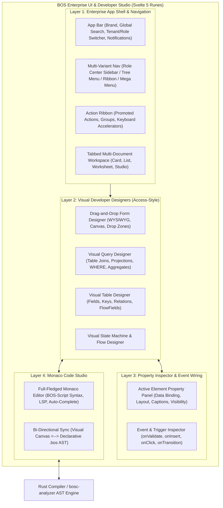
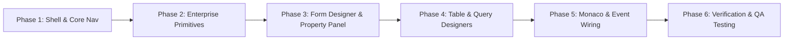

# BOS UI Core & Visual Studio: Enterprise Architecture & Execution Plan

**Document:** `docs/20_ui_core_and_visual_studio_architecture_plan.md`  
**Target Stack:** Svelte 5 (Runes: `$state`, `$derived`, `$props`, `$effect`), Tailwind CSS v4, `shadcn-svelte` (bits-ui), Monaco Editor, Lucide Icons, BOS Hybrid Engine.  
**Inspiration:** Microsoft Dynamics NAV / Business Central (Role Centers, Action Bar, FactBoxes, FastTabs, Subforms), Microsoft Access (Form Designer, Query Designer, Table Relationship Designer, Property Sheet), Modern VS Code (Monaco, Event Hookups).

---

## 1. Executive Vision & Architectural Overview

The BOS UI ecosystem is divided into two seamlessly integrated layers:
1. **Enterprise Runtime UI Shell & Component System:** The end-user operational surface (Role Centers, Documents, FastTabs, FactBoxes, Subforms, Action Bars, and High-Density Editable Grids).
2. **Visual Developer Studio (Low-Code / Pro-Code IDE):** An in-browser Microsoft Access + Dynamics NAV development environment featuring visual Drag-and-Drop Form Designer, Graphical Visual Query Builder, Visual Table & Relationship Designer, Contextual Property Inspector, and an integrated Monaco Code Editor for BOS-Script.



---

## 2. Component Plan 1: Enterprise App Shell & Navigation System

### 2.1 Component Specifications
- **Target Path:** `ui/src/lib/components/shell/`
- **Inspiration:** Dynamics 365 Business Central Role Center & Top Navigation, Salesforce Lightning App Header.
- **Sub-Components:**
  1. `AppShell.svelte`: Root orchestrator managing layout modes (Fluid, Contained, Compact/Dense, Presentation).
  2. `TopNavBar.svelte`: Company/Tenant selector badge, global search (`Ctrl+K`), quick create menu, notification bell with unread counter, theme toggle (Dark/Light/High Contrast), and user profile popover.
  3. `NavigationBar.svelte`: Multi-mode responsive menu:
     - **Mode A: Sidebar Drawer (Modern Enterprise):** Collapsible hierarchical tree navigation with pin/unpin state.
     - **Mode B: Top Ribbon Bar (Classic Dynamics NAV / Access):** Categorized tabbed action ribbon (Home, Actions, Reports, Navigate).
     - **Mode C: Command Palette / Spotlight (Keyboard-First):** Quick navigation jump with fuzzy search across all meta-objects.
  4. `WorkspaceTabs.svelte`: Multi-tab document manager allowing users to keep multiple open cards, lists, queries, and designer sessions alive with state preservation without DOM re-renders.
  5. `StatusBar.svelte`: Engine health, active database name (`bos_dev`), QuickJS fuel meter, network latency, and transactional status.

### 2.2 Svelte 5 Runes State Architecture
```typescript
// ui/src/lib/stores/shell.svelte.ts
export class ShellStore {
    theme = $state<'light' | 'dark'>('light');
    navMode = $state<'sidebar' | 'ribbon' | 'palette'>('sidebar');
    activeTenantId = $state<string>('');
    activeCompanyId = $state<string>('');
    activeDatabase = $state<string>('bos_dev');
    openTabs = $state<WorkspaceTab[]>([]);
    activeTabId = $state<string>('');
    isCompactDensity = $state<boolean>(true); // Enterprise high data density
    
    activeTab = $derived(this.openTabs.find(t => t.id === this.activeTabId));
}
```

---

## 3. Component Plan 2: Enterprise-Grade UI Component Library (NAV/BC Patterns)

We extend `shadcn-svelte` primitives (`bits-ui`) with custom business metadata hooks rather than building raw elements from scratch.

### 3.1 Catalog of Enterprise Primitives (`ui/src/lib/components/enterprise/`)

| Enterprise Element | NAV / BC / Salesforce Equivalent | Capabilities & Implementation |
| :--- | :--- | :--- |
| **`FastTab` & `FastTabGroup`** | Business Central FastTabs (General, Invoicing, Shipping) | Collapsible sections that display summary badges (Summary Cue) when collapsed (e.g. showing "Total: $1,250.00" even when closed). |
| **`FactBox` & `FactBoxArea`** | BC Right-Hand FactBox Panel | Contextual sidebar attached to cards/lists showing linked analytical cards, vendor statistics, attachment counters, and mini cues. |
| **`SubformGrid`** | Sales Order Lines Subform | High-density keyboard-navigable grid supporting tab navigation, inline cell editing, calculated FlowFields, delete row shortcut (`F8`/`Delete`), and instant recalculation. |
| **`CueCard` / `CueTile`** | Role Center KPI Tiles | Metric tiles showing real-time aggregations (e.g. "24 Open Orders"), colored status indicators (Favorable, Unfavorable, Warning), and click-to-filter drill-down. |
| **`LookupInput`** | Table Relation Lookup (Dropdown/Modal) | Form field with drill-down button (`...`), supporting search-as-you-type, quick record preview, and modal entity picker dialog. |
| **`DimensionTagPicker`** | Global & Shortcut Dimensions (Cost Center, Dept) | Multi-select structured taxonomy picker with rule validations against active G/L accounts. |
| **`StatusBadge` & `StatePipeline`** | State Machine Workflow Pipeline | Visual chevron pipeline or badge reflecting current document lifecycle state (Draft -> Pending Approval -> Approved -> Released -> Posted). |
| **`ActionBar` & `PromotedAction`** | NAV Action Pane | Categorized ribbon buttons with icons, shortcut tooltips, keyboard hotkeys, and conditional visibility based on record state. |

---

## 4. Component Plan 3: Drag-and-Drop Visual Form Designer (Access & NAV Page Designer)

### 4.1 Concept & Layout
- **Target Path:** `ui/src/lib/components/studio/form-designer/`
- **Visual Interface:**
  - **Left Sidebar:** Palette of UI Controls (Layout Containers, FastTabs, Input Fields, Grids, FactBoxes, Action Buttons, Charts).
  - **Center Canvas:** WYSIWYG Form Surface with live drop targets, grid alignment rulers, snap-to-grid, selection bounding boxes, and drag handles.
  - **Right Sidebar:** Contextual Property Panel & Event Inspector for the currently selected form element.

```
┌─────────────────┬──────────────────────────────────────────┬─────────────────┐
│ Tool Palette    │ WYSIWYG Form Canvas                      │ Property Panel  │
├─────────────────┼──────────────────────────────────────────┼─────────────────┤
│ [Containers]    │  ┌─────────────────────────────────────┐ │ [Selected:      │
│ ▫ FastTab Group │  │ FastTab: General Information        │ │  CustomerId]    │
│ ▫ 2-Col Grid    │  ├─────────────────────────────────────┤ │                 │
│ ▫ FactBox Part  │  │ [Customer ID*]    [Order Date]      │ │ Caption:        │
│ [Fields]        │  │ [Customer Name]   [Status Badge]    │ │ "Customer"      │
│ ▫ Text Box      │  └─────────────────────────────────────┘ │ Source Field:   │
│ ▫ Decimal / Curr│  ┌─────────────────────────────────────┐ │ SalesHeader.    │
│ ▫ Date Picker   │  │ Subform: Sales Lines (Grid)         │ │   customerId    │
│ ▫ Lookup Drop   │  │ [Item No] [Qty] [Unit Price] [Total]│ │ Editable:       │
│ [Actions]       │  └─────────────────────────────────────┘ │ true            │
│ ▫ Button / Post │                                          │ [Events...]     │
└─────────────────┴──────────────────────────────────────────┴─────────────────┘
```

### 4.2 Core Features & State Machine
1. **Interactive Tree Structure:** Every element is an AST node (`FormNode`):
   - ID, Type (`group`, `field`, `subform`, `factbox`, `action`), Props, Children, and DataBinding.
2. **Drag & Drop Engine:** Implemented using native HTML5 Drag and Drop or modern pointer events with responsive drop indicators (before, inside, after).
3. **Dual-Directional Sync:** Changes made visually in the designer immediately re-generate declarative BOS Script page AST:
   ```typescript
   page SalesOrderCard for SalesHeader { ... }
   ```
   Likewise, editing the code immediately re-renders the visual canvas.

---

## 5. Component Plan 4: Visual Query Designer (Access Query Builder)

### 5.1 Concept & Layout
- **Target Path:** `ui/src/lib/components/studio/query-designer/`
- **Inspiration:** Microsoft Access Visual Query By Example (QBE) & SQL Server Management Studio Query Designer.
- **Visual Interface:**
  - **Top Canvas (Relationship Diagram):** Draggable entity boxes showing table field lists, with visual SVG relationship join lines connecting keys (e.g. `SalesHeader.id` connected to `SalesLine.documentId`).
  - **Middle Grid (Field Selection & Projection):** Access-style tabular grid:
    - Row 1: Field Name
    - Row 2: Table Name
    - Row 3: Alias / Caption
    - Row 4: Aggregate Function (`None`, `Sum`, `Count`, `Avg`, `Min`, `Max`)
    - Row 5: Sort (`Ascending`, `Descending`, `None`)
    - Row 6: Visible / Output checkbox
    - Row 7: Filter / Criteria (e.g. `> 1000 AND status == 'Approved'`)
  - **Bottom Panel:** Instant Live Data Preview + Generated SQL / BOS Query preview.

---

## 6. Component Plan 5: Visual Table & Schema Designer (Access Table Designer)

### 6.1 Concept & Layout
- **Target Path:** `ui/src/lib/components/studio/table-designer/`
- **Visual Interface:**
  - **Upper Table Grid:**
    - Column 1: Field Name (`snake_case` or `camelCase`)
    - Column 2: Data Type (`UUID`, `String(N)`, `Decimal(P,S)`, `Integer`, `Boolean`, `Date`, `DateTime`, `Enum`, `FlowField`)
    - Column 3: Primary Key indicator (Key icon)
    - Column 4: Nullable / Not Null toggle
    - Column 5: Default Value expression
    - Column 6: Description / Caption
  - **Lower Tabbed Property Inspector (Access Style):**
    - **General Tab:** Length, Precision, Scale, Auto-Increment.
    - **Validation Tab:** Min/Max constraints, Regex rule, custom validation error message.
    - **Lookup & Relation Tab:** Foreign Table, Foreign Key, Cascading behavior (`Cascade`, `Restrict`, `SetNull`).
    - **FlowField Calculation Tab:** Method (`Sum`, `Count`), Target Table, Target Field, Filter Predicate.

---

## 7. Component Plan 6: Unified Property Panel & Event Wiring Inspector

### 7.1 Concept & Layout
- **Target Path:** `ui/src/lib/components/studio/property-panel/`
- **Role:** Centralized contextual inspector docked on the right side of any active designer (Form, Query, Table, or State Machine).
- **Structure:**
  - **Tab 1: Properties (`General`, `Data`, `Layout`, `Appearance`):**
    - Dynamic form generator bound to the schema of the active element.
    - Two-way binding: modifying a caption or width immediately updates the canvas and the underlying AST.
  - **Tab 2: Events & Triggers (`Events`):**
    - Displays all lifecycle hooks available for the selected element:
      - For Page Field: `onValidate(val)`, `onLookup()`, `onAssistEdit()`
      - For Page Action: `onExecute(rec)`
      - For Table Field: `validate field(val)` in `tablelogic`
      - For Table Record: `onInsert()`, `onModify()`, `onDelete()` in `tablelogic`
    - **"View / Edit Code" Button (`...`):** Clicking an event jumps directly to the exact function in the Monaco Code Editor or creates a boilerplate stub if it does not exist yet.

---

## 8. Component Plan 7: Modern Monaco Code Studio with Bi-Directional Sync

### 8.1 Concept & Architecture
- **Target Path:** `ui/src/lib/components/studio/code-editor/`
- **Features:**
  1. Full **Monaco Editor** integration with dark and light theme synchronization.
  2. Custom BOS-Script Language Definition (Keywords: `table`, `page`, `codeunit`, `statemachine`, `query`, `validate`, `FlowField`, `FlowFilter`).
  3. Auto-completion, hover tooltips, and real-time syntax diagnostic markers powered by `bosc-analyzer` via backend API or compiled WASM.
  4. Event Stubs Insertion: When an event is wired from the Property Panel, Monaco automatically scrolls to and focuses the event function handler.
  5. Split-View / Toggle Mode: Switch smoothly between Visual Designer, Monaco Code Editor, and Side-by-Side Live Synchronized View.

---

## 9. Phased Implementation Roadmap



| Phase | Deliverables | Verification Milestone |
| :--- | :--- | :--- |
| **Phase 1: App Shell & Navigation** | `AppShell`, `TopNavBar`, `SidebarMenu`, `WorkspaceTabs`, `StatusBar`, Shell Store (Svelte 5 Runes). | Responsive layout on Desktop/Tablet/Mobile; tabs preserve state. |
| **Phase 2: Enterprise Elements** | `FastTab`, `FactBoxArea`, `SubformGrid`, `CueTile`, `LookupInput`, `ActionBar`, `StatusBadge` extending `shadcn-svelte`. | Interactive demonstration page rendering a full Sales Order document with live recalculations. |
| **Phase 3: Drag & Drop Form Designer** | Canvas, component palette, drop zones, selection handles, contextual `PropertyPanel`. | Visual drag-and-drop construction of a form with instant property edits. |
| **Phase 4: Table & Query Designers** | Access-style Visual Table Designer with FlowField wizard, Visual Query Join Designer with SVG connectors. | Designing a 2-table joined query with aggregation previewing live data. |
| **Phase 5: Monaco Editor & Event Wiring** | Monaco BOS-Script integration, syntax highlighting, diagnostics, bi-directional AST sync, and event jumping. | Clicking `onValidate` in Property Panel jumps to and highlights code in Monaco. |
| **Phase 6: Verification & Hardening** | Full end-to-end Playwright tests, zero-mock audit via `detector`, accessibility audit, documentation updates. | Clean `detector` pass and test suite verification. |

---

## 10. bos-ui control kit (Dev Studio)

Dev Studio controls live in `ui/src/lib/bos-ui` and are themed by `theme/surface.js`.

Behavior that needs focus management, overlays, or listbox keyboarding comes from **bits-ui**, styled in the shadcn-svelte way (source we own, not a second theme). Presentational pieces and the two product surfaces (field grid, object tree) are written in bos-ui and embed Input, Combobox, and DatePicker as cell editors.

| Component | Base | Dev Studio use |
| :--- | :--- | :--- |
| Button, Badge, Field, Textarea, Banner, Kbd, Spinner, EmptyState, Toolbar, StatusBar | bos-ui | Toolbars, property sheets, compile feedback, status |
| Checkbox, Switch, Select, Tabs, Tooltip, Dialog, ConfirmDialog, ContextMenu, CommandPalette | bits-ui | Property toggles, view switchers, document tabs, wizards, object menu, Ctrl+K |
| Toast | bos-ui queue with `aria-live` | Replaces browser alerts |
| SplitPane | bos-ui pointer separator | Available for resizable regions. Studio navigation uses a fixed width. |
| Tree | bos-ui, windowed rows | Object catalog |
| DataGrid | bos-ui, windowed rows, keyboard | Available for uniform sheets. The table field grid and query matrix stay custom layouts and embed Input, Select, and Checkbox so primary-key toggles, row reorder, and the Access QBE row shape stay intact. The live datasheet edits through Input. |
| DataTable | `@tanstack/svelte-table` plus bos-ui chrome | List pages: search, filters, sort, group, page, select, pin, resize, totals, export, and cell editors. Datasheet editing stays on DataGrid. |

