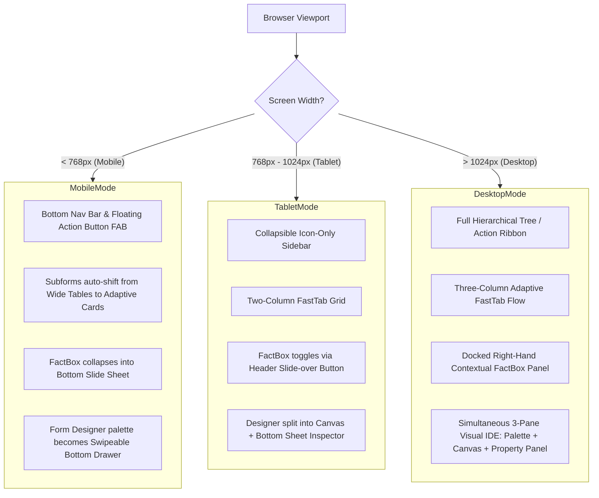

# BOS Custom Enterprise UI & Mobile-First UX Specification

**Document:** `docs/21_bos_custom_enterprise_ui_and_mobile_first_ux_spec.md`  
**Vision:** Beyond Legacy Enterprise Software (Dynamics NAV/BC, SAP, Salesforce) — Bespoke, Next-Generation Ergonomics Tailor-Made for the BOS Ecosystem.  
**Frontend Stack:** Svelte 5 (Runes: `$state`, `$derived`, `$props`, `$effect`), Tailwind CSS v4, Bits UI (`shadcn-svelte` primitives), Lucide Icons.  

---

## 1. Executive Philosophy: Inspiration Without Mimicry

While legacy platforms like Microsoft Dynamics NAV/BC, SAP Fiori, and Microsoft Access introduced powerful paradigms (FastTabs, FactBoxes, QBE Grids, Subforms), their visual executions suffer from significant shortcomings:
- **Desktop-locked desktop rigidity:** Desktop-first tables with endless horizontal scrollbars that break on tablet or mobile screens.
- **Cluttered cognitive overload:** Dense menus with 200+ unorganized actions, complex modal popups, and nested ribbons.
- **Outdated aesthetics:** Flat corporate styling lacking fluid transitions, touch ergonomics, micro-interactions, and accessible high-contrast adaptability.

**The BOS Standard:**
We extract the core underlying enterprise capabilities (instant calculated fields, contextual insights, high-speed multi-line data entry, visual schema and query design), and reimagine them into a **sleek, mobile-first, auto-layout shifting responsive design system**.

```
┌──────────────────────────────────────────────────────────────────────────────────┐
│                   BOS BESPOKE UI/UX DESIGN PILLARS                               │
├──────────────────────────────┬───────────────────────────┬───────────────────────┤
│ 1. Mobile-First Fluidity     │ 2. Contextual Insight     │ 3. Keyboard Velocity  │
│  - Adaptive Layout Shifting  │  - Floating Action Sheets │  - Omnipresent Cmd-K  │
│  - Card/Table morphing       │  - Sliding FactBox Drawers│  - Inline Cell Jumps  │
│  - Touch-friendly hit targets│  - Multi-variant Viewport │  - Dual Pro/Low-Code  │
└──────────────────────────────┴───────────────────────────┴───────────────────────┘
```

---

## 2. Adaptive Responsive Architecture: Viewport Matrix

BOS implements a 4-tier responsive layout matrix that auto-shifts layouts without reloading or sacrificing functionality:



---

## 3. Core Enterprise UI Component Innovations

### 3.1 Adaptive FastTab (`ui/src/lib/components/enterprise/AdaptiveFastTab.svelte`)
- **Desktop:** Multi-column grid (2 to 4 columns depending on density), smooth accordion collapse, and summary pill badges (e.g. `Customer: Tesla | Date: 12 Oct 2026`).
- **Mobile/Tablet:** Automatically collapses into a single-column thumb-friendly flow. Floating quick-jump anchors at top of document for instant one-tap scrolling to any section.

### 3.2 Polymorphic Subform (`ui/src/lib/components/enterprise/AdaptiveSubform.svelte`)
- **Desktop (>1024px):** High-density keyboard-navigable spreadsheet table with tab-to-next-cell, inline calculations, and delete shortcuts.
- **Mobile (<768px):** Automatically transforms from a horizontally scrolling wide table into **compact interactive cards**:
  - Each line item renders as an expandable card displaying Item Code, Description, Quantity Stepper (`-` / `+`), and total amount.
  - Adding a line pops a lightweight, bottom-anchored modal sheet with auto-focused search.

### 3.3 Context FactBox: Docked Sidebar vs Floating Sheet
- **Desktop:** Pinned right-hand analytical sidecar (280px-320px) showing real-time ledger summaries, credit health gauges, and document cues.
- **Mobile/Tablet:** Replaced with a header badge (`3 Cues | FactBox`) that opens an accessible, gesture-dismissible **Bottom Sheet (Slide-over)** with full touch drag support.

### 3.4 Responsive Action Bar & Floating Action Button (FAB)
- **Desktop:** Categorized ribbon or clean toolbar with keyboard accelerators (`Alt+P`, `Ctrl+S`).
- **Mobile:** Primary workflow action (e.g. *Post & Send*) promoted to a thumb-accessible **Sticky Bottom Bar** or **Floating Action Button (FAB)**, with secondary actions grouped in a quick bottom menu (`...`).

---

## 4. Visual Developer Studio: Responsive Touch & Pointer Canvas

Legacy tools like MS Access or NAV Form Designers were built strictly for desktop mouse cursors and large monitors. The BOS Visual Studio is tailored for modern touch, trackpad, and responsive screens:

### 4.1 WYSIWYG Form Designer
- **Desktop:** 3-Pane workspace (Palette on Left, Drag Canvas in Center, Property Panel on Right).
- **Mobile / Tablet Auto-Shift:**
  - Canvas takes full screen with live zoom/pan.
  - **Toolbox:** Toggled as an off-canvas drawer or expandable bottom shelf.
  - **Property Inspector:** Slides in as a bottom sheet whenever an element is tapped, allowing fast on-the-go configuration and property edits from an iPad or phone.
  - **Device Viewport Switcher:** One-click preview toggle on canvas header: `[Mobile 375px]` | `[Tablet 768px]` | `[Desktop 1920px]` | `[Fluid 100%]`.

### 4.2 Visual Query Designer (Access QBE Reimagined)
- **Desktop:** Diagram canvas with draggable table nodes and SVG join lines, plus bottom tabular QBE grid.
- **Small Screens Auto-Shift:**
  - Switches to a segmented **Query Pipeline Builder** (Tables -> Joins -> Fields -> Aggregations -> Filters), avoiding cramped diagram layouts while preserving 100% of query logic.

### 4.3 Visual Table & FlowField Designer
- **Desktop:** Schema grid with a right-docked property sheet. A Group selector lists every property and event, or one group at a time (General, Relation, FlowField, Events).
- **Small Screens Auto-Shift:**
  - Card-based field list with swipe-to-delete, tap-to-configure, and a dedicated **FlowField Calculation Wizard** modal.

---

## 5. Implementation & Verification Deliverables

1. **`ui/src/lib/components/shell/`**:
   - `AppShell.svelte`: Mobile bottom nav bar on `<md`, top app bar on `>=md`.
   - `SidebarMenu.svelte`: Responsive slide-in overlay drawer for mobile with backdrop blur.
2. **`ui/src/lib/components/enterprise/`**:
   - `FastTabCardDemo.svelte`: Responsive layout shifting between spreadsheet table and mobile line cards, with mobile bottom sheet FactBox.
3. **`ui/src/lib/components/studio/form-designer/`**:
   - Responsive multi-device canvas with viewport sizing simulator (`Mobile`, `Tablet`, `Desktop`).
   - Drawer-based Property Panel and Palette on small viewports.
4. **Verification**:
   - Tested across viewports: Mobile (375x812), Tablet (768x1024), and Desktop (1920x1080) with clean builds.
