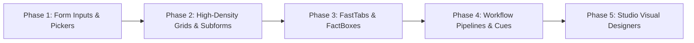

# BOS Enterprise UI Component & Element Taxonomy

**Document:** `docs/22_bos_complete_ui_element_taxonomy_and_shadcn_mapping.md`  
**Architectural Scope:** Comprehensive inventory of all UI elements required by the BOS Enterprise Platform, mapping each custom element to `shadcn-svelte` primitives (`bits-ui`), and contrasting with market leaders (Microsoft Dynamics NAV/BC AL, SAP Fiori, Salesforce Lightning SLDS).  
**Technology Stack:** Svelte 5 (Runes: `$state`, `$derived`, `$props`), Tailwind CSS v4, `bits-ui` / `shadcn-svelte`, Lucide Icons.

---

## 1. Executive Summary: The Extended `shadcn-svelte` Philosophy

Rather than reinventing primitive accessibility (focus rings, WAI-ARIA roles, keyboard focus traps, portal overlays), BOS builds on top of **`shadcn-svelte`** (powered by **`bits-ui`**). However, standard web component libraries lack enterprise transaction ergonomics (calculated FlowFields, multi-dimensional ledger tagging, two-phase posting ribbons, relation lookups with live credit inspection, subform line auto-summing, and visual developer designers).

BOS wraps and extends `shadcn-svelte` primitives into **8 First-Class Enterprise Tiers** comprising **48 Tailor-Made Elements**.

---

## 2. Comprehensive 8-Tier UI Element Inventory & Mapping Matrix

```
┌──────────────────────────────────────────────────────────────────────────────────────────────────┐
│                             BOS ENTERPRISE UI TAXONOMY TIERS                                     │
├────────────────────────────┬─────────────────────────────┬───────────────────────────────────────┤
│ Tier 1: App Shell & Chrome │ Tier 2: Navigation & Menus  │ Tier 3: Enterprise Form Inputs        │
│ Tier 4: Grids & Subforms   │ Tier 5: Containers & Layout │ Tier 6: Action Panes & Pipelines      │
│ Tier 7: Analytics & Cues   │ Tier 8: Developer Studio    │                                       │
└────────────────────────────┴─────────────────────────────┴───────────────────────────────────────┘
```

---

### Tier 1: Application Shell & Global Chrome

| BOS UI Element | Market Leader Equivalent | Underlying `shadcn-svelte` / `bits-ui` Primitive | BOS Bespoke Capability |
| :--- | :--- | :--- | :--- |
| **`AppShell`** | Fiori Launchpad Shell / BC Web Client Shell | Custom Layout (`Paneforge` / `Resizable`) | Responsive multi-breakpoint frame; auto-shifts sidebar to bottom bar on mobile. |
| **`TopNavBar`** | BC Company/Tenant Header, Salesforce Global Header | `NavigationMenu`, `Popover`, `Avatar` | Multi-tenant & Company switcher pill, active DB status (`bos_dev`), quick create action, theme toggle. |
| **`GlobalCommandPalette`** | BC "Tell Me" (`Alt+Q`), Slack `Cmd+K` | `Command` (`cmdk-svelte`), `Dialog` | Omnipresent spotlight search indexing all 14 BOS meta-objects, actions, recent records, and help topics. |
| **`WorkspaceTabStrip`** | MS Access Multi-Tab Document Bar, NAV MDI Tabs | `Tabs` (`bits-ui/tabs`) | Document tab manager caching multiple open cards, lists, queries, and designer sessions with dirty markers (`*`). |
| **`SystemStatusBar`** | VS Code Status Bar, Access Status Bar | `Tooltip`, `Badge` | Real-time PostgreSQL pool health, QuickJS fuel quota meter (`100,000/100,000`), network latency, and OCC conflict indicators. |

---

### Tier 2: Navigation Taxonomy & Menu Systems

| BOS UI Element | Market Leader Equivalent | Underlying `shadcn-svelte` / `bits-ui` Primitive | BOS Bespoke Capability |
| :--- | :--- | :--- | :--- |
| **`HierarchicalTreeNav`** | BC Departments / NAV MenuSuite Tree | `Collapsible`, `Accordion`, `Tooltip` | Role-tailored collapsible module tree with badge counters, favorites pinning, and search filtering. |
| **`ActionRibbonMenu`** | Dynamics NAV Action Ribbon, Access Ribbon | `Menubar`, `DropdownMenu` | Categorized ribbon tabs (Home, Actions, Navigate, Reports) with promoted action buttons and hotkey tooltips. |
| **`SlideOverDrawerNav`** | Salesforce Mobile Drawer, SAP Fiori Side Navigation | `Sheet` (`bits-ui/sheet`) | Mobile-first slide-over navigation with swipe-to-dismiss and backdrop blur. |
| **`BreadcrumbTracker`** | SLDS Breadcrumbs, Fiori Shell Path | `Breadcrumb` | Interactive path trail reflecting tenant > company > module > document > line subform. |
| **`RoleCenterSwitcher`** | BC Role Center Persona Dropdown | `Select`, `DropdownMenu` | Instant persona switching (Accountant, Sales Manager, Warehouse Clerk, System Admin) tailoring page layouts. |

---

### Tier 3: Enterprise Form Inputs & Pickers `[STATUS: IMPLEMENTED & VERIFIED IN UI LAB]`

Located under [`ui/src/lib/components/enterprise/inputs/`](file:///d:/Work%20Studio/Bos/ui/src/lib/components/enterprise/inputs/) and calibrated live in [`ComponentShowcaseApp.svelte`](file:///d:/Work%20Studio/Bos/ui/src/showcase/ComponentShowcaseApp.svelte).

| BOS UI Element | Market Leader Equivalent | Underlying `shadcn-svelte` / `bits-ui` Primitive | BOS Bespoke Capability | Component Path |
| **`Input`** (`bos-ui`) | Salesforce `lightning-input`, SAP `sap.m.Input`, shadcn `InputGroup` | Extended `Input` (`bits-ui`) | Polymorphic input with auto-inferred leading/trailing icons, clear button (`X`), password reveal toggle, number steppers (`+/-`), copy-to-clipboard, loading spinner, status tokens (error, warning, success, info), auto-uppercase codes, character counter, **safe Shunting-Yard in-field math evaluation (`evalMath`, e.g. `120 * 1.15 = 138`)**, **sensitive financial/identity masking (`masked`, `maskType` for credit cards, SSN, IBAN, tokens) with unmask toggle and raw-value clipboard copying**, **live pattern masking (`pattern="(###) ###-####"`, `pattern="##-#######"`)**, **Dynamics NAV / BC `F8` copy-above cell duplication (`onCopyAbove`)**, and **automatic global `themeStore` personalization cascade (density, variant, rounded)**. | [`Input.svelte`](file:///d:/Work%20Studio/Bos/ui/src/lib/bos-ui/input/Input.svelte) |
| **`CurrencyAmountInput`** | BC Decimal / Amount with Currency Code | `Input`, `Select` | Formats currency on blur (`$42,850.50`), enforces decimal precision `(18,2)`, supports math calculations in-field (`100*1.18`). | [`CurrencyAmountInput.svelte`](file:///d:/Work%20Studio/Bos/ui/src/lib/components/enterprise/inputs/CurrencyAmountInput.svelte) |
| **`Combobox`** (`bos-ui`) | BC Table Relation Lookup (`...`), Salesforce Lookup, SAP `sap.m.ComboBox` | `Popover`, `Command` (`bits-ui`) | High-density multi-column table relation lookup with omni-column search-as-you-type, multi-select token chip badges (`multiple`), sortable column headers (`sortable`), sticky category grouping (`groupBy`), recent selections memory (`persistRecentKey`), remote async data streaming (`fetchItems`), keyboard navigation (`F4`, `↑↓`, `Enter`), live FactBox preview card, `+ New <Entity>` quick create action, "Select from full list", and **automatic global `themeStore` personalization cascade (density, variant, rounded, status)**. | [`Combobox.svelte`](file:///d:/Work%20Studio/Bos/ui/src/lib/bos-ui/combobox/Combobox.svelte) |
| **`DatePicker`** (`bos-ui`) | Dynamics Business Central Date Formula / Posting Date, SAP `DatePicker` | `Popover` (`bits-ui`), Custom Calendar Grid | Dynamics BC-inspired enterprise date & date range picker with built-in Business Central date formula engine (`t`, `cm`, `-cm`, `cm+10d`, `cq`, `cy`), quick accounting presets sidebar (Today, Yesterday, This Week, MTD, Full Month, QTD, YTD, Full Fiscal Year), closing date adjustment toggle (`C123126`), closed fiscal period locking, embedded 15-minute time selection (`showTime`), calculation badge indicator, and **automatic global `themeStore` personalization cascade (density, variant, rounded, status)**. | [`DatePicker.svelte`](file:///d:/Work%20Studio/Bos/ui/src/lib/bos-ui/date-picker/DatePicker.svelte) |
| **`themeStore`** (`bos-ui`) | Dynamics BC User Personalization / SAP Theme Designer | Svelte 5 Runes Class Store | Single personalization setting persisted to `localStorage` under `bos_user_preference`. Governs density (`sm` / `md` / `lg`), surface variant (`outline`, `filled`, `underline`, `ghost`), corner radius (`none`, `sm`, `md`, `pill`), color theme, and work date. Every `bos-ui` control reads those choices through one class file, [`surface.js`](file:///d:/Work%20Studio/Bos/ui/src/lib/bos-ui/theme/surface.js). | [`themeStore.svelte.js`](file:///d:/Work%20Studio/Bos/ui/src/lib/bos-ui/theme/themeStore.svelte.js) |
| **`DimensionSetTagPicker`** | Dynamics BC Analytical Dimensions, SAP Cost Centers | `Badge`, `Input`, `Popover` | Multi-tag taxonomy picker enforcing valid dimension combinations with accounting validation rules. | [`DimensionSetTagPicker.svelte`](file:///d:/Work%20Studio/Bos/ui/src/lib/components/enterprise/inputs/DimensionSetTagPicker.svelte) |
| **`QuantityStepper`** | Mobile Touch Stepper | `Button`, `Input` | Large touch targets (`-` / `+`) with integer/fractional step support and minimum threshold locks. | [`QuantityStepper.svelte`](file:///d:/Work%20Studio/Bos/ui/src/lib/components/enterprise/inputs/QuantityStepper.svelte) |
| **`SequentialNumberSeriesField`** | BC No. Series Assistant (`AssistEdit`) | `Input`, `Button`, `Tooltip` | Readonly or assist-editable field linked to number series generation with manual override guard. | [`SequentialNumberSeriesField.svelte`](file:///d:/Work%20Studio/Bos/ui/src/lib/components/enterprise/inputs/SequentialNumberSeriesField.svelte) |
| **`EnumSegmentedRadio`** | SLDS Radio Group, Fiori Segmented Button | `RadioGroup`, `ToggleGroup` | High-density status option selector with semantic colors (Draft, Active, Blocked). | [`EnumSegmentedRadio.svelte`](file:///d:/Work%20Studio/Bos/ui/src/lib/components/enterprise/inputs/EnumSegmentedRadio.svelte) |
| **`FlowFieldExpressionInput`** | BC CalcFields / Virtual Subquery | `Input`, `Code` | Visual expression editor displaying calculated subqueries with a recalculate trigger icon (`RefreshCw`). | [`FlowFieldExpressionInput.svelte`](file:///d:/Work%20Studio/Bos/ui/src/lib/components/enterprise/inputs/FlowFieldExpressionInput.svelte) |
| **`MaskedSecureField`** | Salesforce Encrypted Text Field | `Input`, `Button` | Field-level masking with contextual permission-based unmask toggle. | [`MaskedSecureField.svelte`](file:///d:/Work%20Studio/Bos/ui/src/lib/components/enterprise/inputs/MaskedSecureField.svelte) |
| **`FileAttachmentUploader`** | SAP Upload Collection, SLDS File Upload | `Progress`, `Button`, `Card` | Drag-and-drop document attachment widget with MIME validation, file size cap, and inline PDF/image preview. | [`FileAttachmentUploader.svelte`](file:///d:/Work%20Studio/Bos/ui/src/lib/components/enterprise/inputs/FileAttachmentUploader.svelte) |

---

### Tier 4: Data Grids, Subforms & Repeaters

| BOS UI Element | Market Leader Equivalent | Underlying `shadcn-svelte` / `bits-ui` Primitive | BOS Bespoke Capability |
| :--- | :--- | :--- | :--- |
| **`DataTable`** | BC List Page Grid, Salesforce Datatable | TanStack Table v9 (`@tanstack/svelte-table`) | Headless sorting, multi-sort, global search, column filters (`>100`, `10..20`), grouping, pagination, row selection, column visibility, order, resize, start/end pinning, row pinning, expand, aggregation footer, and CSV export. Cells use bos-ui Input, Select, Checkbox, Switch, DatePicker, Combobox, Badge, and snippets. Keyboard: arrows, Enter, F8 copy-above. |
| **`PolymorphicSubform`** | BC Document Lines (`ListPart`), SAP Worklist | `Table` + `Card` + `Sheet` | **Auto Layout Shifting**: Renders as a compact multi-line spreadsheet on desktop, and morphs into **touch cards** on mobile. |
| **`TreeDataGrid`** | SAP Tree Table, BC Chart of Accounts Hierarchy | `Table`, `Collapsible` | Multi-level indented hierarchical tree grid with collapsible branch nodes and aggregate balance roll-ups. |
| **`FilterBar`** | BC Page Filter Pane (`Shift+F3`), SAP Smart Filter | `Popover`, `Input`, `Select`, `Badge` | Multi-field filter builder supporting wildcard expressions (`..`, `*`, `>1000`, `Draft|Approved`) without SQL knowledge. |
| **`DataGridTotalsBar`** | BC Subform Statistics Footer | `TableFooter` | Sticky bottom summary row displaying real-time column sums, record counts, and VAT/tax breakdowns. |

---

### Tier 5: Containers, Cards & Layouts

| BOS UI Element | Market Leader Equivalent | Underlying `shadcn-svelte` / `bits-ui` Primitive | BOS Bespoke Capability |
| :--- | :--- | :--- | :--- |
| **`AdaptiveFastTab`** | Dynamics Business Central FastTabs | `Accordion`, `Card`, `Badge` | Collapsible section with **Summary Cue Pills** when collapsed, maintaining executive visibility without opening. |
| **`ContextFactBoxPanel`** | BC Right-Hand FactBox Area | `Card`, `ScrollArea` (Desktop) / `Sheet` (Mobile) | Right-hand analytical sidecar pinned on desktop; slides in as an off-canvas drawer on tablets and mobile screens. |
| **`EntityHeroHeader`** | Salesforce Highlights Panel, SAP Object Header | `Card`, `Avatar`, `Badge` | Prominent document summary header displaying Key ID, Customer Name, Status Badge, and Primary Action Bar. |
| **`SplitPaneLayout`** | Fiori Flexible Column Layout | `Resizable` (`paneforge`) | Master-Detail dual-pane allowing users to browse list records on the left while editing cards on the right. |

---

### Tier 6: Action Panes, Workflows & Pipelines

| BOS UI Element | Market Leader Equivalent | Underlying `shadcn-svelte` / `bits-ui` Primitive | BOS Bespoke Capability |
| :--- | :--- | :--- | :--- |
| **`StateMachinePipeline`** | Salesforce Path / Business Process Chevron | Custom SVG / `ToggleGroup` | Visual chevron progression bar indicating lifecycle phases (`Draft` $\rightarrow$ `Pending` $\rightarrow$ `Approved` $\rightarrow$ `Released` $\rightarrow$ `Posted`). |
| **`PromotedActionBar`** | BC Promoted Actions, NAV Action Pane | `Button`, `DropdownMenu` | Promoted primary ribbon buttons with hotkey labels and responsive dropdown grouping. |
| **`FloatingActionButtonBar`** | Modern Mobile ERP FAB | `Button`, `Sheet` | Mobile-only thumb-accessible floating action bar pinning the primary document mutation (*Post & Send*). |
| **`ApprovalAuditTimeline`** | SAP Timeline, Salesforce Activity Timeline | Custom Feed with `Badge` | Vertical audit feed tracking approvals, rejections, comments, and ledger posting timestamps. |
| **`BatchActionToolbar`** | Google Workspace / Salesforce Multi-Select Bar | `Card`, `Button`, `Badge` | Floating selection toolbar that surfaces when 2+ table rows are checked, enabling mass approval or export. |

---

### Tier 7: Analytics, KPI Cues & System Feedback

| BOS UI Element | Market Leader Equivalent | Underlying `shadcn-svelte` / `bits-ui` Primitive | BOS Bespoke Capability |
| :--- | :--- | :--- | :--- |
| **`MetricCueTile`** | BC Role Center Cue Tiles | `Card`, `Badge` | Interactive KPI tile displaying aggregated count/amount with threshold coloring (Favorable, Warning, Critical) and drilldown click. |
| **`MicroSparklineCard`** | Fiori Micro Charts | LayerChart / SVG Sparkline | Mini trendline embedded inside cards or table rows illustrating 30-day balance fluctuations. |
| **`ContextualToast`** | Sonner, BC `Notification.Send()` | `Sonner` (`bits-ui/toast`) | Non-blocking floating notification with action links (e.g. *Undo Posting*, *View Ledger Entry*). |
| **`SystemAlertBanner`** | SLDS Scoped Notification, SAP Message Strip | `Alert` | Non-modal alert card docked to top of page (e.g. "Customer credit limit exceeded by $4,280.00"). |
| **`ProgressFuelMeter`** | QuickJS / WebAssembly Execution Meter | `Progress` | Visual gauge reflecting runtime fuel quota consumption (100k cap) to prevent runaway scripts. |

---

### Tier 8: Visual Developer Studio (MS Access & NAV IDE)

| BOS UI Element | Market Leader Equivalent | Underlying `shadcn-svelte` / `bits-ui` Primitive | BOS Bespoke Capability |
| :--- | :--- | :--- | :--- |
| **`WysiwygFormCanvas`** | MS Access Form Designer, NAV Page Designer | Custom HTML5 DnD + `Resizable` | Visual canvas with snap-to-grid, drop zones, selection bounding handles, and multi-device viewport simulator (`Phone`, `Tablet`, `Desktop`). |
| **`ControlToolboxPalette`** | Access Control Toolbox, Visual Studio Toolbox | `Card`, `Button`, `ScrollArea` | Draggable/clickable palette of all BOS layout and field elements. |
| **`ContextualPropertyInspector`**| MS Access Property Sheet, VS Property Window | `Select`, `Input`, `Checkbox`, `Switch` | Group selector for property groups or the event group of the active canvas selection. |
| **`VisualQueryDiagram`** | MS Access Query By Example (QBE), SSMS Query Builder | Custom SVG Bezier Curves + `Card` | Draggable entity boxes with SVG join lines connecting primary and foreign keys. |
| **`QbeGrid`** | MS Access Query Design Grid | `Table`, `Select`, `Input` | Access-style tabular query builder (Field, Table, Total/Aggregate, Sort, Show, Criteria). |
| **`TableSchemaDesigner`** | MS Access Table Design View | `Table`, `Select` | Schema grid plus a right-docked field property sheet (Group selector, FlowField Calculation Wizard). |
| **`MonacoCodeStudio`** | VS Code / AL Extension Editor | Monaco Editor Component | Full-screen or split-pane editor with BOS-Script LSP, auto-completion, and syntax diagnostics. |

---

## 3. Recommended Phased Implementation Schedule



1. **Phase 1: Enterprise Inputs & Pickers** (`CurrencyAmountInput`, `RelationLookupPicker`, `DimensionSetTagPicker`, `EnterpriseDatePicker`, `SequentialNumberSeriesField`).
2. **Phase 2: High-Density Grids & Subforms** (`HighDensityDataGrid`, `PolymorphicSubform`, `FilterBar`, `DataGridTotalsBar`).
3. **Phase 3: Containers & Layouts** (`AdaptiveFastTab`, `ContextFactBoxPanel`, `EntityHeroHeader`, `WorkspaceTabStrip`).
4. **Phase 4: Workflows, Actions & Cues** (`StateMachinePipeline`, `PromotedActionBar`, `MetricCueTile`, `ContextualToast`).
5. **Phase 5: Developer Studio Primitives** (`WysiwygFormCanvas`, `ContextualPropertyInspector`, `VisualQueryDiagram`, `QbeGrid`, `TableSchemaDesigner`).

---

## 4. `bos-ui` Production Component Library Inventory

All production-grade, zero-mock UI components are located under [`ui/src/lib/bos-ui/`](file:///d:/Work%20Studio/Bos/ui/src/lib/bos-ui/) and exported via [`ui/src/lib/bos-ui/index.js`](file:///d:/Work%20Studio/Bos/ui/src/lib/bos-ui/index.js).

| Module | Primary Export | Key Capabilities | Verification Artifacts |
| :--- | :--- | :--- | :--- |
| **`bos-ui/menu`** | [`Menubar.svelte`](file:///d:/Work%20Studio/Bos/ui/src/lib/bos-ui/menu/Menubar.svelte), `MenuItem`, `MenuHelpers` | Desktop/mobile action ribbon, multi-level submenus, shortcuts, destructive badges, toggle checkboxes, radio groups. | Tested in ComponentShowcase (`activeCategory === "menubar"`) |
| **`bos-ui/input`** | [`Input.svelte`](file:///d:/Work%20Studio/Bos/ui/src/lib/bos-ui/input/Input.svelte), `evaluateMath`, `maskValue`, `formatWithPattern` | 11 polymorphic input modes, in-field math evaluation (`evalMath`), financial masking (`credit-card`, `ssn`, `iban`), live pattern masking (`pattern="(###) ###-####"`), Dynamics NAV/BC `F8` copy-above cell duplication, global `themeStore` cascade. | Screenshots `10`–`16`, `26`, `27` |
| **`bos-ui/combobox`** | [`Combobox.svelte`](file:///d:/Work%20Studio/Bos/ui/src/lib/bos-ui/combobox/Combobox.svelte) | Multi-column table grid, omni-column search-as-you-type, multi-select token chip badges (`multiple`), sortable column headers (`sortable`), sticky category grouping (`groupBy` with global linear indexing), recent selections persistence (`persistRecentKey`), remote async streaming (`fetchItems`), `F4`/`↑↓`/`Enter` keyboard navigation with automatic scroll-into-view, status badge column formatting (`format="badge"`), locale/currency customization (`currency`, `locale`), customizable preview tags (`factBoxFields`), WAI-ARIA combobox/searchbox attributes, live FactBox preview card, `+ New <Entity>` quick create action. | Screenshots `17`–`21` |
| **`bos-ui/date-picker`** | [`DatePicker.svelte`](file:///d:/Work%20Studio/Bos/ui/src/lib/bos-ui/date-picker/DatePicker.svelte), `evaluateDateFormula`, `getAccountingPresets` | Dynamics BC date formula parser (`t`, `cm`, `-cm`, `cm+10d`, `cq`, `cy`), visual calendar month navigation, accounting presets sidebar (MTD, QTD, YTD, Full Fiscal Year), closing date adjustment toggle (`C123126`), closed period lockouts, embedded 15-minute time selection (`showTime`). | Screenshots `22`–`24` |
| **`bos-ui/theme`** | [`themeStore.svelte.js`](file:///d:/Work%20Studio/Bos/ui/src/lib/bos-ui/theme/themeStore.svelte.js), [`surface.js`](file:///d:/Work%20Studio/Bos/ui/src/lib/bos-ui/theme/surface.js) | One saved setting (`bos_user_preference`) and one class map. `resolveSurface()` applies density, variant, and radius to Input, Combobox, DatePicker, Menubar, and menu panels. Profile page writes the setting; components do not keep their own style tables. | Screenshots `25`, `28` |
| **`bos-ui/data-table`** | [`DataTable.svelte`](file:///d:/Work%20Studio/Bos/ui/src/lib/bos-ui/data-table/DataTable.svelte) | TanStack Table v9 list. Column descriptors (`accessorKey`, `kind`, `editor`, `aggregate`, `groupable`, `pin`) plus `cell`, `expanded`, `toolbar`, and `batch` snippets. Toolbar, filters, paging, selection, column dialog, and editors are existing bos-ui controls. `stateKey` stores column layout in `localStorage`. | ComponentShowcase (`activeCategory === "data-table"`): customer list plus empty, loading, and error states |

---

## 5. BOS Infrastructure Alignment for `bos-ui` Form Components

To enable automated zero-boilerplate binding between BOS business packages and `bos-ui` components, the following compiler and runtime specifications are established:

### 5.1. Table `fieldgroup(DropDown; ...)` Syntax & Metadata
In Business Central AL, tables define drop-down column projections via `fieldgroups`:
```al
table 18 Customer
{
    fields { ... }
    keys { ... }
    fieldgroups
    {
        fieldgroup(DropDown; "No.", "Name", "City", "Balance (LCY)") { }
        fieldgroup(Brick; "No.", "Name", "Image") { }
    }
}
```
**Required BOS Compiler Actions:**
1. **`bosc-syntax`**: Extend `TableDef` AST to include `pub field_groups: Vec<FieldGroupDef>`.
2. **`bosc-ir`**: Serialize `drop_down_fields` into table manifest JSON emitted during package compilation.
3. **`bos-ui/combobox`**: When `table="Customer"` is specified without explicit `columns`, the Combobox automatically queries table metadata and populates headers from the `DropDown` fieldgroup.

### 5.2. Fast Lookup API Endpoint: `GET /api/v1/data/:tableName/lookup`
Instead of fetching all columns or triggering large SELECT queries, the runtime exposes an optimized lookup projection:
- **Query Params**:
  - `q`: Search string (omni-searches across all `DropDown` string fields using ILIKE / trigram index).
  - `limit`: Default `50`, maximum `200`.
  - `sort_by`: Column to order by.
  - `sort_dir`: `asc` or `desc`.
- **Response**: `{ items: [...], total_count: 142, field_group: ["id", "name", "city", "balance"] }`.

### 5.3. Fiscal Accounting Calendar & Period Status Table
To feed `DatePicker` with closed period boundaries:
- Standard table `AccountingPeriod` (`packages/base_app/accounting_period.bos`):
  - `period_start`: Date (PK)
  - `period_name`: Text[30]
  - `closed`: Boolean
  - `date_locked`: Boolean
- The frontend `DatePicker` queries `/api/v1/data/AccountingPeriod?$filter=closed eq true` to automatically disable and flag closed periods with lock icons.

### 5.4. User Personalization Server Persistence
In addition to client-side `localStorage`, user interface preferences (density, frame variants, corner radius) sync to the user profile table in PostgreSQL:
```sql
ALTER TABLE sys_user ADD COLUMN IF NOT EXISTS ui_preferences JSONB DEFAULT '{"density":"md","variant":"outline","rounded":"md"}'::jsonb;
```
When a user logs in on a new workstation, `themeStore` hydrates from `sys_user.ui_preferences` before falling back to `localStorage`.

