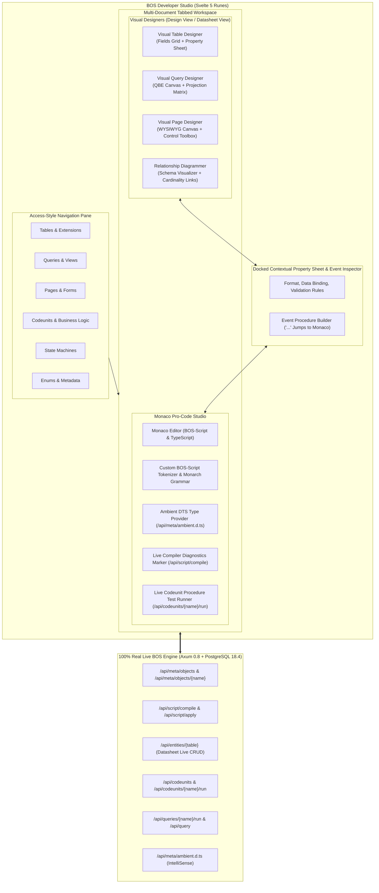

# BOS Developer Studio: Meta-Objects Manager & Monaco Code Engine
## MS Access-Inspired Enterprise Low-Code / Pro-Code Visual Architecture

**Document Version:** 1.0.0  
**Status:** Approved Architectural Blueprint & Execution Specification  
**Crates & Packages:** `ui/src/lib/components/studio/`, `crates/bosc-runtime`, `crates/bosc-analyzer`, `crates/bosc-syntax`  
**Target Tech Stack:** Svelte 5 (Runes: `$state`, `$derived`, `$props`, `$effect`), Monaco Editor 0.52+, Tailwind CSS v4, Lucide Icons, Axum 0.8 Backend, PostgreSQL 18.4  
**Design Paradigm:** Microsoft Access (Navigation Pane, Table Designer, QBE Visual Query Designer, WYSIWYG Form Designer, Relationship Diagrammer) + Modern VS Code (Monaco Editor, Ambient TypeScript DTS, IntelliSense, Live Compiler Diagnostics)

---

## 1. Executive Summary & Vision

The **BOS Developer Studio** bridges the gap between rapid visual modeling (traditionally mastered by Microsoft Access) and mission-critical enterprise systems engineering (Microsoft Dynamics NAV/BC and SAP). It empowers both citizen developers and systems architects to manage all **14 first-class BOS meta-objects** through 100% real, production-connected visual designers and a full-fledged Monaco code editor.



---

## 2. Microsoft Access Design Inspiration & Parity Matrix

Microsoft Access revolutionized rapid database application development by uniting the schema, query, form, and procedural code into a coherent, visual workspace. BOS adopts these iconic ergonomic patterns while supercharging them with modern web technology, strict compilation guarantees, and multi-tenant PostgreSQL scalability.

| Access Concept | BOS Developer Studio Implementation | Modern Advantage Over Classic Access |
| :--- | :--- | :--- |
| **All-in-One Navigation Pane** | Categorized accordion sidebar grouping all 14 meta-objects by type with live object counts, search filter, and `+ New Object` shortcuts. | Web-native, package-scoped (`bos.core`, `bos.sales`), shows compilation status and real-time backend sync state. |
| **Table Design View** | Two-tier layout: Upper Field Grid (Field Name, Type, PK, Description) + Lower Field Property Sheet (Validation Rules, Default, Relations, FlowFields). | Directly generates declarative `.bos` Table AST and executes atomic PostgreSQL DDL with RLS policies and audit triggers. |
| **Datasheet View** | Instant tab toggle on any table to view, edit, filter, and paginate live records in a high-density grid. | Backed by `/api/entities/{table}`, with optimistic concurrency checks (`_system_version`), audit logs, and trigger dispatching. |
| **Visual Query by Example (QBE)** | Dual-surface designer: Upper Canvas with draggable entity cards and visual join lines; Lower Grid with Field, Table, Alias, Total, Sort, Show, and Criteria. | Compiles to optimized SQL subqueries and GraphQL; instantly preview live results and inspect generated SQL DDL. |
| **WYSIWYG Form / Page Designer** | Toolbox of enterprise controls, visual drop canvas with snap guidelines, container hierarchies (FastTabs, Groups, Grids), and live preview. | Built on Svelte 5 runes and `shadcn-svelte`, mobile-responsive, bi-directionally synced with declarative `page` AST. |
| **Relationships Window** | Full database interactive graph canvas displaying table schemas, foreign key links, and relationship cardinalities (1:1, 1:N). | Interactive SVG drag-and-drop canvas with automated foreign key topology layout and cascading action badges. |
| **Property Sheet** | Context-sensitive sidebar. A Group selector chooses All or one group of properties or events (table: Properties, Events, Methods, extensions; field: General, Relation, FlowField, Events; page control: Identity, Data, Behavior, Events). | Two-way reactive binding: editing property immediately mutates canvas, updates AST, and validates against schema rules. |
| **VBA Code Builder (`...`)** | Monaco Code Studio integration: clicking `...` next to any event (`onValidate`, `onInsert`, `onAction`) jumps directly to the function in Monaco. | Replaces VBA with typed TypeScript & BOS-Script inside a sandboxed QuickJS engine with full ambient IntelliSense. |

---

## 3. All 14 BOS Meta-Objects Governance

The Developer Studio natively supports authoring, modifying, testing, and managing every first-class meta-object:

```
┌────────────────────────────────────────────────────────────────────────┐
│                      BOS Meta-Objects Catalog                          │
├─────────────────────┬───────────────────┬──────────────────────────────┤
│ 1. Schema & Data    │ 2. Logic & Flows  │ 3. UI & Experience           │
│  • table            │  • codeunit       │  • page (Card, List, Doc)    │
│  • tableextension   │  • statemachine   │  • pageextension             │
│  • query            │  • interface      │  • view                      │
│  • custommetadata   │  • enum / enumext │  • report                    │
├─────────────────────┴───────────────────┴──────────────────────────────┤
│ 4. Governance & Security                                               │
│  • permissionset                        │  • tablelogic / extension    │
└────────────────────────────────────────────────────────────────────────┘
```

### Meta-Object Architecture & Boundaries (Strict Supervisor Enforcements):
1. **Clean Singular Table Naming**: Enforce simple PascalCase singular names without acronym prefixes (`User`, `Customer`, `SalesHeader`, `LedgerEntry`). Package manifests (`bos.json`) provide namespace isolation.
2. **Strict Boundary Separation**:
   - `table`: Holds the structure only: columns, types, defaults, keys, check constraints, foreign keys, and declarative FlowFields.
   - `tablelogic`: Holds every executable script for that table: field `validate`, lifecycle triggers (`onInsert`, `onModify`, `onDelete`, `before*` / `after*`, draft hooks), and record methods. The file is `*.bl.bos`.
   - `codeunit`: Holds cross-record procedures, multi-table transactions, posting routines, domain events (`@businessEvent`), and event subscriptions (`@subscribeEvent`).
   - `statemachine`: Holds explicit state transitions, guards, and transition actions.

---

## 4. Visual Studio Component Architecture (MS Access Ergonomics)

### 4.1. Access-Style Navigation Pane (`NavigationPane.svelte`)
- **Docked on Left** (collapsible with `Ctrl+\` or ribbon button).
- **Groupings**:
  - 📊 **Tables & Tables Extensions** (with record count badge).
  - 🔍 **Queries & Views** (QBE definitions and SQL views).
  - 📑 **Pages & Forms** (Cards, Lists, Worksheets).
  - ⚡ **Codeunits & Modules** (Business logic and posting routines).
  - 🔄 **State Machines** (Document lifecycles).
  - 🏷️ **Enums & Custom Metadata** (Option sets).
  - 🛡️ **Permission Sets** (Role permissions).
- **Quick Actions**:
  - `+ New Object` dropdown modal with templates for each meta-object.
  - Search filter input with fuzzy matching.
  - Right-click Context Menu: `Open in Design View`, `Open in Datasheet View`, `Open in Code Editor`, `Compile`, `Delete`.

### 4.2. Access-Style Table Designer (`TableDesigner.svelte`)
- **Dual-Mode Workspace**:
  - **Design View Mode**:
    - **Upper Field Grid**:
      - Column 1: Primary Key Indicator (🔑 icon).
      - Column 2: Field Name (`camelCase` or `snake_case`).
      - Column 3: Data Type Dropdown (`UUID`, `String(N)`, `Decimal(P,S)`, `Integer`, `Boolean`, `Date`, `DateTime`, `Enum`, `FlowField`, `Dimensions`).
      - Column 4: Nullable (Checkbox).
      - Column 5: Default Value Expression.
      - Column 6: Caption / Description.
    - **Right-edge Property Sheet**:
      - **Group selector**: All, or one group of properties or events.
      - **Table groups**: Properties, Events, Methods, and one group per table extension.
      - **Field groups**: General (name, type, length or precision and scale, caption, default, required, unique, primary key, editable, visible, searchable), Relation (foreign table, foreign column, on delete), FlowField (expression and calculation wizard), Events (On Validate opens the code editor).
  - **Datasheet View Mode**:
    - High-density spreadsheet grid displaying real live rows from `/api/entities/{table}`.
    - Inline cell editing with instant `PATCH /api/entities/{table}/{id}` calls.
    - Quick add row at bottom with `POST /api/entities/{table}`.
    - Total summary row at bottom (Count, Sum for numeric fields).

### 4.3. Access-Style Visual Query Designer (`QueryDesigner.svelte`)
- **Upper Canvas (Entity Join Diagram)**:
  - Movable table cards showing field checkboxes.
  - Interactive SVG relationship lines connecting primary/foreign keys with join type badges (`INNER JOIN`, `LEFT JOIN`).
- **Lower Tabular Matrix (QBE Grid)**:
  - Row 1: **Field** (Dropdown of selected table fields).
  - Row 2: **Table** (Source table name).
  - Row 3: **Alias / Caption** (Display name in query result).
  - Row 4: **Total / Aggregate** (`Group By`, `Sum`, `Count`, `Avg`, `Min`, `Max`, `Expression`).
  - Row 5: **Sort** (`Ascending`, `Descending`, `None`).
  - Row 6: **Show** (Checkbox: include in output projection).
  - Row 7: **Criteria** (Filter condition, e.g. `> 5000 AND status == 'Approved'`).
  - Row 8: **Or** (Alternative criteria rows).
- **Live Output Tabs**:
  - Tab 1: **Results Datasheet** (executes query and shows real record table).
  - Tab 2: **SQL View** (generates PostgreSQL SQL statement).
  - Tab 3: **BOS Script AST View** (generates declarative `query` meta-object).

### 4.4. Access-Style Form / Page Designer (`PageDesigner.svelte`)
- **Left Toolbox**: Drag-and-drop palette of UI primitives:
  - *Containers*: FastTab Group, 2-Column Grid, FactBox Area, Subform Area.
  - *Data Fields*: Text Box, Decimal/Currency Input, Date Picker, Lookup Dropdown, Toggle.
  - *Actions*: Promoted Button, Action Group, State Transition Button.
- **Center WYSIWYG Canvas**:
  - Live preview with drag handles, drop zone indicators, and snap-to-grid.
  - Toggle between **Design Layout** and **Live Interactive Preview**.
- **Right Contextual Property Inspector**:
  - Group selector: All, Identity, Data, Behavior, or Events.
  - Element ID, Caption, Bound Source Field, Visibility expression, Editable toggle.
  - Event hooks (`onValidate`, `onLookup`, `onClick`).

### 4.5. Access-Style Relationships Window (`RelationshipsViewer.svelte`)
- Visual interactive canvas showing the complete relational schema.
- Entity nodes rendered with field listings, primary key highlights, and relation badges.
- Bezier SVG connector lines indicating referential integrity links.
- Filter by package or search tables.

---

## 5. Full-Fledged Monaco Editor & BOS-Script Pro-Code Engine

### 5.1. Monaco BOS-Script Language Definition (`monacoBosScript.js`)
- Registered custom language `bos-script` with Monaco monarch tokenizer:
  - **Keywords**: `table`, `tableextension`, `codeunit`, `statemachine`, `page`, `pageextension`, `query`, `view`, `report`, `enum`, `enumextension`, `interface`, `permissionset`, `custommetadata`.
  - **Schema Attributes**: `notNull`, `primaryKey`, `key`, `relation`, `onDelete`, `Cascade`, `Restrict`, `SetNull`, `default`, `editable`, `immutable`, `temporal`, `audit`, `dataPerCompany`.
  - **FlowField Primitives**: `FlowField`, `FlowFilter`, `sum`, `count`, `avg`, `min`, `max`, `exist`.
  - **Triggers & Decorators**: `validate`, `onInsert`, `onModify`, `onDelete`, `onRename`, `@businessEvent`, `@subscribeEvent`.
  - **Types**: `UUID`, `String`, `Decimal`, `Integer`, `BigInteger`, `Boolean`, `Date`, `DateTime`, `Time`, `Enum`, `Json`, `Blob`, `Dimensions`.
- Color tokens matched seamlessly with BOS dark and light enterprise theme.

### 5.2. Live Catalog Ambient TypeScript Definitions & IntelliSense (`/api/meta/ambient.d.ts`)
- On Monaco initialization and after every `Apply` (`F5`), the studio fetches live catalog-driven ambient type definitions from `/api/meta/ambient.d.ts` (`MetaManager::generate_live_ambient_dts`).
- The backend introspects `_bos_meta_objects` to dynamically emit:
  - `<Table>Record` interfaces with every physical column and FlowField typed (`UUID`, `Decimal`, `string`, `number`, `boolean`).
  - `Enum` union types from registered `enum` and `enumextension` objects.
  - `BosModelsRegistry` (`declare const models: BosModelsRegistry`) providing typed repository methods (`findById`, `findFirst`, `findMany`, `insert`, `modify`, `delete`, `count`, `sum`) for every catalog table.
  - `ctx: BosSessionContext` (`ctx.db`, `ctx.ui`, `ctx.events`, `ctx.crypto`, `ctx.audit`, `ctx.dimension`, `ctx.workflow`, `ctx.security`, `ctx.http`).
  - `rec`, `xRec`, `Rec`, `error(message)`, and `calcFields(...)`.
- In addition, `monacoBosScript.js` registers 8 Monaco language providers for `bos-script`:
  1. `CompletionItemProvider`: Context-aware completions triggered on `.`, `@`, `:`, `(`, `{`, `,`, and ` ` for all 14 meta-objects, live active-database catalog tables/fields/enums (hydrated automatically from `/api/meta/ambient.d.ts` via `hydrateCatalogFromAmbientDts` and `/api/meta/objects/{name}`), `ctx.*`, `models.<Table>.*`, `rec.*` / `xRec.*` / `this.*` (combining catalog schema + unsaved local buffer fields), inferred local record/model/array variables (`localVarTypes` for `const note = models.Note.first(...)`, `const repo = models.Note`, `const list = models.Note.findMany(...)`, `for (const item of list)`), query/filter object literals (`where`, `orderBy`, `take`, `skip`, `select`, and comparison/text operators `eq`, `ne`, `gt`, `gte`, `lt`, `lte`, `contains`, `startsWith`, `endsWith`, `ilike`, `in`, `notIn`, `isNull`, `OR`, `AND`), decorators (`@businessEvent`, `@subscribeEvent`, `@pushdown`), and field types. Never leaks top-level Meta-Object snippets after a dot (`.`). Completions stay closed inside quotes and inside the text of a template string, and open again inside a `${ }` hole.
  2. `HoverProvider`: Rich Markdown documentation cards for meta-object keywords, data types, triggers, FlowField functions, and live catalog tables/fields/enums.
  3. `SignatureHelpProvider`: Parameter hints for `Decimal(p, s)`, `String(len)`, `primaryKey(...)`, `key(...)`, `ctx.ui.toast(...)`, `ctx.events.publish(...)`, `ctx.audit.log(...)`, and `error(...)`.
  4. `DocumentSymbolProvider`: Hierarchical symbol outline for tables, fields, keys, triggers, codeunit procedures, states, and transitions.
  5. `DocumentFormattingEditProvider`: Prettier formats embedded TypeScript inside triggers, field `validate`, and methods (`Shift+Alt+F`, format on paste, format selection). The `table` and `tablelogic` headers stay structurally indented at 4 spaces. The TypeScript language mode uses Prettier directly.
  6. `CodeActionProvider`: Quick Fixes (`Ctrl+.`) for missing `primaryKey` (`BOS2002`), missing Document `status` field (`BOS2005`), and missing semicolons.
  7. `FoldingRangeProvider`: Brace-aware region folding across all meta-objects and triggers.
  8. `DefinitionProvider`: Go-To-Definition (`F12` / `Ctrl+Click`) for local buffer symbols (fields, procedures, workflow states) and cross-object navigation to active database catalog tables, enums, codeunits, and interfaces.

### 5.3. Real-Time Grammar, Semantic & Virtual TypeScript Shadow Diagnostics (`/api/script/compile`)
- Debounced (320ms) background validation runs two engines in parallel as the developer types:
  1. **Rust `bosc` Compiler Pipeline (`bosc-syntax` + `bosc-analyzer` + `MetaManager::compile_script`)**: Parses all 14 meta-objects (`table`, `tableextension`, `tablelogic`, `tablelogicextension`, `statemachine`, `statemachineextension`, `codeunit`, `interface`, `enum`, `enumextension`, `permissionset`, `view`, `query`, `page`, `pageextension`, `report`, `custommetadata`) and returns structured `CompilerDiagnosticIR` entries (`BOS1001` lexer errors, `BOS1002` parser errors, `BOS2001` duplicate fields, `BOS2002` missing primaryKey, `BOS2003`/`BOS2004` invalid key columns, `BOS2005` Document table missing `status`, `BOS2006` undeclared workflow state, `BOS2007` duplicate procedures, `BOS2010`/`BOS2011` mismatched embedded TypeScript delimiters, `BOS2012` missing referenced catalog table, and `BOS2013` non-existent `models.<Table>` reference in active database) with exact `line`, `column`, `end_line`, `end_column`, and remediation `hint`.
  2. **Virtual TypeScript Shadow Worker (`transpileBosToShadowTypeScript`)**: Transpiles `codeunit` and `tablelogic` buffers line-for-line into a background Monaco `.ts` model so Monaco's TypeScript worker (`getSyntacticDiagnostics` + `getSemanticDiagnostics`) provides real-time TypeScript grammar and type checking inside procedural blocks without false errors on BOS meta-object headers.
- Combined diagnostics are rendered as inline Monaco squiggly markers (`monaco.editor.setModelMarkers`) and listed in the collapsible **Problems & Diagnostics Panel** with click-to-jump navigation.
- Side tabs display:
  - **Source (`.bos`)**: Full Monaco editor with Symbol Outline jumper, Snippet inserter, Format, and Find/Replace.
  - **SQL DDL**: Instant preview of idempotent PostgreSQL 18.4 migrations generated by `bosc-codegen-db`.
  - **AST / IR**: JSON representation of the lowered `ModelIR`.
  - **Ambient `.d.ts`**: Live generated TypeScript declarations from the database catalog.

### 5.4. Live Database Deployment & Apply (`/api/script/apply`)
- **Compile** checks the open script and shows a banner that says the check did not save anything.
- **Apply** (`F5` or `Ctrl+S`) stores the script, including event logic on an existing table, then updates the database structure.
- The result stays in a banner. The live "0 Problems" line is only the check, and it does not replace the save result.
- Reopening the object loads the saved script. A database-structure failure still keeps the saved script and says so in the banner.

### 5.5. Live Codeunit Procedure Test Runner (`/api/codeunits/{name}/run`)
- When editing a `codeunit`, an embedded **Interactive Procedure Runner** panel docks at the bottom:
  - Method selector listing all public procedures in the codeunit.
  - JSON parameter editor with syntax validation.
  - **Run Procedure (`Ctrl+Enter`)** button executing the procedure live in the QuickJS sandbox.
  - Displays: Execution Result, Execution Duration (ms), QuickJS Fuel / Memory Consumed, and Console Log output.

### 5.6. Access Event Procedure Jumper (`...`)
- In any visual designer (Table, Query, or Page), every event trigger (e.g. `validate(val)`, `onInsert()`, `onAction()`) features an Access-style builder button (`...`).
- Clicking `...`:
  1. Checks if the event function exists in the object's BOS-Script code.
  2. If missing, automatically injects the boilerplate event stub.
  3. Switches the active tab to the Monaco Code Editor.
  4. Scrolls to and highlights the exact function line.

---

## 6. Svelte 5 Runes Architecture & Directory Structure

```
ui/src/lib/components/studio/
├── StudioWorkspace.svelte            # Root Studio layout (Nav Pane + Multi-Tab Workspace)
├── NavigationPane.svelte             # Access-style categorized object tree
├── NewObjectModal.svelte             # Wizard for creating any of the 14 meta-objects
├── designers/
│   ├── TableDesigner.svelte          # Table Design View & Datasheet View toggle
│   ├── TableFieldsGrid.svelte        # Upper schema grid (PK, Name, Type, Description)
│   ├── TablePropertySheet.svelte     # Lower Access-style tabbed properties panel
│   ├── FlowFieldWizardModal.svelte   # Guided calculation & formula builder
│   ├── QueryDesigner.svelte          # Access QBE Query Designer
│   ├── QueryJoinCanvas.svelte        # Upper draggable table cards & SVG join lines
│   ├── QueryGridMatrix.svelte        # Lower field projection, criteria & aggregate grid
│   ├── PageDesigner.svelte           # WYSIWYG Form/Page Designer
│   ├── PageToolbox.svelte            # Left palette of draggable controls & containers
│   ├── PageCanvas.svelte             # Center WYSIWYG canvas
│   └── RelationshipsViewer.svelte    # Full database interactive schema graph
├── code-editor/
│   ├── MonacoCodeStudio.svelte       # Full Monaco container with split-screen DDL/IR
│   ├── monacoBosScript.js            # BOS-Script Monarch grammar & keyword tokenizer
│   ├── monacoLspProvider.js          # Ambient DTS & live diagnostic bridge
│   └── CodeunitRunnerPanel.svelte    # Bottom live execution console for QuickJS
├── property-sheet/
│   ├── PropertySheet.svelte          # Unified contextual property inspector
│   └── EventInspector.svelte         # Event procedure listing with '...' jump triggers
└── stores/
    ├── studioStore.svelte.js         # Reactive Studio state (tabs, active object, dirty flags)
    └── studioApi.js                  # 100% Real API client methods
```

### Svelte 5 Runes Reactive State (`studioStore.svelte.js`):
```typescript
export class StudioState {
  // Navigation & Catalog
  catalog = $state<MetaObjectSummary[]>([]);
  activeCategory = $state<string>("tables");
  searchFilter = $state<string>("");
  
  // Tabbed Multi-Document Workspace
  openTabs = $state<StudioTab[]>([]);
  activeTabId = $state<string>("");
  
  // Active Tab Derived
  get activeTab(): StudioTab | null {
    return this.openTabs.find(t => t.id === this.activeTabId) || null;
  }
  
  // Compilation & Diagnostics
  diagnostics = $state<CompilerDiagnostic[]>([]);
  isCompiling = $state<boolean>(false);
  isApplying = $state<boolean>(false);
  
  // Real API Synchronization
  async loadCatalog() { ... }
  async openObject(name: string, viewMode: "design" | "datasheet" | "code") { ... }
  async compileScript(script: string, packageName?: string) { ... }
  async applyScript(script: string, packageName?: string) { ... }
  async runCodeunit(name: string, method: string, params: any) { ... }
}
```

---

## 7. 100% Real Backend Integration Matrix

| Studio Action / Feature | Axum Backend Endpoint | Payload / Method | Live Response & Effect |
| :--- | :--- | :--- | :--- |
| **Catalog Load & Refresh** | `/api/meta/objects` | `GET` | Returns list of all registered meta-objects with types, names, packages, versions, and checksums. |
| **Get Object Definition** | `/api/meta/objects/{name}` | `GET` | Returns full meta-object IR AST, columns, relations, state machines, and source script. |
| **Compile BOS-Script** | `/api/script/compile` | `POST { script, package_name, apply: false }` | Validates syntax, runs type checks, returns compiled PostgreSQL DDL and IR, flags error lines. |
| **Apply & Deploy to DB** | `/api/script/apply` | `POST { script, package_name, apply: true }` | Atomically executes DDL in PostgreSQL, provisions tables/triggers, registers meta-object. |
| **Load Ambient TypeScript**| `/api/meta/ambient.d.ts` | `GET` | Fetches TypeScript `.d.ts` declaration file and registers it in Monaco's IntelliSense engine. |
| **Datasheet Live Rows** | `/api/entities/{table}` | `GET ?limit=50&offset=0` | Returns paginated JSON records, total counts, and RFC pagination headers (`x-total-count`). |
| **Datasheet Cell Update** | `/api/entities/{table}/{id}`| `PATCH { [field]: val }` | OCC version-checked record update with OnValidate cascades. |
| **Datasheet Row Insert** | `/api/entities/{table}` | `POST { ...values }` | Inserts row, generates UUID PK, assigns tenant/company context, dispatches `onInsert`. |
| **Run Query Execution** | `/api/queries/{name}/run` | `POST { params }` | Executes designed QBE query against PostgreSQL and returns tabular projection dataset. |
| **Run Codeunit Procedure** | `/api/codeunits/{name}/run` | `POST { method, params }` | Executes procedure inside QuickJS sandbox, returns return values, logs, and fuel usage. |
| **Table Schema Introspect**| `/api/entities/{table}/schema`| `GET` | Returns physical columns, data types, nullability, and primary key constraints. |

---

## 8. Phased Implementation Roadmap & Verification Milestones

```mermaid
flowchart LR
    P1["Phase 1: Monaco Core & BOS-Script Tokenizer"] --> P2["Phase 2: Navigation Pane & Studio Shell"]
    P2 --> P3["Phase 3: Access Table Designer & Datasheet"]
    P3 --> P4["Phase 4: Access Visual Query Designer (QBE)"]
    P4 --> P5["Phase 5: Access Page Designer & Relationships"]
    P5 --> P6["Phase 6: Property Sheet, Event Wiring & Live Runner"]
    P6 --> P7["Phase 7: End-to-End QA & Detector Audit"]
```



### Phase Breakdown & Deliverables:

| Phase | Core Deliverables | Target Files | Verification Check |
| :--- | :--- | :--- | :--- |
| **Phase 1: Monaco & Tokenizer** | Install `monaco-editor`, author BOS-Script Monarch tokenizer, connect `/api/meta/ambient.d.ts`, implement live `/api/script/compile` diagnostic markers. | `ui/src/lib/components/studio/code-editor/monacoBosScript.js`, `monacoLspProvider.js`, `MonacoCodeStudio.svelte` | Monaco renders BOS-Script with syntax highlighting, IntelliSense autocomplete, and red error squiggles on bad syntax. |
| **Phase 2: Access Nav Pane & Workspace** | Categorized accordion tree, search filter, `+ New Object` modal wizard, multi-document tab manager with dirty state (`*`). | `ui/src/lib/components/studio/StudioWorkspace.svelte`, `NavigationPane.svelte`, `NewObjectModal.svelte`, `studioStore.svelte.js` | Clicking tables or codeunits opens dedicated tabs preserving editor state across tab switches. |
| **Phase 3: Table Designer & Datasheet** | One design model emits two scripts. `table Name { }` (`*.bos`) is structure only: fields, types, defaults, keys, relations, table properties, and declarative FlowFields. `tablelogic NameLogic for Name { }` (`*.bl.bos`) holds every executable script: field validation, `on*` / `before*` / `after*` / draft triggers, and record methods. The designer does not write those files to disk. Save & Apply posts the combined script; the server creates the SQL table and stores both objects in the catalog. Existing package files may still contain inline `on*` triggers; the parser accepts them, and the designer’s target is the split above. Data type is a searchable list of unique types; length, precision, and scale are separate inputs. Events are a property group: the builder opens the code editor on that event and the procedure is saved with it. The property sheet is docked on the right edge. Its Group selector shows every group at once, or one property group or event group. Opening an object collapses the navigation pane. Design/Datasheet view toggle. | `ui/src/lib/components/studio/designers/TableDesigner.svelte`, `TableFieldsGrid.svelte`, `TablePropertySheet.svelte`, `tableModel.js` | Designing a table compiles to DDL, applies to PostgreSQL, and toggling to Datasheet allows adding/editing live rows. |
| **Phase 4: Visual Query Designer** | Visual join diagram canvas (SVG lines), Access QBE tabular matrix (Field, Table, Alias, Total, Sort, Show, Criteria), Run Query live preview. | `ui/src/lib/components/studio/designers/QueryDesigner.svelte`, `QueryJoinCanvas.svelte`, `QueryGridMatrix.svelte` | Dragging two tables, connecting PK to FK, choosing fields and criteria executes and displays real query results. |
| **Phase 5: Page, StateMachine & PermissionSet Designers** | WYSIWYG Form Designer, interactive Relationship Diagrammer, Visual State Machine Flow & Guard Matrix (`StateMachineDesigner.svelte`), and Visual RIMDX + Row-Level Security Matrix (`PermissionSetDesigner.svelte`). | `ui/src/lib/components/studio/designers/PageDesigner.svelte`, `RelationshipsViewer.svelte`, `StateMachineDesigner.svelte`, `PermissionSetDesigner.svelte` | Visual layout of entity forms, schema graphs, state machine transitions/guards, and RBAC permission matrices bi-directionally synced with BOS-Script. |
| **Phase 6: Property Sheet, Set-Based SDK & Live Debugger** | Unified Property Sheet, Access `...` event jumper to Monaco, QuickJS Codeunit Live Debugger (`CodeunitRunnerPanel.svelte`) with procedure auto-discovery, Before/After `rec` State Diff Inspector, Logs/UI Directives Inspector, and clickable stack trace line numbers; enterprise set-based SQL (`modifyAll`, `deleteAll`, `sumField`, `avgField`, `minField`, `maxField`) and `BosDecimal` comparison helpers. | `ui/src/lib/components/studio/property-sheet/PropertySheet.svelte`, `EventInspector.svelte`, `CodeunitRunnerPanel.svelte`, `crates/bosc-runtime/src/quickjs_engine.rs` | Clicking `...` jumps to Monaco stub; running a codeunit procedure auto-discovers parameters, shows field-by-field `rec` diffs, and executes real set-based SQL & host SDK bridges. |
| **Phase 7: Verification & QA Audit** | Real backend integration test matrix, zero-mock detector audit, Playwright visual tests, docs synchronization. | `scripts/test-agent/`, `docs/25_...` | Detector issues **`VERDICT: FLAWLESS (PASSED)`** with 0 flaws; all 14 meta-objects manageable without errors. |

---

## 9. Zero-Mock & Quality Gatekeeping Protocol

As dictated by the **BOS Expert AI Team Charter**:
1. **Zero Mocks / Zero Simulated Data**: Every table list, query result, script compilation, and codeunit execution must hit real Axum endpoints and PostgreSQL 18.4 tables.
2. **Table Naming Enforcement**: Table names must be clean, singular PascalCase (`Customer`, `SalesLine`, `LedgerEntry`), mapping directly to singular `snake_case` in SQL.
3. **Supervisor-Detector Quality Loop**:
   - `detector` will scan all authored studio components (`ui/src/lib/components/studio/`).
   - Any `todo!()`, dummy data structures, hard-coded mock arrays, or unhandled promise rejections will fail the quality gate.
   - Task completion is strictly blocked until the detector outputs a clean pass.
