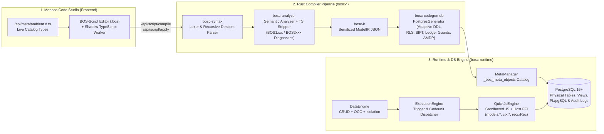

# BOS-Script Documentation Library & System Gap Reference

Welcome to the official **BOS-Script Documentation Library** (`docs/BOS-Script/`). This library documents every language construct, meta-object, runtime SDK API, database code generation rule, and real-world enterprise use case of **BOS-Script**, alongside a complete, truth-checked **System-Wide Gap Analysis** across the Compiler, Runtime Engine, Frontend Studio, and Database Management layers.

---

## 1. Architectural Vision of BOS-Script

**BOS-Script** (`.bos`) is a domain-specific enterprise application language purpose-built for the **Business Operating System (BOS)**. It synthesizes the best capabilities of four industry-leading enterprise platforms while eliminating their historical bloat:

1. **Microsoft Dynamics 365 Business Central (AL / C/AL)**:
   - First-class declarative meta-objects (`table`, `tableextension`, `page`, `pageextension`, `codeunit`, `report`, `query`, `enum`, `interface`, `permissionset`).
   - Zero-N+1 declarative **FlowFields** (`sum`, `count`, `average`, `min`, `max`, `lookup`, `exist`) backed by automatic **SIFT (SumIndexField Technology)** covering indexes (`CREATE INDEX ... INCLUDE (...)`).
   - **`Rec` vs. `xRec`** state snapshots during record modifications and `testField` / `calcFields` / `validate` record primitives.
2. **Salesforce Apex & Lightning Platform**:
   - Strict multi-tenant isolation (`_tenant_id`, `_company_id`) with adaptive physical storage (`shared_rls`, `partitioned`, `schema_per_company`, `table_per_company`).
   - Non-invasive package extensibility and deployable `custommetadata`.
   - CPU/instruction fuel metering (`100,000` instruction quota) and memory sandboxing (`8 MB` heap cap per QuickJS context).
3. **SAP S/4HANA ABAP Core Data Services (CDS) & AMDP**:
   - **BOS-AMDP (`@pushdown`)**: Ability to compile performance-critical Codeunit procedures directly into native PostgreSQL `PL/pgSQL` stored functions (`bos_proc_<codeunit>_<method>`) for zero-network-hop execution.
   - Declarative SQL `view` (Standard and Materialized Views) and analytical `query` objects.
4. **Modern TypeScript & Prisma-Style Ergonomics**:
   - Procedural blocks use TypeScript syntax. Oxc reports syntax errors (`BOS1001`). The JavaScript that runs is produced by the line-preserving eraser, then a small optimizer: decimal field math becomes `ctx.decimal(...).toString()`, and `Model.get(row.field)` inside `for (const row of rows)` becomes one `getMany`.
   - Repository API: `findMany`, `get`, `getMany`, `create`, `createMany`, `modify`, `modifyAll`, `deleteAll`, plus filters (`contains`, `gt`, `in`, `OR`, `AND`). `select` is a name list or `{ field: true }`. Monaco completions follow `ambient.d.ts` and `monacoBosScript.js`. There is no separate language server.

---

## 2. End-to-End Compilation & Execution Pipeline

---

## 3. Library Volumes & Navigation Index

| Volume | File | Scope & Contents |
| :--- | :--- | :--- |
| **Vol. 0** | [`00_README_and_Architecture_Index.md`](./00_README_and_Architecture_Index.md) | Architecture overview, compilation lifecycle, and master index of all 17 BOS-Script meta-objects. |
| **Vol. 1** | [`01_Data_Modeling_Tables_Extensions_and_Types.md`](./01_Data_Modeling_Tables_Extensions_and_Types.md) | `table`, `tableextension`, all 14 data types, column modifiers, `primaryKey` & SIFT `key`, `flowField` formulas, multi-tenant storage strategies, and immutable ledger guards with real-world ERP schemas. |
| **Vol. 2** | [`02_Procedural_Logic_TableLogic_Codeunits_and_Events.md`](./02_Procedural_Logic_TableLogic_Codeunits_and_Events.md) | `tablelogic`, `tablelogicextension`, field `validate`, lifecycle triggers (`onInsert`, `onModify`, `onDelete`, draft hooks), `rec` & `xRec` helpers (`testField`, `calcFields`, `validate`), `codeunit`, `@pushdown` AMDP, `@businessEvent` / `@subscribeEvent`, `interface`, and polymorphic `enum`. |
| **Vol. 3** | [`03_Data_Access_ORM_Filtering_and_Runtime_SDK.md`](./03_Data_Access_ORM_Filtering_and_Runtime_SDK.md) | Complete guide to `models.<Table>` and `ctx.db.<Table>` repository methods, `where` filter operators (`contains`, `gt`, `in`, `OR`, `AND`), `orderBy`, `select`, `upsert`, exact monetary math (`ctx.decimal`), UI notifications (`ctx.ui`), `ctx.crypto`, `ctx.audit`, `ctx.wasm`, and `ctx.sidecar`. |
| **Vol. 4** | [`04_Workflows_Security_Analytical_and_UI_MetaObjects.md`](./04_Workflows_Security_Analytical_and_UI_MetaObjects.md) | `statemachine`, `statemachineextension`, `permissionset` (RBAC + RLS), `view` (standard & materialized), `query`, `page`, `pageextension`, `report`, and `custommetadata` with real-world enterprise examples. |
| **Vol. 5** | [`05_System_Wide_Gap_Analysis_and_Remediation_Roadmap.md`](./05_System_Wide_Gap_Analysis_and_Remediation_Roadmap.md) | **Complete Truth-Checked Gap Analysis** between BOS-Script Language, Compiler (`bosc-*`), Runtime (`bosc-runtime`), Frontend (`ui/`), and DB Management (`bosc-codegen-db`), with severity ratings and architectural remediation specs. |

---

## 4. Master Summary of All 17 BOS-Script Meta-Objects

| # | Keyword | Category | Purpose | Physical PostgreSQL Artifact |
| :--- | :--- | :--- | :--- | :--- |
| 1 | `table` | Data Model | Declares a physical entity table, columns, keys, and FlowFields. | `CREATE TABLE`, SIFT indexes, `<tbl>_view`, RLS policy, ledger/delete triggers + `_bos_meta_objects` row |
| 2 | `tableextension` | Data Model | Non-invasively adds columns and indexes to an existing base `table`. | `ALTER TABLE ... ADD COLUMN IF NOT EXISTS`, `CREATE INDEX` + `_bos_meta_objects` row |
| 3 | `tablelogic` | Procedural Logic | Companion object holding `validate <field>`, lifecycle triggers (`onInsert`, `onModify`, `onDelete`), and record methods for a `table`. | Stored as `TableLogicIR` JSONB in `_bos_meta_objects`; executed by `ExecutionEngine` / `QuickJsEngine` |
| 4 | `tablelogicextension` | Procedural Logic | Non-invasively appends additional field validations and lifecycle triggers to a target table. | Stored as `TableLogicExtensionIR` JSONB in `_bos_meta_objects`; chained by `ExecutionEngine` |
| 5 | `codeunit` | Procedural Logic | Encapsulates transactional business services, ledger posting routines, `@pushdown` AMDP functions, and `@test` suites. | Stored as `CodeunitIR` in `_bos_meta_objects`; `@pushdown` methods emit `CREATE FUNCTION bos_proc_...` |
| 6 | `statemachine` | Workflow | Deterministic finite-state lifecycle governing a table's status column, guards, approval tiers, and transition effects. | `CREATE TABLE <tbl>_state_history` + `StateMachineIR` in `_bos_meta_objects` |
| 7 | `statemachineextension` | Workflow | Appends custom states and transitions to an existing `statemachine`. | AST parsed in `bosc-syntax` (see Vol. 5 Gap Analysis for lowering status) |
| 8 | `interface` | Polymorphism | Defines abstract method contracts implemented by one or more `codeunit` objects. | Stored as `InterfaceIR` JSONB in `_bos_meta_objects` |
| 9 | `enum` | Type / Strategy | Strongly-typed domain enumeration; can optionally implement an `interface` and bind each value to a `codeunit`. | Stored as `EnumIR` JSONB in `_bos_meta_objects` + emitted as `<Name>Enum` in `ambient.d.ts` |
| 10 | `enumextension` | Type / Strategy | Appends new values to an `extensible: true` base `enum`. | AST parsed in `bosc-syntax` (see Vol. 5 Gap Analysis for lowering status) |
| 11 | `permissionset` | Security / RBAC | Grants table-level `read`, `insert`, `modify`, `delete`, codeunit `execute`, and row-level `rowFilter` policies. | `CREATE POLICY rls_<ps>_<tbl>` + `PermissionSetIR` in `_bos_meta_objects` |
| 12 | `view` | Analytical SQL | Declares a standard or `materialized: true` SQL projection with joins and filters. | `CREATE OR REPLACE VIEW` or `CREATE MATERIALIZED VIEW` + `_bos_meta_objects` row |
| 13 | `query` | Analytical SQL | Multi-table hierarchical analytical query (`dataitem`, aggregations, `groupBy`, `orderBy`). | Stored as `QueryIR` with compiled `sql_query` in `_bos_meta_objects`; executed via `/api/queries/:name/execute` |
| 14 | `page` | UI Metadata | One screen: a single `source`, one of eight layouts, and field/command overrides. See `docs/28_page_meta_object_design.md`. | Stored as compact `PageIR` JSONB in `_bos_meta_objects` |
| 15 | `pageextension` | UI Metadata | Adds, moves, or hides fields and commands on an existing `page` by anchor. | Stored as `PageExtensionIR` JSONB and merged onto the base page |
| 16 | `report` | Reporting | Analytical or document report bound to a `dataset` table with columns and pre/post triggers. | Stored as `ReportIR` JSONB in `_bos_meta_objects` |
| 17 | `custommetadata` | Configuration | Deployable application configuration schema and seed records shipped with a package. | Stored as `CustomMetadataIR` JSONB in `_bos_meta_objects` |
